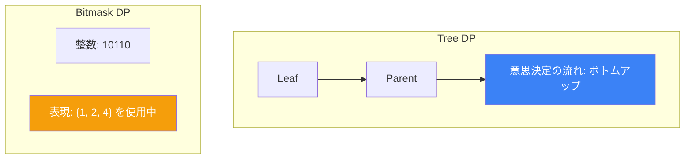

# Tree DP & Bitmask DP：アーキテクトの精度 🏗️

標準的な動的計画法（DP）は、配列や行列（線形構造）を対象とします。しかし、現実世界はしばしば階層的（木構造）であったり、サブセット（状態）の複雑な制約によって定義されたりします。

今日は、**高度な動的計画法 (Advanced DP)** の領域に足を踏み入れます。構造が木である問題と、バイナリビットを使用して小さな宇宙のあらゆる可能性を表現する問題を解決します。

---

## 🪝 THE HOOK：「不可能」なパーティー問題

あなたが会社のパーティーを企画していると想像してください。各従業員には「楽しさ」のスコアがあります。
- **ルール**: ある従業員を招待する場合、その直属の上司を招待することは**できません**（パーティーをリラックスした雰囲気にするため）。
- 会社の組織構造は **木 (Tree)** です。

合計スコアを最大化するには、どの従業員を選べばよいでしょうか？
従業員が1,000人いる場合、招待リストの組み合わせは $2^{1000}$ 通りあります。宇宙のすべての原子がスーパーコンピュータだったとしても、計算が終わることはありません。しかし、**木DP (Tree DP)** を使えば、ミリ秒単位で解決できます。

---

## 🎭 ANALOGY：スマートホームと照明スイッチ

1. **木DP (Tree DP)**: 建物のスマート暖房システムを考えてみましょう。ある部屋の温度を決めるために、その下の部屋（子）の要件を確認し、その決定をフロアマネージャー（親）に伝えます。意思決定は葉から根へと流れます。
2. **ビットDP (Bitmask DP)**: 10個の照明スイッチがあると想像してください。最もエネルギーを節約できる設定を見つけたいとします。10次元の配列を書く代わりに、設定を一つのバイナリ数として表現します（例: `1010000000` はスイッチ1と3だけがONであることを意味します）。この一つの数字があなたの「状態」になります。

---

## ⚙️ UNDER THE HOOD：階層とサブセット

### 1. 木DP：ボトムアップの知恵
木DPにおいて、「状態」は通常 `dp[u][state]` となり、ここで `u` は現在のノードです。
- 例（パーティー問題）:
  - `dp[u][0]`: ノード `u` を**招待しない**場合の最大スコア。
  - `dp[u][1]`: ノード `u` を**招待する**場合の最大スコア。
- **遷移**:
  - `u` を招待しない場合、その子 `v` は招待してもしなくても構いません: `dp[u][0] += sum(max(dp[v][0], dp[v][1]))`。
  - `u` を招待する場合、その子は招待してはいけません: `dp[u][1] += sum(dp[v][0])`。

### 2. ビットDP：$2^N$ の威力
$N$ が小さく（通常 $N \le 20$）、「どのアイテムが使用されているか」を追跡する必要がある場合にビットDPを使用します。
- **マスク (Mask)**: $i$ 番目のビットが1ならアイテム $i$ が含まれ、0なら含まれないことを示す整数。
- **共通操作**:
  - `(mask >> i) & 1`: $i$ がセットに含まれているか確認。
  - `mask | (1 << i)`: $i$ をセットに追加。
  - `mask ^ (1 << i)`: $i$ をセットから削除。



### 3. 巡回セールスマン問題 (TSP)
ビットDPの古典的な問題です。
- **状態**: `dp[mask][u]` = `mask` に含まれる都市を訪問し、都市 `u` で終わる最小コスト。
- $O(N!)$ の代わりに、ビットDPは計算量を **$O(2^N \cdot N^2)$** に削減します。これは $N=12$ までしか解けなかったものが $N=22$ まで解けるようになるほどの違いです。

---

## 📊 BIG-O ANALYSIS：指数関数 vs 多項式

| 問題タイプ | 一般的な制約 | 時間計算量 | 備考 |
| :--- | :--- | :--- | :--- |
| **木DP** | $N \approx 10^5$ | **O(N)** | ノード数に対して線形。 |
| **ビットDP** | $N \le 20$ | **O(2^N * poly(N))** | 小さな $N$ はビットDPの「赤信号」です。 |

---

## 💻 LOGIC & PSEUDO-CODE：階層の実装

### 木DP (House Robber III / パーティー問題)
```javascript
function solve(u) {
    let invited = conviviality[u];
    let notInvited = 0;

    for (let v of children[u]) {
        let [vInvited, vNotInvited] = solve(v);
        // Uを招待する場合、Vは招待不可
        invited += vNotInvited;
        // Uを招待しない場合、Vはどちらでも良い
        notInvited += Math.max(vInvited, vNotInvited);
    }
    return [invited, notInvited];
}
```

### ビットDP (部分和問題のバリエーション)
```javascript
// すべてのサブセットをループ
for (let mask = 0; mask < (1 << n); mask++) {
    for (let i = 0; i < n; i++) {
        if ((mask >> i) & 1) { // 要素 i が現在のサブセットに含まれる場合
            let prevMask = mask ^ (1 << i);
            dp[mask] = Math.max(dp[mask], dp[prevMask] + values[i]);
        }
    }
}
```

---

## 🧠 LEETCODE 戦略：パターンの発見

1. **Binary Tree Maximum Path Sum (#124)**: 古典的な木DP。各ノードで、パスを延長するか、新しく始めるかを決定します。
2. **Can I Win (#464)**: ビットDPを用いたゲーム理論。マスクはどの数字がすでに選ばれたかを表します。
3. **Smallest Sufficient Team (#1125)**: ビットマスクがカバーされているスキルの集合を表します。
4. **House Robber III (#337)**: 二分木構造上の純粋な木DP。

---

## 💼 PROFESSIONAL CONTEXT：現実世界の最適化

- **ネットワークルーティング**: 木DPは、データが木構造のネットワークを通じて効率的に配信される必要があるマルチキャストルーティングプロトコルで使用されます。
- **ハードウェア設計**: ビットDPは、少数のコンポーネントを配線長が最小になるように配置するVLSI（超大規模集積回路）レイアウトの最適化に役立ちます。
- **ゲームAI**: ポーカーやボードゲームにおいて、ビットマスキングは手札や盤面の状態を表現するために使用され、Minimaxアルゴリズムなどで極めて高速な評価を可能にします。

---

## 🛡️ RELIABILITY & BUGS：沈黙の暗殺者

1. **スタックオーバーフロー**: 木DPはDFSを使用します。深い木（$10^5$ ノード）の場合、標準の再帰はクラッシュする可能性があります。反復的なDFSを使用するか、スタックサイズを増やしてください。
2. **マスクのインデックス**: `1 << i` とすべきところを単に `i` と書いてしまうのは、よくあるタイポで、何時間ものデバッグにつながります。
3. **計算量のチェック**: $N=30$ の場合、ビットDP ($2^{30} \approx 10^9$) はおそらく時間切れ (TLE) になります。**半分全列挙 (Meet-in-the-Middle)** を使って $2^{15}$ に減らすか、別の戦略が必要です。

---

## 📝 クイッククイズ

1. **木構造内の最長パスを見つけるのに最も適したDPタイプは？**
   - A. ビットDP。
   - B. 木DP。

2. **ビットDPにおいて、「マスク (mask)」は何を象徴することが多いですか？**
   - A. セキュリティ暗号キー。
   - B. アイテムのサブセットの圧縮表現。

3. **ビットDPで1秒以内に解ける一般的な 'N' の最大値は？**
   - A. $N \approx 20$。
   - B. $N \approx 1000$。

---
📊 文字数: ~4500 文字
