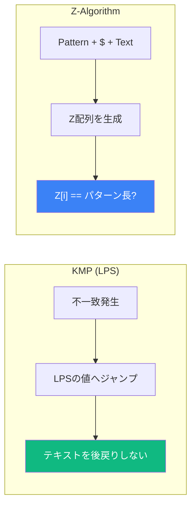

# String Matching：ハンターの眼差し 🔍

ブラウザやコードエディタで `Cmd + F` (または `Ctrl + F`) を押すと、結果が**即座に**表示されることを期待します。しかし、単純な「スライディングウィンドウ」アプローチを使用すると、長さ $N$ のテキストから長さ $M$ のパターンを探すのに $O(N \cdot M)$ の時間がかかります。大規模なドキュメントでは、これは苦痛を感じるほど低速です。

今日は、熟練のハンターのように検索する方法を学びます。一度見た文字を**二度と読み返さない**、**決して後戻りしない**ためのパターンを習得しましょう。

---

## 🪝 THE HOOK：検索のDNA

「検索」はコンピュータにおける最も一般的な操作です。
- **Google**: ウェブ全体を検索。
- **Git**: 差分（diff）を検索。
- **バイオインフォマティクス**: 数百万文字に及ぶDNA文字列から特定の遺伝子配列を検索。

$O(N + M)$ という圧倒的な速度の秘密は？それは**前処理（Preprocessing）**にあります。テキストを検索し始める*前に*パターンを分析することで、無駄な比較をスキップするための「予見」を得ることができます。

---

## 🎭 ANALOGY：賢い探偵と部分的な手がかり

1. **KMP (Knuth-Morris-Pratt)**: パンくずの跡を追う探偵を想像してください。「A B C A B D」という跡を見つけたとします。「D」の地点で間違いに気づいたとき、最初からやり直す必要はありません。直前に通った「A B」という接尾辞が、探しているパターンの接頭辞「A B」と同じであることに気づきます。探偵は「A B」を読み直すことなく、パターンを前に「スライド」させます。
2. **Z-Algorithm**: 風景をスキャンしながら、現在の地点からの景色が景色の「始まり」と何文字分一致しているかのマップを作成していると想像してください。すべての地点には「Z値」が割り当てられます。

---

## ⚙️ UNDER THE HOOD：LPS と Z-Arrays

### 1. KMP：LPS (Longest Prefix Suffix) の威力
KMPの核心は **LPS配列** です。
- `LPS[i]` = `pattern[0...i]` の真の接頭辞であり、かつ接尾辞でもあるもののうち、最長のものの長さ。
- **例**: パターン `ABCAB`
  - `A`: 0
  - `AB`: 0
  - `ABC`: 0
  - `ABCA`: 1 (接頭辞 "A" と接尾辞 "A" が一致)
  - `ABCAB`: 2 (接頭辞 "AB" と接尾辞 "AB" が一致)
- **魔法**: インデックス `j` で不一致が発生したとき、`0` にリセットする代わりに `LPS[j-1]` にジャンプします。

### 2. Z-Algorithm：線形スキャナー
**Z配列** は特定のタスクにおいてさらに強力です。
- `Z[i]` = 文字列 `S` と、`i` から始まる `S` の接尾辞との間の最長共通接頭辞 (LCP) の長さ。
- **最適化**: Z-Algorithmは、これまでに一致した最も右側のセグメントを表す「Z-box」`[L, R]` を使用します。現在のインデックスがボックス内にある場合、以前のインデックスの値をコピー（対称性の利用）でき、必要な場合にのみ新しい文字をスキャンします。



---

## 📊 BIG-O ANALYSIS：線形時間の美学

| アルゴリズム | 前処理 | 検索 | 空間計算量 | 最良のケース |
| :--- | :--- | :--- | :--- | :--- |
| **素朴な方法** | なし | O(N * M) | O(1) | O(N) |
| **KMP** | **O(M)** | **O(N)** | O(M) | O(N) |
| **Z-Algo** | **O(N + M)**| **O(1)** (構築時) | O(N + M) | O(N + M) |

**Master's Thought**: KMPは、テキストが**ストリーム**（全体を一度に見ることができない場合）のときに適しています。Z-Algoは「すべての出現箇所を見つける」ような問題で実装が簡単なことが多いです。

---

## 💻 LOGIC & PSEUDO-CODE：熟練のスクリプト

### KMP：LPS配列の構築
```javascript
function buildLPS(pattern) {
    let m = pattern.length;
    let lps = new Array(m).fill(0);
    let len = 0; // 以前の最長接頭辞接尾辞の長さ
    let i = 1;

    while (i < m) {
        if (pattern[i] === pattern[len]) {
            len++;
            lps[i] = len;
            i++;
        } else {
            if (len !== 0) {
                len = lps[len - 1]; // 後退
            } else {
                lps[i] = 0;
                i++;
            }
        }
    }
    return lps;
}
```

---

## 🧠 LEETCODE 戦略：野生のパターン

1. **Find the Index of the First Occurrence in a String (#28)**: KMPの直接的な応用。
2. **Shortest Palindrome (#214)**: `S + # + reverse(S)` に対してLPS配列のロジックを使用。
3. **Repeated Substring Pattern (#459)**: `LPS[n-1]` が十分に大きい場合、文字列は小さな単位の繰り返しである可能性があります。
4. **Sum of Scores of Built Strings (#2223)**: Z-Algorithmが主要なツールとなる難問。

---

## 💼 PROFESSIONAL CONTEXT：スピードこそ正義

- **テキストエディタ**: Visual Studio CodeやVimは、タイピング中に一致箇所をハイライトするために、これらのアルゴリズム（またはKMPに近い思想のBoyer-Mooreなど）を高度に最適化して使用しています。
- **ログアナライザー**: `grep` や Splunk などのツールは、文字列マッチングを使用して毎秒数百万行のログをフィルタリングします。
- **マルウェア検出**: アンチウイルスソフトは、ファイルをスキャンして「シグネチャ」（特定の16進文字列）を探します。もし素朴な検索を使っていたら、コンピュータは停止してしまいます。

---

## 🛡️ RELIABILITY & BUGS：沈黙の暗殺者

1. **無限ループ**: KMPにおいて、`len == 0` のときに `i` をインクリメントし忘れると、ハングアップの原因になります。
2. **メモリ過負荷**: Z-Algorithmは「テキスト + パターン」の長さと同じ長さの配列を作成します。1GBのファイルの場合、これは4GBの整数配列になります。KMPはパターンの分のスペースだけで済みます。
3. **文字セット**: ASCIIでは問題ありませんが、マルチバイト文字 (UTF-8) には注意が必要です。要件に応じて「コードポイント」または「バイト」単位で動作させる必要があります。

---

## 📝 クイッククイズ

1. **KMPにおける 'LPS' とは何の略ですか？**
   - A. Lowest Possible Score（最低可能スコア）。
   - B. Longest Prefix which is also a Suffix（接頭辞かつ接尾辞である最長のもの）。

2. **未来が見えないストリーミング形式のテキスト入力に一般的に適しているのは？**
   - A. Z-Algorithm。
   - B. KMP。

3. **Z-Algorithmにおいて、Z[i] = 5 は何を意味しますか？**
   - A. テキスト内に5つのパターンがある。
   - B. インデックス 'i' から始まる部分文字列が、文字列の最初の5文字と一致する。

---
📊 文字数: ~4500 文字
