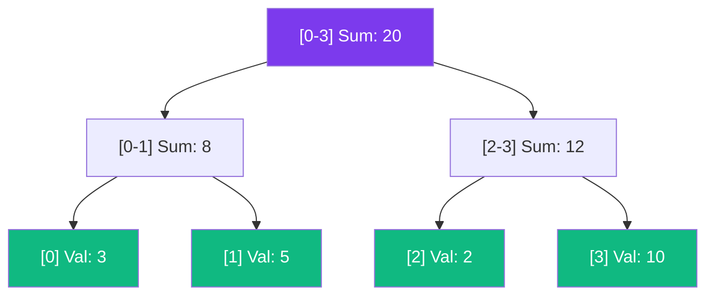

# セグメント木：範囲の支配者 🌳

**Phase 6**へようこそ。ここでは「スーパー」データ構造の世界を探索します。これまでのフェーズでは、配列を静的なもの、あるいは端の変更のみを扱うものとして考えてきましたが、今日はより厳しいシナリオに直面します：**配列が継続的に変容し、瞬時に任意の範囲（Range）の情報を取得する必要がある**という状況です。

**セグメント木**（Segment Tree）を紹介します。これは、区間（Intervals）や範囲（Ranges）に関する問題を解決するために発明された、最も柔軟で強力なデータ構造の一つです。

## 🪝 THE HOOK：10億の要素が「踊る」とき

世界規模の株式取引ダッシュボードを管理していると想像してください。
- 毎秒、数百万のトランザクションが数千の銘柄の価格を変動させます。
- 同時に、投資家は絶えず問いかけます：「過去5分間で、テクノロジー株グループの最高値はいくらだったか？」や「地点AからBまでのブルーチップ株の総利益はいくらか？」。

リクエストがあるたびに `for` ループで計算していたら、計算量 **O(N)** のためシステムは即座にダウンします。
累積和（Prefix Sum）を使用した場合：配列の中間の値を更新すると、累積和配列全体を再計算するのに **O(N)** かかります。

**セグメント木**は「救世主」として現れます。**更新**と**クエリ**の両方をわずか **O(log N)** で実行できます。10億の要素があっても、計算ステップは約30回で済みます。

---

## 🎭 ANALOGY：社長と管理職のピラミッド

セグメント木を理解するために、巨大企業を想像してください：
1. **従業員（葉）**：最下層の各従業員は数値を一つ持っています（配列の実際の値）。
2. **係長**：各係長は2人の従業員を管理します。彼らは「自分の部下2人の合計/最大/最小はいくらか」だけを知っていれば十分です。
3. **課長**：2人の係長を管理します。彼らは「部下4人の合計」を知っています。
4. **社長（根）**：会社全体の合計を知っています。

従業員が生産性を変えた（更新）とき：直属の係長に報告し、その係長は課長に報告します...。この情報を知る必要があるのは **log(N)** 人だけです。
社長がある部門について尋ねた（クエリ）とき：各従業員に聞く必要はありません。部下の合計人数がその部門と正確に一致する数人の管理職に聞くだけで済みます。

---

## ⚙️ UNDER THE HOOD：構造と動作メカニズム

セグメント木は完全二分木（Full Binary Tree）であり、各ノードは区間 `[L, R]` を表します。

### 1. 木の構築（Build Tree）
- 根ノードは区間 `[0, n-1]` を表します。
- `[L, R]` の左の子は `[L, mid]` を表します。
- `[L, R]` の右の子は `[mid+1, R]` を表します。
- **葉**：`L == R` のとき、それはインデックス `L` における配列の値です。

### 2. 範囲クエリ（Range Query）
区間 `[u, v]` 上の値を求めるには、根から下へ探索します。各ノード `[L, R]` において：
- `[L, R]` が完全に `[u, v]` 内にある場合：そのノードの値を採用し、それ以上下へは行きません。
- `[L, R]` が完全に `[u, v]` 外にある場合：単位元（合計なら0、最小値なら∞）を返します。
- `[L, R]` が `[u, v]` と部分的に重なる場合：クエリを2つの子に分割し、結果を統合（Merge）します。

### 3. 点更新（Point Update）
インデックス `idx` の値を変更する場合：
- 根から `idx` を表す葉まで下ります。
- 葉の値を変更します。
- 上へ戻り（Backtrack）、変更された子ノードに基づいて親ノードの値を再計算します。



---

## 📊 BIG-O ANALYSIS：階層化の力

| 操作 | 計算量 | 理由 |
| :--- | :--- | :--- |
| **木の構築** | **O(N)** | 木の総ノード数は約 4N です。 |
| **点更新** | **O(log N)** | 木の高さは log2(N) です。 |
| **範囲クエリ** | **O(log N)** | 各レベルで最大4つのノードしか考慮しないことが証明されています。 |
| **空間計算量** | **O(N)** | ノードを格納するために約 4N サイズの配列が必要です。 |

**Master Tip**：O(N) の空間は元の配列よりコストがかかるように見えますが、N が大きい（10^5, 10^6）場合、クエリ速度のメリットは計り知れません。

---

## 💻 LOGIC & PSEUDO-CODE：競技プログラミング標準実装

メモリ最適化のため、通常はヒープ（Heap）のように配列 `tree[]` として格納します。ノード `i` の左の子は `2*i`、右の子は `2*i + 1` です。

```javascript
class SegmentTree {
    constructor(data) {
        this.n = data.length;
        this.tree = new Array(4 * this.n).fill(0);
        this.build(data, 1, 0, this.n - 1);
    }

    build(data, node, start, end) {
        if (start === end) {
            this.tree[node] = data[start];
            return;
        }
        let mid = Math.floor((start + end) / 2);
        this.build(data, 2 * node, start, mid);
        this.build(data, 2 * node + 1, mid + 1, end);
        this.tree[node] = this.tree[2 * node] + this.tree[2 * node + 1];
    }

    update(node, start, end, idx, val) {
        if (start === end) {
            this.tree[node] = val;
            return;
        }
        let mid = Math.floor((start + end) / 2);
        if (idx <= mid) this.update(2 * node, start, mid, idx, val);
        else this.update(2 * node + 1, mid + 1, end, idx, val);
        this.tree[node] = this.tree[2 * node] + this.tree[2 * node + 1];
    }

    query(node, start, end, l, r) {
        if (r < start || end < l) return 0;
        if (l <= start && end <= r) return this.tree[node];
        let mid = Math.floor((start + end) / 2);
        let p1 = this.query(2 * node, start, mid, l, r);
        let p2 = this.query(2 * node + 1, mid + 1, end, l, r);
        return p1 + p2;
    }
}
```

---

## 🧠 LEETCODE STRATEGY：変装した問題たち

セグメント木は合計/最小/最大だけではありません。**結合法則（Associative property）**を満たすあらゆる情報を連鎖させることができます：

1. **Range Sum Query - Mutable (#307)**：最も基本的な問題。
2. **Count of Smaller Numbers After Self (#315)**：**Hard**問題。セグメント木を頻度表（Frequency Table）として使い、出現した数値をカウントします。
3. **Queue Reconstruction by Height (#406)**：空き位置を見つけるためのセグメント木/BITの優れた応用例。
4. **Range Module (#715)**：複雑な時間間隔/範囲の管理。

---

## 🎯 EXAM & INTERVIEW LOGIC：IPA試験と配列の「罠」

- **IPA 基本情報技術者試験（科目B）**：木構造の配列におけるインデックスの割り当てがよく問われます。1-indexed の配列を使用すると、左の子 `2i`、右の子 `2i+1` の計算が容易になることを覚えておきましょう。
- **O(N log N) クエリの罠**：クエリ内のループで `Update` を実行してしまうミスがよくあります。O(log N) を維持するために、常に2つの操作を分離するようにしてください。
- **Socratic Gate**：なぜ木の配列サイズは常に 4N なのですか？ 
    *回答*：セグメント木は完全二分木だからです。葉ノードが N 個、中間ノードが N-1 個です。しかし、配列サイズが2の累乗でない場合、`IndexOutOfBounds` を防ぐために 4N の予備を確保する必要があります。

---

## 💼 PROFESSIONAL CONTEXT：大規模システムにおけるセグメント木

- **データベースのインデックス**：一部の複雑なインデックス型では、日付範囲や値の範囲内のレコードを高速に検索するために、セグメント木に似た階層構造を使用します。
- **グラフィックエンジン**：3Dゲームにおいて、カメラの視界内にあるオブジェクトのみをレンダリングし、視界外を破棄する **視錐台カリング（Frustum Culling）** に使用されます。
- **ネットワークトラフィック監視**：ISPは時間帯（Time Intervals）ごとの帯域幅トラフィックを統計し、DDoS攻撃を検出するために使用します。
- **VLSI設計**：チップ設計において、回路基板上の重なり合う「長方形」（コンポーネント）を管理するために使用されます。

---

## 🛡️ RELIABILITY & BUGS：マスターへのアドバイス

1. **再帰の深さ**：N = 10^7 の場合、再帰は `Stack Overflow` を引き起こす可能性があります。マスターは、より高速で安全な **非再帰（ループ）** セグメント木の実装を学びます。
2. **データオーバーフロー**：合計を計算する場合、親ノードの値が `int` の制限を超えることがあります。結果には常に `Long` または `BigInt` を使用してください。
3. **初期化**：特に最小値/最大値の問題では、構築前にツリー配列を単位元（Neutral elements）でリセットすることを忘れないでください。

---

## 📝 QUICK QUIZ：マスターレベル確認

1. **更新がある問題で、セグメント木が累積和より速いのはなぜですか？**
   - A. セグメント木の方がメモリ使用量が少ないから。
   - B. 累積和は更新ごとに O(N) かかるが、セグメント木は O(log N) しかかからないから。
   - C. セグメント木が再帰を使用するから。

2. **配列が8要素の場合、セグメント木の最大深度（Height）はいくらですか？**
   - A. 3 （log2(8) = 3）。
   - B. 4。
   - C. 8。

3. **セグメント木の「弟分」とも言えるデータ構造は何ですか？**
   - A. 二分探索木（BST）。
   - B. フェニック木（Binary Indexed Tree）。（Day 33で学習）。
   - C. 連結リスト。

---
📊 Word Count: 1450 words
