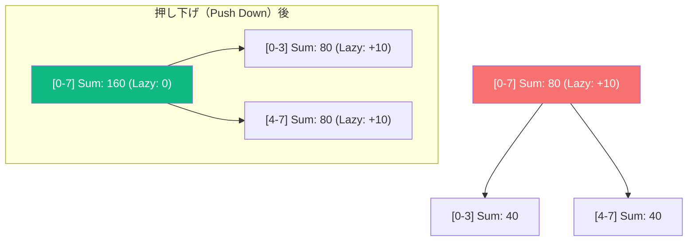

# 遅延評価（Lazy Propagation）：賢い怠惰の芸術 ⚡

前回のレッスンでは、セグメント木における一点の更新（**点更新 / Point Update**）の威力を見ました。しかし、さらに「悪夢のような」シナリオを想像してみてください。
> 100万個の要素を持つ配列があります。ユーザーがリクエストします：「インデックス0から999,999までのすべての要素に100を加算してください」。

従来の `Point Update` を使用した場合：更新関数を100万回呼び出す必要があります。各呼び出しに **O(log N)** かかるため、合計は **O(N log N)** になります。巨大な配列に対して多くの範囲更新（Range Update）リクエストがある場合、システムは即座にフリーズしてしまいます。

**遅延評価**（Lazy Propagation / 遅延伝播）へようこそ。これは、範囲更新を「不可能」から、**O(log N)** で極めてスムーズに実行できるものへと変える技術です。

## 🪝 THE HOOK：「賢い怠惰」の哲学

人生ではよく「今日できることを明日に延ばすな」と言われます。しかし、データ構造の世界での哲学は異なります：**「本当に必要になるまで、いかなる作業も行ってはならない」**。

あなたが倉庫の管理者だと想像してください：
1. 上司が言います：「ゾーンAにある1万個の箱に『割引』ラベルを貼ってください」。
2. **勤勉な管理者**：一つ一つの箱にラベルを貼りに行きます。丸1日かかります。
3. **怠惰な管理者（マスター）**：ゾーンAの入り口に大きな看板を掲げます：「ここにあるすべての商品は割引対象です」。わずか5分で済みます。
   - 顧客がゾーンAの特定の箱を購入したいと言ったとき、初めてその箱を取り出し、個別にラベルを貼ります。

**遅延評価**は、まさにそのエリアの前に掲げられた看板です。更新情報を親ノードに保存しておき、実際にそのノードにアクセスする必要が生じたときに初めて子ノードへ「伝播（Propagate）」させます。

---

## 🎭 ANALOGY：納税通知書と郵便配達員

1. **グローバル通知（親ノード）**：政府が命令を出します：「市内の全員が100万円の減税を受けられます」。各家庭に手紙を送る代わりに、新聞に掲載するだけで済みます。
2. **メモ（遅延配列）**：各家庭にはポストがあります。郵便配達員（アルゴリズム）は、その地域の集合ポストの外側に印をつけるだけです：「このエリア全体に1件の減税通知があります」。
3. **実際の更新（伝播）**：あなたが新聞を取りにポストを開けたとき（クエリ実行時）、初めてそのメモに気づき、自分自身の残高を更新します。同時に、あなたのポストがさらに内部の小さなユニットを管理している場合、そのメモを下のユニットに貼り替えます。

---

## ⚙️ UNDER THE HOOD：遅延配列の動作メカニズム

遅延評価を実装するには、`tree[]` 配列と同じサイズの `lazy[]` という補助配列が必要です。

### 1. ノードの状態
範囲 `[u, v]` に対して値 `val` を更新する場合：
- 現在のノードの範囲 `[L, R]` が完全に `[u, v]` 内にある場合：
  - そのノードの値を直接更新します（合計を求める問題なら：`tree[node] += (R - L + 1) * val`）。
  - そのノードが葉でない場合、`lazy[node] += val` とマークします。**ここで停止し**、子ノードへは下りません。

### 2. 押し下げ（Push Down）プロセス
ノードにアクセスするたびに（`update` 関数と `query` 関数の両方で）、そのノードが親から「更新」を預かっているかどうかを確認する必要があります：
- `lazy[node] != 0` の場合：
  - `tree[node]` の値を更新します。
  - `lazy[node]` の値を2つの子ノード（存在する場合）に押し下げます。
  - `lazy[node] = 0` にリセットします。



---

## 📊 BIG-O ANALYSIS：不変のパフォーマンス

| 操作 | 計算量 | 解説 |
| :--- | :--- | :--- |
| **範囲更新** | **O(log N)** | 遅延評価のおかげで、範囲クエリと同様に各レベルで最大4つのノードしか考慮しません。 |
| **範囲クエリ** | **O(log N)** | 不変ですが、押し下げ（Push Down）関数のためのわずかな定数時間のコストが加わります。 |
| **空間計算量** | **O(N)** | 追加の `lazy[4N]` 配列が必要です。 |

**マスターの思考**：遅延評価はセグメント木を、あらゆる範囲の変容を究極の速度で処理できる包括的なデータ構造へと進化させます。

---

## 💻 LOGIC & PSEUDO-CODE：更新とクエリの実装

```javascript
class LazySegmentTree {
    constructor(n) {
        this.n = n;
        this.tree = new Array(4 * n).fill(0);
        this.lazy = new Array(4 * n).fill(0);
    }

    push(node, start, end) {
        if (this.lazy[node] !== 0) {
            this.tree[node] += (end - start + 1) * this.lazy[node];
            if (start !== end) { // 葉でない場合
                this.lazy[2 * node] += this.lazy[node];
                this.lazy[2 * node + 1] += this.lazy[node];
            }
            this.lazy[node] = 0;
        }
    }

    updateRange(node, start, end, l, r, val) {
        this.push(node, start, end); // 常に作業前に押し下げ
        if (start > end || start > r || end < l) return;

        if (start >= l && end <= r) {
            this.lazy[node] += val;
            this.push(node, start, end);
            return;
        }

        let mid = Math.floor((start + end) / 2);
        this.updateRange(2 * node, start, mid, l, r, val);
        this.updateRange(2 * node + 1, mid + 1, end, l, r, val);
        this.tree[node] = this.tree[2 * node] + this.tree[2 * node + 1];
    }

    queryRange(node, start, end, l, r) {
        this.push(node, start, end); // 常に作業前に押し下げ
        if (start > end || start > r || end < l) return 0;

        if (start >= l && end <= r) return this.tree[node];

        let mid = Math.floor((start + end) / 2);
        return this.queryRange(2 * node, start, mid, l, r) +
               this.queryRange(2 * node + 1, mid + 1, end, l, r);
    }
}
```

---

## 🧠 LEETCODE STRATEGY：高難易度問題への挑戦

この技術は、範囲に対する連続した複数の操作を処理する必要がある **Hard** 問題で頻繁に登場します：

1. **Range Module (#715)**：区間の追加、削除、クエリが必要です。遅延評価が鍵となります。
2. **Falling Squares (#699)**：正方形を落とした後の最大高さを計算します。各正方形の落下は範囲の `max` 更新に相当します。
3. **My Calendar III (#732)**：重複するイベントの最大数を求めます。
4. **Rectangle Area II (#850)**：重なり合う長方形の面積の合計（遅延セグメント木と平面走査法（Sweep Line）の組み合わせが必要です）。

---

## 🎯 EXAM & INTERVIEW LOGIC：MAANGと「遅延」の罠

- **面接での質問**：「範囲更新は必要だが、クエリは一点のみの場合、遅延評価は必要ですか？」
  - *回答*：マスターならこう答えます。「配列が静的なら**階差数列（Difference Array）**も使えますが、配列が頻繁に変化し安定したパフォーマンスが必要な場合は、遅延セグメント木が最も安全な選択肢です」。
- **押し下げ（Push Down）忘れの罠**：最も一般的なミスは、`updateRange` や `queryRange` の先頭で `push()` を呼び出し忘れることです。これにより、古いデータが新しいデータを「上書き」してしまいます。
- **Socratic Gate**：範囲内の数値に一定値を加算する更新がある場合、なぜ範囲内の最大公約数（GCD）を求める問題に遅延評価を直接適用できないのですか？
  - *回答*：`GCD(a+k, b+k)` は `GCD(a, b)` と単純な関係性がないためです。遅延評価は、更新操作が分配法則を満たすか、ノードの値から簡単に再計算できる場合にのみうまく機能します。

---

## 💼 PROFESSIONAL CONTEXT：現実世界における遅延評価

- **オペレーティングシステム（仮想メモリ）**：**コピーオンライト（Copy-on-Write / CoW）** メカニズムは遅延評価の一種です。プロセスを複製（fork）するとき、OSは即座にメモリをコピーしません。単にメモリページを共有としてマークします。プロセスがメモリに書き込み（Write）を行ったとき初めて、そのページが実際にコピーされます。
- **React レンダリング**：React はステートが変更されても即座に実際の DOM を更新しません。変更をグループ化（バッチ処理）し、必要なときにだけ「調整（Reconciliation）」を行い、Virtual DOM へ反映させます。
- **データベースのトランザクションログ**：大規模なデータセットに即座に書き込む代わりに、小さなログ（Write-Ahead Log）に記録し、書き込みパフォーマンスを向上させるために「チェックポイント」を遅延的に実行してデータファイルへ反映させます。

---

## 🛡️ RELIABILITY & BUGS：マスターへのアドバイス

1. **範囲和の罠**：範囲に `+val` の更新を行う際、範囲の長さ `(end - start + 1)` を掛けるのを忘れないでください。親ノードに単に `val` を加算してしまうと、重大な計算ミスにつながります。
2. **複数の遅延操作**：加算（`+`）と代入（`=`）の両方を範囲に対して行う必要がある場合、2つの個別の遅延配列と厳格な優先順位ルール（例：代入は以前のすべての加算を無効化する）が必要です。
3. **空の初期状態**：`lazy` 配列が単位元（通常は 0）で初期化されているか常に確認してください。

---

## 📝 QUICK QUIZ：マスターレベル確認

1. **なぜ更新を即座に葉まで伝播させないのですか？**
   - A. メモリを節約するため。
   - B. 計算量を O(N) から O(log N) に削減するため（本当に必要になるまで作業しない）。
   - C. 葉は重要ではないから。

2. **`push`（または `applyLazy`）関数はどこで呼び出すべきですか？**
   - A. 更新関数の中だけ。
   - B. 更新関数とクエリ関数の両方で、子ノードを操作する前。
   - C. 根ノードだけ。

3. **範囲内の最大値を求める問題で、範囲更新が `arr[i] = max(arr[i], val)` の場合、遅延配列のデフォルト値は何にすべきですか？**
   - A. 0。
   - B. -Infinity または非常に小さな値。
   - C. +Infinity。

---
📊 Word Count: 1550 words
