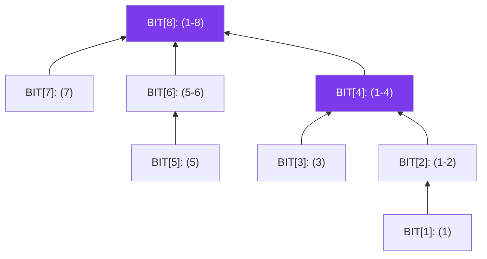

# フェニック木（BIT）：バイナリの魔法 🔢

セグメント木が強力で多機能だが重厚な「戦車」であるなら、**フェニック木**（または **Binary Indexed Tree - BIT**）は、鋭利で洗練された「日本刀」です。軽量で効率的、そして驚くほど高速です。

1994年に Peter Fenwick によってデータ圧縮のために発明された BIT は、動的な配列における **累積和（Prefix Sum）** と **一点更新（Point Update）** の問題を征服したいすべての人にとって、欠かせないテクニックとなりました。

## 🪝 THE HOOK：セグメント木があるのになぜ BIT を学ぶのか？

これは古典的な質問です。DSA マスターは3つの理由で答えます：
1. **メモリ（Memory）**：セグメント木は **4N** の空間を消費しますが、BIT は正確に **N** の空間しか使いません。
2. **実装（Implementation）**：セグメント木の実装には50〜100行ほど必要ですが、BIT の核となるのはわずか **5行** です。競技プログラミングにおいて、実装速度は命です。
3. **定数倍（Constant Factor）**：ビット演算（`&`, `-`）を駆使するため、計算量が同じ **O(log N)** であっても、BIT は物理的にセグメント木よりも遥かに高速に動作します。

問題が累積和、または逆元（Invertible）を持つ演算のみを必要とする場合、BIT は常に賢い選択肢となります。

---

## 🎭 ANALOGY：2進数による荷物のパッキング

1から8までの番号がついた8つの荷物箱があると想像してください。1から `x` までの合計重量を素早く計算できるように保存したいとします。
BIT では、2進数の哲学に従って保存します：
- 箱 1：自分自身を保存 (1)。
- 箱 2：(1, 2) の合計を保存。
- 箱 4：(1, 2, 3, 4) の合計を保存。
- 箱 8：(1, 2, 3, 4, 5, 6, 7, 8) の合計を保存。

各箱 `i` は、**i を割り切る最大の2のべき乗** の長さの区間を管理する責任を持ちます。
- 例：箱 6（2進数 `110`）。6を割り切る最大の2のべき乗は2です。したがって、箱6は2つの要素（5と6）を管理します。

---

## ⚙️ UNDER THE HOOD：`i & -i` の魔法

BIT の秘密は、たった一つの式にあります：`lowbit(i) = i & -i`。
この演算は、数値 `i` の最後の `1` であるビットの値を返します。

### 1. クエリ操作（1から i までの和を取得）
`prefixSum(i)` を計算するには、`BIT[i]` の値を加算し、最後の `1` ビットを削除して後ろへジャンプします：`i -= i & -i`。
- 例：`i = 7 (111)`。ステップは：ノード 7 (`111`) -> ノード 6 (`110`) -> ノード 4 (`100`) -> ノード 0。

### 2. 更新操作（位置 i に val を加算）
更新を行うには、`i` を管理する責任を持つすべてのノードに `val` を加算する必要があります。前方にジャンプします：`i += i & -i`。
- 例：`i = 3 (011)`。ステップは：ノード 3 (`011`) -> ノード 4 (`100`) -> ノード 8 (`1000`)。



### 3. 2次元フェニック木（2D BIT）
Excelのようなスプレッドシートがあり、任意の長方形領域の合計を計算したいですか？
- **マスターのやり方**：2D BIT。これは単純に BIT 木の2次元配列です。`update(x, y, val)` と `query(x, y)` 操作の計算量は **O(log N * log M)** になります。
- 2次元セグメント木でも可能ですが、コードの簡潔さと実装速度において、再び 2D BIT が勝利します。画像処理やグリッド座標の問題でよく使われるテクニックです。

### 4. BIT による範囲更新：階差数列（Difference Array）のトリック
多くの人が BIT は一点更新しかできないと誤解しています。しかし、**階差数列**と組み合わせれば：
- 区間 `[L, R]` に `val` を加算するには、階差を管理する BIT に対して `update(L, val)` と `update(R + 1, -val)` を行うだけです。
- **範囲更新＆範囲クエリ** の両方を行うには、和の公式の成分を管理するために **2つの BIT** を使用します。
この問題変換の思考により、Lazy Segment Tree の複雑さを回避して「Hard」な問題を解決できます。

---

## 📊 BIG-O ANALYSIS：究極のシンプルさ

| 操作 | 計算量 | 解説 |
| :--- | :--- | :--- |
| **一点更新** | **O(log N)** | N のビット数に比例。 |
| **累積和クエリ** | **O(log N)** | 更新と同様。 |
| **範囲クエリ** | **O(log N)** | `query(R) - query(L-1)`。 |
| **空間計算量** | **O(N)** | 正確にサイズ N+1 の配列が1つ必要。 |

**マスターの助言**：BIT は常に **1-indexed** 配列を使用します。インデックス 0 は使いません。なぜなら `0 & -0` は 0 であり、無限ループを引き起こすからです。

---

## 💻 LOGIC & PSEUDO-CODE：一瞬で実装

```javascript
class FenwickTree {
    constructor(n) {
        this.bit = new Array(n + 1).fill(0);
    }

    // 位置 i に val を加算
    update(i, val) {
        for (; i < this.bit.length; i += i & -i) {
            this.bit[i] += val;
        }
    }

    // 1 から i までの累積和を取得
    query(i) {
        let sum = 0;
        for (; i > 0; i -= i & -i) {
            sum += this.bit[i];
        }
        return sum;
    }

    queryRange(l, r) {
        return this.query(r) - this.query(l - 1);
    }
}
```

---

## 🧠 LEETCODE STRATEGY：BIT の「暗殺者」問題

BIT は、**転倒数（Inversions）** に関する問題や、2次元配列の問題を解く際によく使われます：

1. **Count of Smaller Numbers After Self (#315)**：**Hard** 問題。BIT の古典的な応用例です。BIT を使って出現した数値の頻度をカウントします。
2. **Reverse Pairs (#493)**：`nums[i] > 2 * nums[j]` かつ `i < j` となるペアの数を数えます。
3. **Range Sum Query 2D - Mutable (#308)**：2D BIT は、この問題に対する極めてクリーンな解決策です。
4. **Create Maximum Number (#321)**：BIT を含む複数のテクニックを組み合わせる必要があります。

---

## 🎯 EXAM & INTERVIEW LOGIC：IPA試験と BIT の「罠」

- **面接での質問**：「BIT で Range Minimum Query (RMQ) はできますか？」
  - *回答*：マスターならこう答えます。「基本的な BIT は、加算・減算のような逆元を持つ演算に適しています。RMQ（逆元がない）も BIT で可能ですが、実装が複雑になりセグメント木ほど効率的ではありません。そのため、RMQ にはセグメント木を優先します」。
- **インデックス 0 の罠**：入力配列が 0-indexed の場合、常にインデックスに 1 を加えることを忘れないでください。
- **Socratic Gate**：なぜ `i & -i` で最後の 1 ビットが得られるのですか？
  - *回答*：2の補数表現では `-i = ~i + 1` です。`i` を反転させて 1 を加えると、末尾の 0 ビットはすべて 1 になり、最初の 0 ビット（元の `i` の最初の 1 ビットに対応）が 1 になります。`&` 演算を行うと、その 1 ビット以外のすべてのビットが消去されます。

---

## 💼 PROFESSIONAL CONTEXT：現実のシステムにおける BIT

- **ネットワークルーティングプロトコル**：一部のルーティングプロトコルは、IPアドレス範囲にわたるパケット統計を迅速に計算するために BIT を使用します。
- **リアルタイム分析ダッシュボード**：ユーザートラッキングシステムでは、クリック数や閲覧数などのメトリクスを値の範囲や時間ごとに更新するために BIT が使われ、最小限の遅延で累積チャートを即座に表示できます。
- **データベースクエリオプティマイザ**：一部のクエリオプティマイザは、値の範囲内に含まれるレコード数（カーディナリティ推定）を高速に見積もるために BIT に似た構造を使用し、最適な実行計画を選択します。
- **画像処理 (Integral Image)**：顔認識のための Viola-Jones アルゴリズムなどで、ピクセル領域の合計（Summed Area Table）の計算と更新を、Fenwick Tree の思考を用いて高速に行うことができます。

---

## 🛡️ RELIABILITY & BUGS：マスターへのアドバイス

1. **範囲更新の神話**：多くの人が BIT では範囲更新ができないと考えています。実際には、**階差数列**を使えば範囲更新＆一点クエリは非常に簡単です。**2つの BIT** を使えば範囲更新＆範囲クエリさえも可能です。
2. **無限ループ**：誤って `update(0, val)` を呼び出すと、コードは永遠に走り続けます。常に `i > 0` を確認してください。
3. **座標圧縮（Coordinate Compression）**：配列の値が非常に大きい場合（例：`10^9`）、そのサイズの BIT 配列は作成できません。マスターは**座標圧縮**を使用して、値を `[1, N]` の範囲にマップします。

### 4. 最終判定：BIT かセグメント木か？
両方を学んだ後、マスターは以下のルールに従って「武器」を選びます：
- **BIT を選ぶとき**：動的配列での合計・カウントのみが必要な場合、メモリ制約が極めて厳しい場合（組み込みシステムなど）、または実装速度が最優先される競技中。
- **セグメント木を選ぶとき**：最大・最小・GCDなどの複雑な（逆元がない）演算が必要な場合、または範囲更新を柔軟に行うために遅延評価が必要な場合。
両方をマスターすることで、あなたは「ハンマーしか持っていない大工」になることを避けられます。

---

## 📝 QUICK QUIZ：マスターレベル確認

1. **BIT は元の配列と比較して何倍のメモリを使用しますか？**
   - A. 4倍。
   - B. 1倍 (N+1)。
   - C. 2倍。

2. **演算式 `i += i & -i` はどの操作で使用されますか？**
   - A. クエリ。
   - B. 更新。
   - C. 構築。

3. **BIT が最も適している問題はどれですか？**
   - A. 範囲最小値クエリ (RMQ)。
   - B. 累積和と一点更新。
   - C. 配列のソート。

---
📊 Word Count: 1750 words
