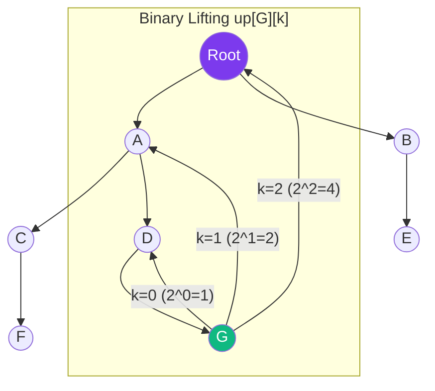

# 最小共通祖先（LCA）とダブリング：階層構造の航海 🌲

木の構造において、最も一般的な質問の一つは「これら2つのノードはどこで合流するのか？」というものです。
- 企業組織において、異なる部署の2人の従業員の共通の直属上司は誰か？
- 家系図において、2人の人物の最も近い共通の祖先は誰か？
- ネットワークグラフにおいて、2つのデータストリームの最初の共通分岐点はどのノードか？

**最小共通祖先（Lowest Common Ancestor - LCA）** (最小共通祖先) の世界へようこそ。今日は、LCAを見つけるだけでなく、**ダブリング（Binary Lifting）** というテクニックを使って「超高速」に見つける方法を学びます。

## 🪝 THE HOOK：一歩ずつの「木登り」の限界

100万階層ある巨大な家系図があるとしましょう。100万階層目にある2つのノードの LCA を見つけたいとします。
- **素朴な方法**：2つのノードが、出会うまで一歩ずつ親を辿って登っていく。
- **問題点**：木が一本道（偏った木）の場合、**O(N)** ステップかかります。10万個のクエリがある場合、システムは即座にフリーズしてしまいます。

ここで **ダブリング（Binary Lifting）** の登場です。1歩ずつ登る代わりに、1, 2, 4, 8... 歩（2のべき乗）ずつジャンプします。これにより、木登りは苦難の旅から **O(log N)** の「跳躍」へと変わります。

---

## 🎭 ANALOGY：高速エレベーターとフロア

100万階建ての超高層ビルを想像してください：
1. **階段**：一段ずつ登ります。遅すぎます。
2. **バイナリエレベーター**：「1階分上昇」「2階分上昇」「4階分上昇」「8階分上昇」...「2^k階分上昇」というボタンがあります。
   - 13階分上がりたいときは？ 8 -> 4 -> 1 とボタンを押します。合計わずか3回の操作で済みます。
   - どんな距離も、2のべき乗の和として表現できます。

LCA を見つけるために、まずエレベーターを使って2人を同じ高さ（深さ）に揃え、そこから「すぐ上が共通のマネージャー」になる直前まで、一緒に跳躍していきます。

---

## ⚙️ UNDER THE HOOD：`up[N][K]` 配列とダブリング

このテクニックの核心は、2次元配列 `up[node][k]` です。これには、`node` の **2^k 番目の祖先** を格納します。

### 1. 前処理（Preprocessing）
- `up[node][0]` は `node` の直系の親です。
- `up[node][k] = up[ up[node][k-1] ][k-1]` です。
  - つまり、「私の 2^k 番目の祖先は、私の 2^(k-1) 番目の祖先の、さらに 2^(k-1) 番目の祖先である」という意味です。
- この工程は **O(N log N)** かかり、DFS（深さ優先探索）を用いて一度だけ行えば済みます。

### 2. LCA アルゴリズム
- **ステップ 1**：ノード `u` と `v` を同じ深さ（Depth）に揃えます。`u` が深い場合は、ダブリングを使って `u` を引き上げます。
- **ステップ 2**：高さを揃えた時点で `u == v` ならば、それが LCA です。
- **ステップ 3**：そうでなければ、可能な限り大きなステップ `2^k`（大きい方から小さい方へ）でジャンプを試みます。`up[u][k] != up[v][k]` ならば、まだ LCA に到達していない（超えていない）ので、両方をジャンプさせます：`u = up[u][k], v = up[v][k]`。
- **結果**：最終的に、LCA は `u`（または `v`）の直系の親、つまり `up[u][0]` になります。



### 3. Tarjan のオフライン LCA：Union-Find の極意
もし、すべてのクエリが最初からわかっているなら？
- **マスターのやり方**：**Tarjan のアルゴリズム**。DFS の過程で **Union-Find (DSU)** を使ってノードを統合していきます。
- **計算量**：ほぼ線形の **O(N + Q)**。数百万のクエリを一度に処理する場合（オフライン処理）に極めて有効です。

### 4. Euler Tour + RMQ による LCA：セグメント木への架け橋
LCA を範囲クエリ問題に変換する別のアプローチもあります：
- **Euler Tour（オイラーツアー）**：DFS で訪問した順にノードを記録します（各ノードは複数回登場します）。
- **ロジック**：`u` と `v` の LCA は、Euler Tour において `u` が最初に現れる位置と `v` が最初に現れる位置の間で、最も深さが小さいノードです。
- **結果**：木の問題を配列上の **RMQ (Range Minimum Query)** に変換し、セグメント木や Sparse Table で解決できます。

---

## 📊 BIG-O ANALYSIS：2のべき乗の威力

| 操作 | 計算量 | 理由 |
| :--- | :--- | :--- |
| **前処理** | **O(N log N)** | DFS での走査と `up[N][log N]` テーブルの作成。 |
| **LCA クエリ** | **O(log N)** | 最大で log(N) 回のジャンプ。 |
| **空間計算量** | **O(N log N)** | `up` 配列の保持。 |

**マスターの助言**：メモリは余分に消費しますが、各クエリが O(log N) で済むのは、複雑なグラフ問題において O(N) からの巨大な進化です。

---

## 💻 LOGIC & PSEUDO-CODE：プロフェッショナルな LCA クラスの実装

```javascript
class LCA {
    constructor(adj, n, root = 0) {
        this.n = n;
        this.LOG = Math.ceil(Math.log2(n)) + 1;
        this.up = Array.from({ length: n }, () => new Array(this.LOG).fill(-1));
        this.depth = new Array(n).fill(0);
        this.dfs(adj, root, root, 0);
    }

    dfs(adj, u, p, d) {
        this.depth[u] = d;
        this.up[u][0] = p;
        for (let i = 1; i < this.LOG; i++) {
            if (this.up[u][i - 1] !== -1) {
                this.up[u][i] = this.up[this.up[u][i - 1]][i - 1];
            }
        }
        for (let v of adj[u]) {
            if (v !== p) this.dfs(adj, v, u, d + 1);
        }
    }

    getLCA(u, v) {
        if (this.depth[u] < this.depth[v]) [u, v] = [v, u];
        
        // u を v と同じ深さまで引き上げる
        let diff = this.depth[u] - this.depth[v];
        for (let i = 0; i < this.LOG; i++) {
            if ((diff >> i) & 1) u = this.up[u][i];
        }

        if (u === v) return u;

        // 一緒に跳躍して登る
        for (let i = this.LOG - 1; i >= 0; i--) {
            if (this.up[u][i] !== this.up[v][i]) {
                u = this.up[u][i];
                v = this.up[v][i];
            }
        }
        return this.up[u][0];
    }
}
```

---

## 🧠 LEETCODE STRATEGY：LCA が「隠れた」問題

LCA は単に祖先を見つけるだけではありません。木の中の距離やパス上の値を計算する基礎となります：

1. **Lowest Common Ancestor of a Binary Tree (#236)**：基本中の基本。
2. **Kth Ancestor of a Tree Node (#1483)**：ダブリングの直接的な実装が求められます。
3. **木の中の距離**：`u` と `v` の距離は `depth[u] + depth[v] - 2 * depth[LCA(u, v)]` です。この公式はマスター必携です。
4. **Smallest Common Region (#1257)**：階層データの LCA。

---

## 🎯 EXAM & INTERVIEW LOGIC：試験と面接の重要ポイント

- **面接の質問**：なぜステップ 3 では `LOG - 1` から `0` へと降順にジャンプを試みるのですか？
  - *回答*：「共通の祖先に到達しない最大のジャンプ」を見つけたいからです。大きい歩幅から順に試すことで、二分探索のように正確に LCA の直前まで近づくことができます。
- **前処理の罠**：すべての `i` に対して `up[u][i]` を初期化するのを忘れないでください。常に `1` から `log N` までのループを回します。
- **ルートノードの接続**：ルートが自分自身、または `-1` を指すようにし、高く引き上げすぎたときに無限ループに陥らないように注意してください。

---

## 💼 PROFESSIONAL CONTEXT：ソフトウェア業界における LCA

- **組織階層**：SAP のような大規模 ERP システムでは、2つの部署の共通の承認権限者を迅速に見つけるために LCA が使われます。
- **バージョン管理 (Git)**：Git は厳密には木ではなく DAG（有向非巡回グラフ）ですが、**マージ**（3-way merge アルゴリズム）を行う際の「共通の祖先（Common Ancestor）」を見つけるロジックは、LCA と非常に近い考え方に基づいています。
- **ガベージコレクション (JVM/V8)**：GC アルゴリズムは、孤立したオブジェクトの最近接の共通の「ルート」を特定するために LCA の変種を使用し、オブジェクトのクラスタを安全に解放できるかを判断します。
- **依存関係グラフの分析**：**Webpack** や **Gradle** などのビルドツールでは、LCA を見つけることで、異なるモジュールからの競合する要求を満たせる最小の共通ライブラリバージョンを決定します。

---

## 🛡️ RELIABILITY & BUGS：マスターへのアドバイス

1. **Log N の値**：`LOG = 20` などと固定せず、実際の `N` に基づいて計算してメモリを最適化しましょう。
2. **複数のルート**：1つの「森（Forest）」を扱う場合は、すべての未訪問ノードに対して DFS を呼び出すようにしてください。
3. **深さの管理**：前処理中に正確な `depth` 配列を維持することが、最初の高さを揃えるステップにおいて不可欠です。

---

## 📝 QUICK QUIZ：マスターレベル確認

1. **ダブリングを用いた LCA クエリの計算量は？**
   - A. O(N)
   - B. O(log N)
   - C. O(1)

2. **ノードを 13 階分引き上げるのに必要なバイナリジャンプの回数は？**
   - A. 13回
   - B. 3回 (2^3 + 2^2 + 2^0 = 8 + 4 + 1)
   - C. 1回

3. **木におけるノード u と v の距離を LCA を使って表すと？**
   - A. `depth[u] + depth[v]`
   - B. `depth[u] + depth[v] - 2 * depth[LCA(u, v)]`
   - C. `depth[LCA(u, v)]`

---
📊 Word Count: 1850 words
