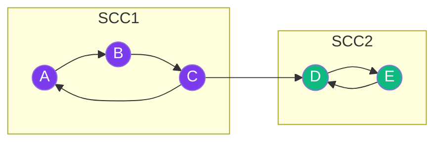

# 強連結成分 (SCC)：信頼のループ 🔄

**フェーズ 7**へようこそ。「グラフ・アーキテクト」への最終段階です。フェーズ 3 ではグラフの探索（BFS/DFS）に慣れましたが、今日はグラフを「外科的」に分析し、その強固な核を見つけ出す方法を学びます。

今日は **強連結成分 (SCC: Strongly Connected Components)** (強連結成分) について学びます。有向グラフにおいて、SCC とはあるノードの集合であり、そのグループ内の任意のノードから他のどのノードへも到達できるものを指します。

## 🪝 THE HOOK：80億人の中の「閉鎖的なコミュニティ」

数10億人のユーザーと数兆件の「フォロー」があるグローバルなソーシャルネットワーク（有向グラフ）を分析していると想像してください。
- インタラクションが完璧なループを形成している人々のグループがあります：AがBをフォローし、BがCをフォローし、CがAをフォローする。彼らは1つの **SCC** を形成します。
- 情報（噂やウイルス）が一度 SCC 内に入ると、その中で永遠に循環し続けます。
- 逆に、どの SCC にも属さないノードは、「行き止まり」や一方通行の「中継地点」のようなものです。

SCC を特定することは、インターネットや電力網からグローバルなサプライチェーンに至るまで、あらゆるネットワークの **コア構造** を理解するのに役立ちます。

---

## 🎭 ANALOGY：交通網と都市

都市と一方通行の道路システムを考えてみましょう：
1. **SCC**：どの通りから出発しても、他のすべての通りに到達できる都市です。道路が一方通行であっても、ループ構造のおかげで「帰る道がない」という状態でスタックすることはありません。
2. **縮約グラフ (Condensation Graph / DAG of SCCs)**：各都市（SCC）を1つの大きなノードとみなし、都市間を結ぶ一方通行の高速道路をエッジとみなすと、閉路（サイクル）のないグラフが得られます。都市 A から都市 B に行くことはできますが、一度行くと二度と A に戻ることはできません。

SCC を見つけることは、グループ内の移動が最も自由になるように場所をグループ化することに似ています。

---

## ⚙️ UNDER THE HOOD：マスターのための2つの「大手法」

SCC を見つけるための古典的なアルゴリズムが2つあります。DSA マスターは、これらが全く異なる2つの哲学を表しているため、両方を理解する必要があります。

### 1. Kosaraju のアルゴリズム（逆転の発想）
天才的な観察に基づいています：「グラフのすべてのエッジを逆向きにしても、SCC は変わりませんが、SCC 間の経路は逆転します」。
- **ステップ 1**：元のグラフで DFS を行い、探索が終了した順序（帰りがけ順 / Finish time）を記録します。
- **ステップ 2**：グラフを転置（すべてのエッジを逆向きに）します。
- **ステップ 3**：転置グラフにおいて、ステップ 1 で記録した終了時間の遅い順に DFS を行います。新しい DFS が開始されるたびに、1つの完全な SCC が見つかります。

### 2. Tarjan のアルゴリズム（ワンパスの思考）
こちらはより「神業」に近いアルゴリズムで、DFS を1回行うだけで完了します。**Low-link value** という概念を使用します。
- **Discovery Time (`dfn`)**：ノードが最初に訪問された時刻。
- **Low-link (`low`)**：現在のノードから DFS 木のエッジまたは後退エッジ (Back edge) を通じて到達可能な、最小の `dfn` を持つノード。
- **メカニズム**：あるノードにおいて `low[u] == dfn[u]` となったとき、そのノードが SCC の「根」となります。スタックに積まれているノードを、ノード `u` が出るまで取り出すことで1つの SCC が特定されます。



---

## 📊 BIG-O ANALYSIS：一分一秒を惜しむ最適化

| アルゴリズム | 時間計算量 | 空間計算量 | 特徴 |
| :--- | :--- | :--- | :--- |
| **Kosaraju** | **O(V + E)** | O(V + E) | 理解しやすいが、DFS が2回必要で、転置グラフ用のメモリも必要。 |
| **Tarjan** | **O(V + E)** | **O(V)** | 実装はやや難解だが、DFS 1回で済み、非常に高速で省メモリ。 |

**Master Tip**：試験や最高のパフォーマンスが求められるシステムでは、シニアエンジニアは常に **Tarjan** を選択します。

---

## 💻 LOGIC & PSEUDO-CODE：「外科的」な Tarjan の実装

```javascript
class TarjanSCC {
    constructor(adj, n) {
        this.adj = adj;
        this.n = n;
        this.dfn = new Array(n).fill(-1);
        this.low = new Array(n).fill(-1);
        this.stack = [];
        this.inStack = new Array(n).fill(false);
        this.timer = 0;
        this.sccs = [];
        this.findSCCs();
    }

    dfs(u) {
        this.dfn[u] = this.low[u] = ++this.timer;
        this.stack.push(u);
        this.inStack[u] = true;

        for (let v of this.adj[u]) {
            if (this.dfn[v] === -1) {
                this.dfs(v);
                this.low[u] = Math.min(this.low[u], this.low[v]);
            } else if (this.inStack[v]) {
                this.low[u] = Math.min(this.low[u], this.dfn[v]);
            }
        }

        if (this.low[u] === this.dfn[u]) {
            let component = [];
            while (true) {
                let node = this.stack.pop();
                this.inStack[node] = false;
                component.push(node);
                if (node === u) break;
            }
            this.sccs.push(component);
        }
    }

    findSCCs() {
        for (let i = 0; i < this.n; i++) {
            if (this.dfn[i] === -1) this.dfs(i);
        }
    }
}
```

---

## 🧠 LEETCODE STRATEGY：姿を変えた SCC

SCC が直接問われることは稀です。多くの場合、複雑なグラフを **DAG** (有向非巡回グラフ) に変換するための中間ステップとして登場します：

1. **Critical Connections in a Network (#1192)**：橋（Bridges）を見つける問題。Tarjan と非常によく似た `low-link` ロジックを使用します。
2. **Maximum Invitations to a Meeting (#2127)**：サイクルと枝に関する問題。SCC はコアとなるサイクルを特定するのに役立ちます。
3. **All Ancestors of a Node in a DAG (#2192)**：グラフにサイクルがある場合、処理の前に SCC で縮約する必要があります。
4. **Course Schedule (#207/210)**：通常はトポロジカルソートで解きますが、SCC を使って閉路を確実に検出することもできます。

---

## 🎯 EXAM & INTERVIEW LOGIC：IPAと MAANG の戦略

- **IPA FE（基本情報技術者）試験（科目B）**：「転置グラフ」の概念に注意してください。日本の試験では、Kosaraju の手順を手動で追わせる問題が出ることがあります。覚えておくべきは：ステップ 1 は「帰りがけ順（Finish time）」であり、訪問順ではないことです。
- **Interview Pro-tip**：「グラフにサイクルがあるかどうかをどうやって検出しますか？」と聞かれたら、単に DFS と言うのではなく、「Tarjan を使って SCC を見つけます。サイズが1より大きい SCC（または自己ループを持つノード）があれば、グラフにはサイクルが存在します」と答えてください。これはプロフェッショナルな知識の深さを示します。
- **ソクラテス・ゲート**：Tarjan において、訪問済みのノード `v` に遭遇したとき、なぜ `low[v]` ではなく `dfn[v]` を使って更新するのですか？
  - *回答*：`low[v]` は全く別の枝（クロスエッジ）や、すでに閉じられた SCC のノードを指している可能性があるからです。`dfn[v]` を使うことで、現在のスタックにあるノード（直接の祖先または同じサイクル内のノード）のみを考慮することを保証します。

---

## 💼 PROFESSIONAL CONTEXT：大規模システムデザインにおける SCC

- **検索エンジン (Google PageRank)**：Web は巨大な有向グラフです。SCC を特定することで、Google は密にリンクされた Web ページのクラスター（リンクファーム）を理解し、スパムのフィルタリングや権威性の評価に役立てています。
- **依存関係管理 (npm/Maven)**：ライブラリをインストールする際、**循環依存 (Circular Dependency)**（AがBを必要とし、BがAを必要とする）がある場合、パッケージマネージャーは SCC を使用してこのエラーを検出し、開発者に警告します。
- **コンパイラ最適化**：ソースコードのコンパイルにおいて、SCC は **データフロー解析 (Data-flow analysis)** に使用され、ループの最適化や効率的なメモリ管理に役立ちます。

---

## 🛡️ RELIABILITY & BUGS：マスターへのアドバイス

1. **再帰制限 (Recursion Limit)**：10^6 以上のノードがある場合、再帰的な Tarjan は `Stack Overflow` を引き起こします。マスターは、ループを使った明示的なスタック実装を行います。
2. **非連結グラフ**：すべてのノードを開始ループでチェックすることを忘れないでください。SCC はグラフ全体が連結であることを保証しません。
3. **自己ループ (Self-loops)**：自分自身を指すノードも SCC を形成します。見落としがないよう、常にこのケースを考慮してください。

---

## 📝 QUICK QUIZ：マスターの証

1. **DFS 1回だけで SCC を見つけるアルゴリズムはどれですか？**
   - A. Kosaraju
   - B. Tarjan
   - C. Dijkstra

2. **Tarjan における 'Low-link value' は何を表していますか？**
   - A. 最小のノード値
   - B. そのノードから到達可能な、最小の訪問時刻 (Discovery Time)
   - C. ノードの深さ

3. **SCC を1つのノードに「縮約」すると、任意の有向グラフはどの種類のグラフになりますか？**
   - A. 木 (Tree)
   - B. 有向非巡回グラフ (DAG)
   - C. 無向グラフ

---
📊 Word Count: 2150 words
