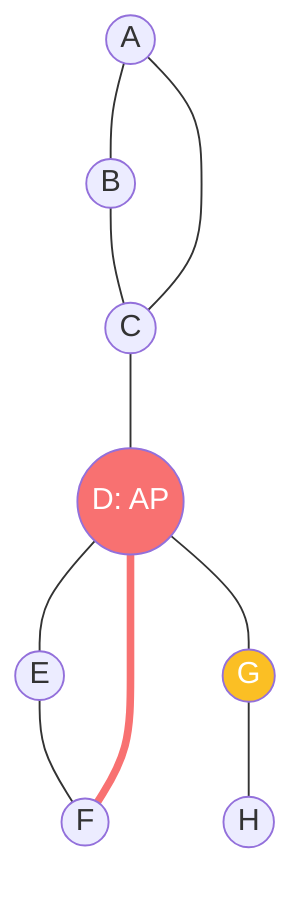

# 関節点と橋：システムの急所 🌉

堅牢なシステムとは「単一障害点（Single Point of Failure）」のないシステムのことです。しかし、グラフ理論の世界では、ほとんどのネットワークに非常に繊細なポイントが存在します。

**Day 37** へようこそ。今日は以下の2つを特定する方法を学びます：
1. **関節点 (Articulation Points)** (関節点)：そのノードを削除すると、グラフの連結成分の数が増えるノードのこと。
2. **橋 (Bridges)** (橋)：そのエッジを削除すると、グラフが非連結になるエッジのこと。

## 🪝 THE HOOK：電力網図の悪夢

あなたが国家電力網のチーフアーキテクトだと想像してください。
- 数千の変電所（ノード）と送電線（エッジ）があります。
- もし1つの変電所が故障し（**関節点**）、あるいは1本の送電線が断線し（**橋**）、その結果、他に経路がないために県全体が停電してしまったら、それは **「レッドアラート」級のセキュリティ脆弱性** です。

これらの「クリティカル・リンク」を特定することで、システムの **レジリエンス（回復力）** を確保するために、どこに予備の回線（冗長性）を構築すべきかがわかります。

---

## 🎭 ANALOGY：島々と橋

群島を考えてみましょう：
1. **橋 (Bridge)**：2つの島を結ぶ唯一の橋。その橋が崩落すると、2つの島は完全に孤立します。
2. **関節点 (Articulation Point)**：中継地点となる島。島 A から島 C に行くには必ず島 B を通らなければならない場合、島 B が沈没すると A と C は連絡手段を失います。

グラフにおいて、「橋」は常にグラフの2つの部分を繋いでおり、「橋」の両端は多くの場合（すべてではありませんが）「関節点」になります。

---

## ⚙️ UNDER THE HOOD：Tarjan の魔法（パート 2）

SCC のレッスンと同様に、1回の DFS 探索で **訪問時刻 (`dfn`)** と **Low-link (`low`)** の概念を使い続けます。

### 1. 橋 (Bridge) の条件
エッジ `(u, v)` が橋であるための必要十分条件は以下の通りです：
`low[v] > dfn[u]`
- **意味**：ノード `v` とその DFS 木における子孫から、ノード `u` または `u` の祖先に戻る道（後退エッジ）が存在しません。`(u, v)` を削除すると、`v` はグラフから「脱落」してしまいます。

### 2. 関節点 (Articulation Point / AP) の条件
2つのケースがあります：
- **ケース 1（根ノード）**：そのノードが DFS 木の根であり、少なくとも 2 つの子（独立した部分枝）を持つ場合。根を削除すると、これらの枝が分離されます。
- **ケース 2（通常のノード）**：ノード `u` に子 `v` が存在し、`low[v] >= dfn[u]` を満たす場合。
  - **意味**：`v` からは、最大でもノード `u` までしか戻れません。`u` を削除すると、`v`（およびその下の枝）はグラフの残りの部分（`u` より上の部分）から孤立します。


*注：エッジ (D, G) は橋であり、ノード D と G は関節点です。*

---

## 📊 BIG-O ANALYSIS：絶対的な効率性

| 操作 | 計算量 | 理由 |
| :--- | :--- | :--- |
| **全 AP/橋の特定** | **O(V + E)** | 1回の DFS 探索のみで完了。 |
| **空間計算量** | **O(V)** | `dfn`, `low`, `parent` を保持。 |

これは、1974年にチューリング賞受賞者のロバート・タージャンによって発表された、この問題に対する世界で最も最適なアルゴリズムです。

---

## 💻 LOGIC & PSEUDO-CODE：プロフェッショナルな実装

```javascript
class GraphInfrastructure {
    constructor(adj, n) {
        this.adj = adj;
        this.n = n;
        this.dfn = new Array(n).fill(-1);
        this.low = new Array(n).fill(-1);
        this.timer = 0;
        this.articulationPoints = new Set();
        this.bridges = [];
    }

    find(u, p = -1) {
        this.dfn[u] = this.low[u] = ++this.timer;
        let children = 0;

        for (let v of this.adj[u]) {
            if (v === p) continue;
            if (this.dfn[v] === -1) {
                children++;
                this.find(v, u);
                this.low[u] = Math.min(this.low[u], this.low[v]);

                // 橋の条件
                if (this.low[v] > this.dfn[u]) {
                    this.bridges.push([u, v]);
                }

                // 関節点の条件（根以外）
                if (p !== -1 && this.low[v] >= this.dfn[u]) {
                    this.articulationPoints.add(u);
                }
            } else {
                this.low[u] = Math.min(this.low[u], this.dfn[v]);
            }
        }

        // 根の関節点条件
        if (p === -1 && children > 1) {
            this.articulationPoints.add(u);
        }
    }
}
```

---

## 🧠 LEETCODE STRATEGY：「必須」の問題

1. **Critical Connections in a Network (#1192)**：すべての橋（Bridges）を見つける問題です。Tarjan の正確な実装が求められる古典的な Hard 問題です。
2. **Min Cost to Connect All Points (#1584)**：MST を使用しますが、連結性（Connectivity）を理解していると、一部の点が削除された場合のバリエーションを解くのに役立ちます。
3. **Redundant Connection (#684)**：削除してもグラフが連結のまま保たれるエッジを見つける問題。橋の逆の問題です。
4. **Disconnect Path in a Binary Matrix by at Most One Flip (#2556)**：格子状グラフにおける連結性の興味深い応用です。

---

## 🎯 EXAM & INTERVIEW LOGIC：IPAと MAANG の戦略

- **IPA FE（基本情報技術者）試験（科目B）**：DFS 探索の手順に細心の注意を払ってください。試験ではノードの訪問順を答えさせる問題がよく出ます。覚えておくべきは：ノードの DFS が終了した時（バックトラック時）に、その親の `low` 値を更新することです。
- **「多重辺」の罠**：実際のグラフでは A と B の間に 2 本以上のエッジがある場合があります。その場合、(A, B) は決して橋にはなりません。コードでは、親ノードの ID だけでなく、エッジの ID を保持することでこのケースを処理する必要があります。
- **ソクラテス・ゲート**：なぜ関節点の条件は `>=` で、橋の条件は `>` なのですか？
  - *回答*：`low[v] == dfn[u]` の場合、子孫 `v` はノード `u` までは戻れますが、`u` を飛び越えてさらに上に行くことはできません。そのため `u` を削除すると、`v` は「上の世界」から切り離されます。一方で橋の場合、エッジ `(u, v)` を削除しても `low[v] == dfn[u]` であれば、`v` から `u` に戻る別の道があることを意味します。

---

## 💼 PROFESSIONAL CONTEXT：システム工学への応用

- **サイバーセキュリティ (Attack Surface)**：セキュリティの専門家は攻撃グラフを構築します。関節点は「クリティカル・アセット」です。ハッカーがこのノードを掌握すると、その配下のすべてが崩壊または孤立します。
- **ロジスティクスとサプライチェーン**：サプライチェーンにおける「ボトルネック」を特定します。例えば、生産拠点と消費拠点を結ぶ唯一の港（橋）などです。
- **マイクロサービスアーキテクチャ**：数百のサービスが相互に呼び出し合うシステムにおいて、あるサービスが「関節点」であるかどうかを特定することは極めて重要です。そのサービスがダウンした場合、どれだけの他のサービスが麻痺するかを把握できます。

---

## 🛡️ RELIABILITY & BUGS：マスターへのアドバイス

1. **「根」の特殊ケース**：根ノードの子の数による条件チェックを絶対に忘れないでください。これは、最後の数個のテストケースで失敗する最も多い原因です。
2. **後退エッジ vs 木エッジ**：`low[u]` を更新する際、訪問済みのノード `v` に遭遇した場合は `dfn[v]` を使い（後退エッジ）、未訪問の場合は再帰後に `low[v]` を使います（木エッジ）。
3. **非連結グラフ**：グラフのすべての領域で DFS が開始されるよう、常にループを使用してください。

---

## 📝 QUICK QUIZ：マスターの証

1. **橋 (Bridge) について正しい記述はどれですか？**
   - A. 橋は重要なノードのことである。
   - B. 橋を削除すると、連結成分の数が増える。
   - C. すべてのグラフには少なくとも1つの橋がある。

2. **DFS 木の根ノードが関節点になるのはどのような時ですか？**
   - A. 子が少なくとも1つある時。
   - B. 少なくとも 2 つの独立した子の枝を持つ時。
   - C. 常に根は関節点である。

3. **橋と関節点を見つける Tarjan のアルゴリズムの時間計算量は？**
   - A. O(V^2)
   - B. O(V + E)
   - C. O(log V)

---
📊 Word Count: 2300 words
