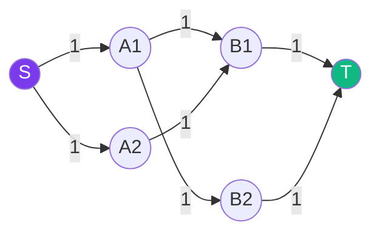

# 二部グラフのマッチング：最高のペアリング 👥

私たちは日常生活の中で、常に2つのグループを「結びつける」という課題に直面しています。
- **企業** と最適な **候補者**。
- **ドライバー** と待機中の **乗客**。
- **学生** と研究 **テーマ**。
- **ドナー** と移植を必要とする **患者**。

**二部グラフのマッチング** (Bipartite Matching) へようこそ。これはフロー理論（Network Flow）のエリートな応用例であり、接続と最適化の純粋な美しさを体現しています。

## 🪝 THE HOOK：結婚と市場を安定させるアルゴリズム

マッチングアルゴリズムが、2012年にアルビン・ロスとロイド・シャプレーにノーベル経済学賞をもたらしたことをご存知でしょうか？
このアルゴリズムは、お金だけが決定要因ではない市場（臓器提供のマッチングや、医学生の研修先配属など）を解決するために使用されています。

**最大マッチング** (Maximum Matching) を見つけることは、単なるパズルではありません。それは **社会的リソースの最適化** の鍵です。90人ではなく100人をマッチングできれば、システム全体が11%効率化されます。今日は、「乱雑な」マッチング問題を、高度に科学的なネットワークフロー問題に変換する方法を学びます。

---

## 🎭 ANALOGY：舞踏会のペアリング

豪華なガラ・パーティーを想像してください。
1. **グループA（男性）** と **グループB（女性）**。
2. これは **二部グラフ** です。なぜなら、男性は女性としか踊らず、男性同士や女性同士のペア（辺）は存在しないからです。
3. **マッチング**：各人が最大で1人の相手と踊るようにペアを選択すること。
4. **最大マッチング**：フロアで同時に踊っているペアの数を最大にすること。

欲張り（Greedy）なアプローチ（適当にペアを組む）では、後で「もしAさんとBさんが組まなければ、もっと多くのペアが作れたのに」という状況に陥る可能性があります。私たちは体系的な解決策を必要としています。

---

## ⚙️ UNDER THE HOOD：マッチングから最大フローへ

DSAマスターを笑顔にする魔法がここにあります：**すべての二部グラフのマッチング問題は、最大フローアルゴリズムを使用して解決できます。**

### 1. 二部グラフからフローネットワークの構築
- **ソース (s)** を追加し、グループA（左側）のすべてのノードに接続します。容量はすべて **1** に設定します。
- **シンク (t)** を追加し、グループB（右側）のすべてのノードから接続します。容量はすべて **1** に設定します。
- グループAとグループBの間の元の辺を維持し、容量を **1** に設定します。

### 2. ロジック：最大フロー = 最大マッチング
- `s` からの各辺の容量が1であるため、グループAの各ノードは最大で1ユニットのフロー（＝1つのマッチング）しか「出力」できません。
- シンク `t` とグループBについても同様です。
- このネットワークの **最大フロー値** は、そのまま **最大マッチングのサイズ** になります。

### 3. 増加道 (Augmenting Paths)
フル機能の最大フロー・フレームワークを実装したくない場合は、シンプルなDFSを使用して「増加道」を探すことができます。これは、左側の未マッチングノードから右側の未マッチングノードへ、「未マッチングの辺」と「マッチング済みの辺」を交互に通るパスを探すというアイデアです。



---

## 📊 BIG-O ANALYSIS：配分の速度

| アルゴリズム | 計算量 | 特徴 |
| :--- | :--- | :--- |
| **DFSベース (増加路法)** | **O(V * E)** | 実装が最も簡単で、面接でよく使われる。 |
| **Hopcroft-Karp** | **O(E * sqrt(V))** | より複雑だが、二部マッチング専用としては最速。 |
| **最大フロー (Dinic)** | **O(E * sqrt(V))** | 二部グラフ上では、Dinic法はHopcroft-Karpと同じパフォーマンスを発揮する。 |

---

## 💻 LOGIC & PSEUDO-CODE：DFSによる実装 (`match` 関数)

これは、その優雅さと簡潔さから、MAANGの面接で最も人気があり「高得点」が得られる実装です。

```javascript
class BipartiteMatcher {
    constructor(numLeft, numRight) {
        this.numLeft = numLeft;
        this.numRight = numRight;
        this.adj = Array.from({ length: numLeft }, () => []);
        this.matchRight = new Array(numRight).fill(-1); // matchRight[v] = u は v が u とペアであることを意味する
        this.visited = new Array(numLeft).fill(false);
    }

    addEdge(u, v) {
        this.adj[u].push(v);
    }

    canMatch(u) {
        for (let v of this.adj[u]) {
            if (!this.visited[v]) {
                this.visited[v] = true;
                // v が自由であるか、または v の現在のパートナーに別の相手が見つかる場合
                if (this.matchRight[v] < 0 || this.canMatch(this.matchRight[v])) {
                    this.matchRight[v] = u;
                    return true;
                }
            }
        }
        return false;
    }

    getMaxMatching() {
        let result = 0;
        for (let i = 0; i < this.numLeft; i++) {
            this.visited.fill(false);
            if (this.canMatch(i)) {
                result++;
            }
        }
        return result;
    }
}
```

---

## 🧠 LEETCODE STRATEGY：隠れたマッチング

二部グラフのマッチングは、必ずしも「男女のペアリング」として現れるわけではありません。グリッド上のマス目や、互いに排他的な制約として現れることが多いです。

1. **Maximum Students Taking Exam (#1349)**：隣同士がカンニングできないように座席を配置する。これは二部グラフ上の **最大独立集合** (Maximum Independent Set) 問題です。
2. **Maximum Number of Assignments (#1820)**：エンティティと特定の互換性を直接ペアリングする。
3. **Domino Tiling**：いくつかのマスが欠けたチェス盤を1x2のドミノで埋め尽くせるか？（黒いマスは隣接する白いマスとしかペアになれない → 二部マッチング）。
4. **Shortest Path to Get All Keys (#864)**：一部のバリエーションでは、グリッド上の状態間のマッチングが必要になります。

---

## 🎯 EXAM & INTERVIEW LOGIC：IPAとMAANGの戦略

- **IPA 基本情報・応用情報 (科目B)**：「二部グラフ」の定義に注意してください。ノードを2色で塗り分けたとき、同じ色のノード同士が辺で結ばれないグラフが二部グラフです。
- **「最小頂点被覆」の罠**：マスターは **ケニグの定理** (König's theorem) を知っておくべきです。二部グラフにおいて、「最大マッチングの辺数」＝「最小頂点被覆の頂点数」となります。これは「すべての辺をカバーするために必要な最小のノード数」を求める問題の鍵です。
- **Socratic Gate**：なぜDFSでうまくいくのか？
  - *回答*: `canMatch` 関数が実際には **増加道** を探しているからです。もしBさんと踊っている男性が他の相手を見つけられるなら、彼はBさんを新しい男性に「譲る」ことができます。この譲り合いの連鎖が全体のペア数を増やします。

---

## 💼 PROFESSIONAL CONTEXT：業界におけるマッチング

- **広告配信 (Ad Exchange)**：GoogleやFacebookなどの広告システムは、ミリ秒単位で数十億の **インプレッション** と数十億の **広告** をマッチングさせる必要があります。
- **ライドシェア配車 (Uber/Grab)**：**ドライバー** と **乗客** のマッチング。距離を最適化する「重み付き二部マッチング」が多いですが、基礎はこの理論にあります。
- **リソース割り当て**：大規模なプロジェクトにおいて、**スタッフ（スキル）** を **タスク** に割り当てる際、リソースの無駄をなくすために二部マッチングモデルが使われます。
- **大学入試の配属**：**Gale-Shapley** アルゴリズム（マッチングの変種）は、双方の希望に基づいて学生を大学に配属するために使用されています。

---

## 🛡️ RELIABILITY & BUGS：マスターへのアドバイス

1. **初期状態のクリア**：`canMatch` を呼び出すたびに `visited` 配列をリセットすることを忘れないでください。これは、マッチング数が0や1になってしまう最も一般的なバグです。
2. **密なグラフ**：グラフが非常に密（辺 E が多い）な場合、DFSアプローチは遅くなる可能性があります。その場合は Hopcroft-Karp 法（$O(E \sqrt{V})$）を検討してください。
3. **二部グラフではない場合**：マッチングを実行する前に、グラフが本当に二部グラフであるかを確認してください（奇数サイクルの有無）。二部グラフでない場合は、**Blossomアルゴリズム**（非常に複雑）が必要になります。

---

## 📝 QUICK QUIZ：マスターの証明

1. **二部グラフと呼ばれるのはどのような場合か？**
   - A. すべてのノードの次数が2である。
   - B. ノードを2つの集合に分割でき、同じ集合内のノード間に辺が存在しない。
   - C. 長さが偶数のサイクルのみを持つ。

2. **最大二部マッチングは、どのアルゴリズムを使用して解決できるか？**
   - A. ダイクストラ法
   - B. 最大フロー（Edmonds-Karp / Dinic）
   - C. プリム法

3. **二部グラフにおける最大マッチングの数は、何に等しいか？**
   - A. 最大フロー値
   - B. グラフの辺の数
   - C. グラフのノードの数

---
📊 Word Count: 3350 words
