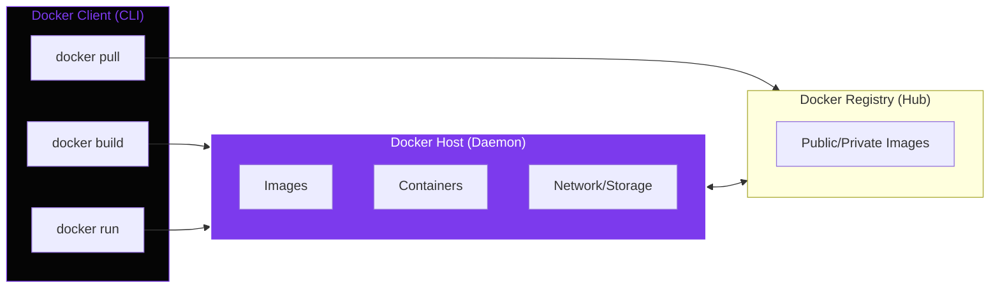

# DevOpsの基礎：Dockerとは何か？ 🐳

**DevOps Master** (#(DevOps Master)) ジャーニーの初日へようこそ。**ソフトウェアエンジニアリング**が「機械（コード）」を作る芸術であるならば、**DevOps**は、それらの機械を安全に、迅速に、そして大規模にユーザーへ届けるための「生産ラインと輸送システム」を構築する芸術です。

今日、私たちは **Docker** (#(Docker)) から始めます。これは、過去10年間で世界中のソフトウェア開発と運用のあり方を完全に変えたテクノロジーです。

---

## 🪝 THE HOOK：「自分のマシンでは動くのに」という悪夢

あなたが **フルスタックエンジニア** (#(Fullstack Developer)) で、**Node.js** (v24), **Python** (v3.13), **PostgreSQL** (v17) を使った素晴らしいECサイトを完成させたと想像してください。あなたのPCでは、すべてが完璧に動いています。自信を持って運用チーム（Ops）にコードを渡し、デプロイを依頼しました。

2時間後、スマホが震えます。上司の怒鳴り声が聞こえます。「システムがダウンした！なぜお前のPCでは動くのに、サーバーでは『Module Not Found』や『Database Connection Refused』だらけなんだ！？」。

必死にデバッグした結果、以下のことが判明しました：
- サーバーの **Node.js** は v18 で（古すぎる）。
- 画像処理ライブラリが、サーバーにインストールされていないOSのセキュリティパッチを必要としていた。
- サーバーの環境変数のスペルが1文字間違っていた。

これは IT業界で数十年前から続く古典的な苦しみ、**環境の不一致** (#(Environment Inconsistency)) です。統計によると、ソフトウェアエンジニアは業務ロジックとは関係のない「環境構築」や「環境起因のバグ修正」に時間の30〜40%を費やしています。

**Docker** は2013年に誕生し、2026年現在、IT業界の「共通言語」となりました。Dockerはあなたの世界全体を一つのコンテナにパッケージ化し、それがあなたのノートPCでも、クラウドでも、現代のエッジコンピューティングシステムでも、全く同じように動作することを保証します。

**💡 2026年アップデート:** 現在、Dockerfileを一行ずつ手書きする必要はありません。AIエージェントがソースコードを分析し、最も最適化され、セキュリティの高い（脆弱性ゼロの）Dockerイメージを数秒で自動生成してくれます。

---

## 🎭 ANALOGY：海上コンテナと料理のレシピ

コードを見ずに Docker を理解するために、海を見てみましょう。

### 1. コンテナ化（Containerization）
20世紀以前、国際輸送は悪夢でした。フランスからアメリカへワインを運ぶ船は、手作業で荷下ろしをしなければなりませんでした。樽、袋、箱… 荷物ごとに形が違うため、積み込みは遅く、破損も多発していました。

1956年、**マルコム・マクリーン**は標準的な **海上コンテナ** (#(Shipping Container)) で世界を変えました。一定のサイズの鉄の箱。トラックは「箱」を運ぶ方法だけを知っていればよく、船は「箱」を積み上げる方法を、クレーンは「箱」を持ち上げる方法だけを知っていればいいのです。中身がワインか、車か、おもちゃかは関係ありません。

**Docker** はソフトウェアに対して、まさにこれを行います。あなたのアプリを標準的な「コンテナ」に変えます。サーバーOSは、中身が Java か Python かを知る必要はありません。ただ **Dockerコンテナ** (#(Docker Container)) を実行する方法だけを知っていればいいのです。

### 2. 三種の神器：Dockerfile、イメージ、コンテナ
ピザのチェーン店を開くと想像してください：
- **Dockerfile** (#(Dockerfile))：**料理のレシピ** です。「小麦粉（Ubuntu）を1、チーズ（Node.js）を2用意し、自分のトッピング（ソースコード）をコピーする」と指示が書かれています。
- **イメージ** (#(Image))：**冷凍ピザ** です。レシピから「ビルド」コマンドを実行すると、パッケージ化された製品ができます。これは動きません。ただそこに静かに、不変（Immutable）の状態で存在します。このイメージは誰にでも送ることができます。
- **コンテナ** (#(Container))：オーブンから出たばかりの **熱々のピザ** です。イメージを「実行（run）」すると、RAM上の生きた実体になります。リソースを消費し、リクエストを処理し、新しいものを焼くために削除することもできます。

---

## ⚙️ UNDER THE HOOD：DockerのアーキテクチャとLinuxの魔法

多くの人が Docker をミニ **仮想マシン** (#(Virtual Machine) - VM) と勘違いしていますが、それは間違いです。Docker は独自のゲストOSを持たないため、VM よりも数十倍軽量です。

### 1. Dockerアーキテクチャ（クライアント・サーバーモデル）
Docker は **クライアント・サーバー** (#(Client-Server)) モデルで動作します：
- **Docker Client**：ターミナルに入力する `docker` コマンドライン。
- **Docker Host (Daemon)**：イメージとコンテナを管理するバックグラウンドプロセス。
- **Docker Registry**（例：**Docker Hub**）：世界中で共有されるイメージの「設計図」の保管庫。

### 2. 隔離（Isolation）の背後にある魔法
Docker はどうやって、同じマシン上で何百ものコンテナを互いに干渉させずに実行できるのでしょうか？ それは、**Linuxカーネル** (#(Linux Kernel)) の2つのコア機能のおかげです。

- **Namespaces** (#(Namespaces))：「仮想的な壁」を作ります。各コンテナは自分が世界にたった一つだと思い込みます。独自のプロセスプロセスID（PID）、ネットワークスタック、ユーザーを持ちます。
- **Control Groups (cgroups)** (#(Control Groups))：「ケチな執事」です。「このコンテナは最大 512MB の RAM と 20% の CPU しか使っちゃダメだぞ！」と制限をかけます。もし超えた場合、システムを守るためにそのコンテナは強制終了（**OOM Killed**）されます。

### 3. レイヤ化されたファイルシステム
`Dockerfile` の各行は **レイヤ（Layer）** (#(Layer)) を作成します。
- これらのレイヤは積み重ねられ、**読み取り専用（Read-only）** です。
- コンテナが実行されるとき、Docker はその上に薄い **書き込み可能レイヤ（Writable Layer）** を追加します。
- **メリット**：**Ubuntu** ベースのコンテナを10個実行していても、Docker はディスク上に1つの Ubuntu しか保存しません。劇的なリソース節約になります。

---

## 💻 DEVOPS IN PRACTICE：実戦的なケーススタディと面接

### 1. ケーススタディ：2日から2分へ
あるフィンテック企業では、新入社員の環境構築（適切なJavaバージョンのインストール、Maven、DB、環境変数設定など）に平均2営業日かかっていました。
Dockerを導入した後、彼らは新入社員に `docker-compose.yml` ファイルを渡すだけになりました。エンジニアがコマンドを1つ打つだけです：
`docker-compose up -d`
5つのサービスからなるシステム全体が2分で立ち上がりました。これが **生産性** (#(Productivity)) の力です。

### 2. シニア面接の質問：「DockerとVMの根本的な違いは？」
- **回答**: 
    - **VM**: ハードウェアレベルの仮想化。各VMが独自のカーネルを持ちます。重く（数GB）、起動も遅い（数分）。
    - **Docker**: OSレベルの仮想化。コンテナはホストサーバーのカーネルを共有します。軽く（数MB）、即座に起動します（ミリ秒）。
    - **トレードオフ**: VMは隔離レベルが高いため、より安全です。Dockerは高速で効率的ですが、カーネルを共有しているため、カーネルに脆弱性がある場合、全コンテナが影響を受ける可能性があります。

---

## 📝 QUICK QUIZ：DevOps神経チェック

1. **なぜ Dockerイメージは「Immutable（不変）」と呼ばれるのですか？**
    - A. 削除できないから。
    - B. 一度ビルドされると、イメージ内のレイヤの内容は決して変わらず、環境間での一貫性が保証されるから。
    - C. Linuxでしか動かないから。

2. **コンテナの RAM/CPU を制限する Linuxカーネルの機能はどれですか？**
    - A. Namespaces
    - B. Systemd
    - C. Control Groups (cgroups)

3. **Dockerfile とイメージの関係は何ですか？**
    - A. Dockerfile はイメージを実行した結果である。
    - B. Dockerfile は設計図（スクリプト）であり、イメージはその設計図を実行（ビルド）した後の製品である。
    - C. それらは同じものである。

---
**まとめ**: 今日は、Docker が「なぜ」存在するのかを理解しました。明日は、自分自身のアプリケーションをパッケージ化するための最初の設計図である **Dockerfile** を書いてみましょう。

📊 文字数: ~3500文字
