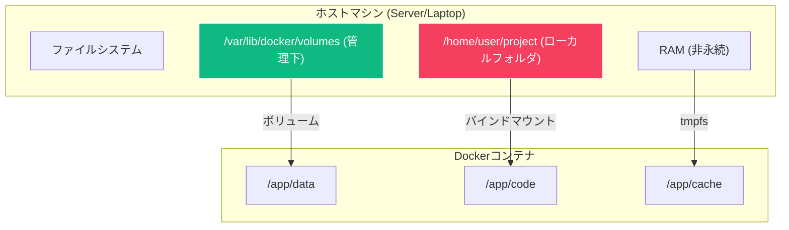

# Dockerのデータとネットワーク：永続ストレージと接続 🔌

Day 03へようこそ！最初の2日間はアプリケーションの「パッケージ化（ビルド）」に集中してきましたが、今日は**本番環境（Production）** (#(Production)) において生死を分ける2つの問いを解決します：
1. コンテナが削除されたとき、私のデータはどこへ行くのか？
2. コンテナ同士を安全に「会話」させるにはどうすればよいのか？

---

## 🪝 THE HOOK：一晩で「データベースが空」になる悲劇

あなたがブログアプリを運用していると想像してください。**MySQL** (#(MySQL)) データベースをコンテナ化し、非常にスムーズに動作しています。何百もの記事が投稿されました。

ある日、サーバーにエラーが発生し、再起動が必要になりました。あなたは古いコンテナを削除し、同じイメージから新しい `docker run` コマンドを実行しました。

Webサイトを開いてみると… **衝撃！** すべての記事、ユーザー、設定データが完全に消えていました。サイトはインストール直後の「真っさらな」状態に戻っています。

**何が起きたのでしょうか？** コンテナは **エフェメラル（Ephemeral）** (#(Ephemeral) - 一時的) な性質を持つように設計されています。コンテナ内で行ったすべての変更（ファイルの書き込み、DBの作成）は、**書き込み可能レイヤ（Writable Layer）** (#(Writable Layer)) 上にのみ存在します。コンテナが削除されると、このレイヤも一緒に消滅します。

あなたのプロジェクトでこのようなことを起こしてはいけません！今日は、コンテナのライフサイクルの影響を受けない「データの金庫」を構築する方法を学びます。

---

## 🎭 ANALOGY：ホテルの部屋と専用の金庫

### 1. Dockerストレージ：ホテルとスーツケース
コンテナを、旅行中に借りる **ホテルの部屋** に例えてみましょう。
- **コンテナ内のデータ**: 部屋の中に自分の荷物を広げるようなものです。チェックアウト（コンテナ削除）すると、ホテルのスタッフがすべて片付けてしまいます。
- **バインドマウント（Bind Mounts）**: 自宅から持ってきた **スーツケース** に荷物を入れておくようなものです。荷物は実際にはあなたの自宅（ホストマシン）にあり、ホテルの部屋でスーツケースを開けて使っているだけです。
- **ボリューム（Volumes）**: ホテルの管理部にある **専用の金庫** を借りるようなものです。この金庫はあなたの部屋の中にはなく、別の安全な管理区域にあります。部屋を移動しても、鍵さえあれば同じ金庫を開けることができます。

### 2. Dockerネットワーク：トランシーバーと交換手
- **ブリッジネットワーク（Bridge Network）**: 同じ周波数を使っている兵士のグループの **トランシーバー** のようなものです。電話番号（IP）を知らなくても、名前（コンテナ名）を呼ぶだけで通信できます。
- **ポートマッピング（Port Mapping）**: ホテルに一つの **代表電話番号** があるようなものです。外部のゲストが代表番号に電話をかけると、受付があなたの部屋番号に繋いでくれます。

---

## ⚙️ UNDER THE HOOD：ストレージの仕組みと仮想ネットワーク

### 1. Dockerストレージの種類
データの **永続化（Persistence）** (#(Persistence)) のために、3つの選択肢があります：

- **ボリューム（Volumes）** (#(Volumes))：Dockerによって完全に管理されます。データはホスト上の特別なディレクトリ（通常は `/var/lib/docker/volumes`）に置かれます。データベースにとって最も安全で推奨される方法です。
- **バインドマウント（Bind Mounts）** (#(Bind Mounts))：ホストマシン上のディレクトリをコンテナに直接マウントします。開発中（Develop）に自分のPC上のコード変更を即座にコンテナに反映させたい場合に非常に便利です。
- **tmpfs**：データを直接 **RAM** 上に保存します。爆速ですが、電源を切ると消去されます。機密データや一時的なキャッシュに使用されます。

### 2. Dockerネットワークドライバ
- **Bridge** (#(Bridge))：デフォルトのネットワーク。同じブリッジネットワーク内のコンテナ同士は IP で通信できます。カスタムブリッジを作成すれば、**コンテナ名** で互いを見つけることができます。
- **Host**：コンテナがホストサーバーの IP スタックを共有します。パフォーマンスは最高ですが、セキュリティ面では劣ります。
- **None**：コンテナは完全に孤立し、ネットワークアクセスがありません。
- **Overlay**：**複数のホストマシン** にまたがるコンテナ同士を接続するために使用されます（主に Kubernetes や Swarm で使用）。

---

## 💻 DEVOPS IN PRACTICE：Webアプリとデータベースの接続

実戦的なシナリオを見てみましょう：Node.js の Webアプリと MongoDB データベースがあります。

### ステップ 1：専用のプライベートネットワークを作成する
`docker network create my-app-net`

### ステップ 2：ボリューム（データの金庫）を指定してDBを実行する
`docker run -d --name db-mongo --network my-app-net -v mongo-data:/data/db mongo`
- `-v mongo-data:/data/db`: `mongo-data` という名前のボリュームを作成し、データを保持します。

### ステップ 3：名前を使ってDBに接続するWebアプリを実行する
`docker run -d --name my-web --network my-app-net -p 8080:3000 my-node-app`
- Webアプリのコード内では、アドレスとして `mongodb://db-mongo:27017` と記述するだけです。Docker が自動的に `db-mongo` という名前を内部 IP に「翻訳」してくれます。これを **サービスディスカバリ（Service Discovery）** (#(Service Discovery)) と呼びます。

---

## 📝 QUICK QUIZ：アーキテクト思考のチェック

1. **コンテナのポート 80 をホストのポート 8080 にマッピングするコマンドはどれですか？**
    - A. `-v 80:8080`
    - B. `-p 8080:80`
    - C. `--network 8080`

2. **なぜデフォルトのブリッジではなく、カスタムブリッジネットワークを使うべきなのですか？**
    - A. その方が速いから。
    - B. 固定 IP を使わなくても、コンテナ同士が名前（コンテナ名）で互いを見つけられるようになるから。
    - C. RAM の消費が少ないから。

3. **自分のマシンでコードを修正し、コンテナ内で即座に変更を確認したい場合、何を使うべきですか？**
    - A. Docker ボリューム
    - B. Docker イメージレイヤ
    - C. バインドマウント

---
**まとめ**: あなたは Docker の「筋肉」（ネットワーク）と「足」（ストレージ）をマスターしました。明日は、個別のコマンドを実行するのをやめ、**Docker Compose** を使ってシステム全体の「軍団を指揮する」方法を学びます。

📊 文字数: ~3800文字
