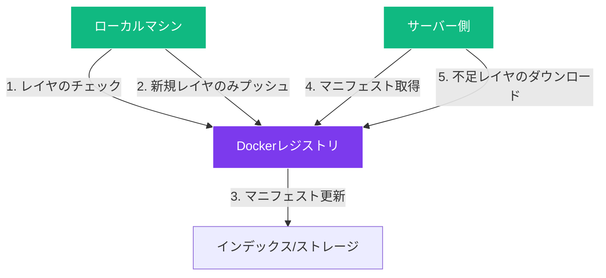

# Dockerレジストリとイメージ配信：イメージの管理と配布 🌐

Day 06へようこそ！Linuxとコンテナ化の基礎を学んだ一週間を経て、今日はソフトウェア界の「ロジスティクス（物流）」の課題を解決します。

自分のローカルマシンで素晴らしい Docker イメージをビルドしたとして、アメリカやシンガポールにいる顧客のサーバーがそれを数秒でダウンロードして実行できるようにするにはどうすればよいでしょうか？ また、更新したバージョンが最新かつ安全であることをどうやって保証するのでしょうか？ その重要な役割を担うのが **Dockerレジストリ** (#(Docker Registry)) です。

---

## 🪝 THE HOOK：「デプロイの混乱」という悲劇と致命的な Version 1.0

運命の金曜日。あなたは重大なバグを修正し終えました。イメージをビルドし、タグに `latest` を付け、自信満々に `docker push` で Docker Hub にアップロードしました。

10分後、システム全体がダウンしました。なぜでしょうか？
- 運用チーム（Ops）がデプロイのために自動的に `latest` イメージをプルしました。
- しかし、あなたがプッシュした数秒後に、別の同僚が（十分にテストされていない）別の `latest` イメージをプッシュしてしまったのです。
- あなたのシステムは今、中身が誰も正確に把握していない「ギャンブルのような」バージョンで動いています。

さらに深刻なことに、会社の重要なソースコードを含むイメージを **パブリックレジストリ（Public Registry）** に保存し、プライベート設定にするのを忘れてしまったら、競合他社が `docker pull` 一発であなたの「知的財産」をすべてダウンロードできてしまいます。

**Dockerレジストリ** と **タグ戦略（Tagging Strategy）** (#(Tagging Strategy)) をマスターすることは、単なる技術スキルではなく、DevOps Master としての「生存スキル」なのです。

---

## 🎭 ANALOGY：国立図書館と App Store

Docker がイメージをどのように配布するかを理解するために、身近な2つのモデルで考えてみましょう。

### 1. 図書館（Docker Hub）
**Docker Hub** は **国立図書館** のようなものです。
- そこには、誰もが必要とする「古典的な名著」（Ubuntu, Nginx, MySQL）があります。これらは信頼できる組織によって検証され、署名されています（**公式イメージ**）。
- あなた自身も「本」を書いて図書館に納本できます。公開エリアに置けば、誰でも借りて読むことができます。
- もし「門外不出のレシピ」があるなら、その図書館の中に **専用の金庫（プライベートリポジトリ）** を借りる必要があります。

### 2. App Store（イメージのバージョニング）
スマホのアプリの更新方法を見てください。
- `Facebook-latest` という名前のアプリはありません。`v241.0.1` のようなバージョンが表示されます。
- このバージョニングにより、どのビルドを使っているかを正確に把握できます。新バージョンにバグがあれば、簡単に旧バージョンを「入れ直す」ことができます（**ロールバック**）。
- **イメージレイヤ（Layer）** (#(Layer)) は更新パッチのようなものです。500MB のアプリ全体を再ダウンロードする代わりに、スマホは 50MB の修正分だけをダウンロードします。Docker も同様に、変更されたレイヤだけを配信するため、帯域幅を劇的に節約できます。

---

## ⚙️ UNDER THE HOOD：イメージという箱の中身

### 1. イメージのタグ付け（命名の芸術）
完全なイメージ名（Full Image Name）の構造は以下の通りです：
`[Registry_URL]/[Namespace]/[Repository_Name]:[Tag]`

例：`ghcr.io/google/my-app:v1.2.3`
- `ghcr.io`: 保管場所のアドレス（GitHub Container Registry）。
- `google`: 組織名またはユーザー名。
- `my-app`: アプリケーション名。
- `v1.2.3`: 特定のバージョン。

**鉄則**: 本番環境（Production）で `latest` を使ってはいけません。`v1.0.0` のような **セマンティックバージョニング（Semantic Versioning）** (#(Semantic Versioning) - SemVer) や、**Git Commit SHA** を使って一意性を保証してください。

### 2. コンテンツ・アドレッサブル・ストレージ
Dockerレジストリはイメージをファイル名で保存するのではなく、**ダイジェスト（Digest）** (#(Digest) - SHA256 ハッシュ) で保存します。
タグ名が何であれ、イメージの内容が全く同じであれば、同じダイジェストを共有します。これにより、データの改ざんを防ぐことができます。

### 3. プッシュとプルの流れ（Push & Pull Flow）
`docker push` を実行すると：
1. クライアントは、どのレイヤがすでにレジストリにあるかをチェックします（ハッシュ値を使用）。
2. レジストリにない「新しい」レイヤだけがアップロードされます。
3. レジストリは **マニフェスト（Manifest）** を更新し、新しいタグがそれらのレイヤを指すように記録します。

---

## 💻 DEVOPS IN PRACTICE：自分専用の「宝物庫」を構築する

### 1. ログインと Docker Hub へのプッシュ
`docker login`
`docker tag my-app:local myuser/my-app:v1.0.1`
`docker push myuser/my-app:v1.0.1`

### 2. プライベートレジストリの運用（ローカル）
セキュリティ上の理由でイメージをインターネットに出したくない場合、Docker を使って自分たちでレジストリを動かすことができます。

`docker run -d -p 5000:5000 --name my-local-registry registry:2`

これで「社内金庫」にプッシュできるようになります：
`docker tag app:v1 localhost:5000/app:v1`
`docker push localhost:5000/app:v1`

### 3. 電光石火のロールバック戦略
`v1.0.2` にエラーが発生したとき、DevOps Master はすぐにコードを直し始めたりしません。最初のアクションはこれです：
`docker pull my-app:v1.0.1` （最後に確認された安定版）
`docker run ...`
システムは30秒で安全な状態に戻ります。その後、ゆっくりと `v1.0.2` の失敗原因を分析します。これが **Reliability First（信頼性第一）** (#(Reliability First)) の考え方です。

---

## 🛡️ SECURITY：シークレット管理とイメージスキャン

`.env` ファイルや API キーを含むイメージをレジストリにプッシュしてしまうのは致命的なミスです。
- **Docker Scan**: 常に `docker scan [image_name]` を実行し、イメージ内のライブラリに脆弱性（CVE）がないか確認しましょう。
- **イメージ署名**: **Docker Content Trust** (#(Docker Content Trust)) を使用して、イメージに電子署名をします。サーバーは、正当な署名がないイメージの実行を拒否し、ハッカーによる「すり替え」を防止します。

---

## 📝 QUICK QUIZ：物流マスターの挑戦

1. **本番環境で 'latest' タグを使用するのが極めて危険な理由は何ですか？**
    - A. ディスク容量を多く消費するから。
    - B. 一貫性が保証されないため。'latest' タグが付いたイメージは、システムが知らない間にいつでも内容が更新される可能性があるから。
    - C. Docker の動作が遅くなるから。

2. **完全な Docker イメージ名は何で構成されていますか？**
    - A. アプリケーション名だけでよい。
    - B. アプリ名とビルド日時。
    - C. レジストリURL、名前空間、リポジトリ名、およびタグ。

3. **イメージをレイヤで保存することの最大の利点は何ですか？**
    - A. イメージの見栄えが良くなる。
    - B. 異なるイメージ間で共通のレイヤを再利用することで、帯域幅とストレージ容量を節約できる。
    - C. ハッカーの侵入が難しくなる。

---
**まとめ**: あなたはソフトウェアの「貨物」をパッケージ化し、世界中に届ける方法を学びました。しかし、運用は常にバラ色ではありません。明日は、コンテナが深夜に「突然死」したときに、どのように「手がかりを追う」か（トラブルシューティング）を学びます。

📊 文字数: ~4000文字
