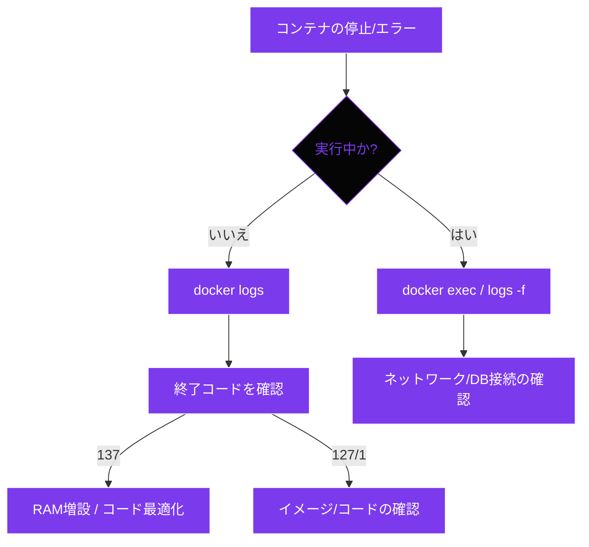

# コンテナのトラブルシューティングとライフサイクル：実戦デバッグ 🔍

Phase 1 の折り返し地点へようこそ！今日は文字通り「実戦」の日です。DevOps の世界では、あなたの仕事は構築（Build）するだけでなく、修理（Fix）することでもあります。

本番環境では数千ものコンテナが動いており、いつ何時、どれかが「突然死」するかわかりません。あなたの任務は技術的な探偵となり、痕跡（ログ）を辿って最短時間で事故の原因を突き止めることです。

---

## 🪝 THE HOOK：深夜の「CrashLoopBackOff」トラブル

あなたがぐっすり眠っていると、監視システムから通知が届きます。「決済アプリがダウンしました！」。パソコンを立ち上げて確認すると、コンテナが **Exited** 状態になっています。再起動を試みますが、5秒間動いて…また停止します。

再起動、停止。再起動、停止。この現象を **CrashLoopBackOff** (#(CrashLoopBackOff)) と呼びます。
- コンソールには何のエラーも表示されません。
- コンテナが5秒以上「生存」しないため、SSH で中に入ることもできません。
- 上司は聞いてきます。「いつ復旧するんだ？」。

Docker の診断ツールを使いこなせなければ、「試行 → 失敗 → 再試行 → 再び失敗」という絶望のループに陥ります。今日は、コンテナの「魂」を読み解く方法を学びます。

---

## 🎭 ANALOGY：かかりつけ医と飛行機のブラックボックス

### 1. コンテナのライフサイクル：誕生から消滅まで
コンテナを **陸上競技の選手** に例えてみましょう：
- **Created**: スタートラインに立ち、準備はできているが、まだ走行開始の合図を待っている状態。
- **Running**: トラック（RAM）上を全力疾走している状態。
- **Paused**: 水を飲んで一休みしている状態。すべての状態がその場で凍結されます。
- **Exited**: レースを完走した（あるいは途中で怪我をした）ため、スタジアムを去った状態。

### 2. トラブルシューティング：飛行機のブラックボックス（ログ）
航空機事故が起きたとき、最初に探されるのは **ブラックボックス** です。
- **Docker Logs** はまさにそのブラックボックスです。アプリケーションが「死ぬ」直前までの、あらゆる呼吸や救いを求める声を記録しています。
- **Docker Inspect** はレントゲン写真のようなものです。コンテナの内部構造、血管（ネットワーク）、骨組み（ボリューム）を可視化します。

---

## ⚙️ UNDER THE HOOD：終了コード（Exit Codes）と診断ツール

### 1. 最後の言葉（Exit Codes）を解読する
コンテナがクラッシュすると、必ず謎の数字を残します。これはコンテナの「遺言」です：
- **Exit Code 0**: 「老衰」による死（タスクの正常完了）。
- **Exit Code 1**: 一般的なエラー（コードのバグによるアプリのクラッシュ）。
- **Exit Code 137**: OSによって「暗殺」された状態 (**SIGKILL**)。通常は RAM の使いすぎ (**OOM - Out of Memory**) が原因です。
- **Exit Code 127**: 「コマンドが見つかりません」エラー。`python` を実行するように指示したが、イメージ内に Python が入っていない場合などです。

### 2. Docker「探偵」ツールキット
調査のために、以下の4つのコマンドをマスターする必要があります：

- **docker logs -f [id]**: リアルタイムでログを追跡します。原因の99%はここにあります（DB接続エラー、構文エラー、環境変数の不足など）。
- **docker inspect [id]**: 詳細な JSON 設定を表示します。IP が正しいか、ボリュームが正しい場所にマウントされているかを確認するのに役立ちます。
- **docker stats**: リソースの実際の消費量（CPU, RAM）を表示します。「大食い」なコンテナを特定するのに役立ちます。
- **docker exec -it [id] /bin/sh**: 実行中のコンテナの「内部」に飛び込んで、ファイルシステムをチェックします。注：コンテナが **Running** 状態である場合にのみ使用可能です。

### 3. マスターレベルの診断フロー

---

## 💻 DEVOPS IN PRACTICE：ケーススタディ「消えるコンテナ」

状況：Nginx コンテナを実行しましたが、起動直後に成功を報告してすぐに `Exit 0` で終了してしまいます。
実行コマンド：`docker run -d nginx`
結果：コンテナがバックグラウンドで動いていません。

**マスターの分析**: 
Docker コンテナは、それが管理するメインプロセス（PID 1）が動いている間だけ生存します。Nginx はデフォルトで「デーモン（バックグラウンド）」モードで動作します。Nginx がバックグラウンドに回ると、Docker のメインプロセスが終了したとみなされ、コンテナも自動的に停止します。
**解決策**: Nginx を「フォアグラウンド」で動かすように指示する必要があります：
`docker run -d nginx nginx -g 'daemon off;'`

これは初心者が最も陥りやすいミスです：**フォアグラウンドとバックグラウンドプロセス** (#(Foreground vs Background Processes)) の違いを理解していないことが原因です。

---

## 🛡️ BEST PRACTICES：トラブルの荒波を乗り越える

1. **ヘルスチェック（Health Checks）**: Dockerfile や Compose 内で常にヘルスチェックコマンドを定義しましょう。「200 OK を返したときだけ生存とみなす」といった設定です。
2. **再起動ポリシー（Restart Policies）**: `--restart unless-stopped` を使用しましょう。一時的なエラーでコンテナが落ちた場合、Docker が自動的に蘇生させてくれます。
3. **ログローテーション（Log Rotation）**: ログファイルがディスクを埋め尽くすまで放置してはいけません。サイズ制限（例：10MB）を設けて `json-file` ドライバを設定しましょう。

---

## 📝 QUICK QUIZ：診断エンジニアへの挑戦

1. **Exit Code 137 は通常何を意味しますか？**
    - A. アプリケーションがタスクを完了した。
    - B. OSによってコンテナが強制停止された。通常は RAM の過負荷（OutOfMemory）が原因。
    - C. データベースのパスワードが間違っている。

2. **実行中のコンテナの内部に入ってコマンドを入力するためのコマンドはどれですか？**
    - A. `docker inspect`
    - B. `docker exec -it`
    - C. `docker logs`

3. **コンテナが 'Running' 状態を維持するための条件は何ですか？**
    - A. サーバーがインターネットに接続されていること。
    - B. コンテナ内のメインプロセス（PID 1）がアクティブであること。
    - C. Webサイトを頻繁にクリックすること。

---
**まとめ**: あなたはコンテナの「診断」スキルをマスターしました。しかし、一つずつ個別に修理するのは疲れます。明日は、**Docker Compose** に戻りますが、より高いレベルで、ヘルス管理、環境変数、そして大規模システム全体の自動化について学びます。

📊 文字数: ~4200文字
