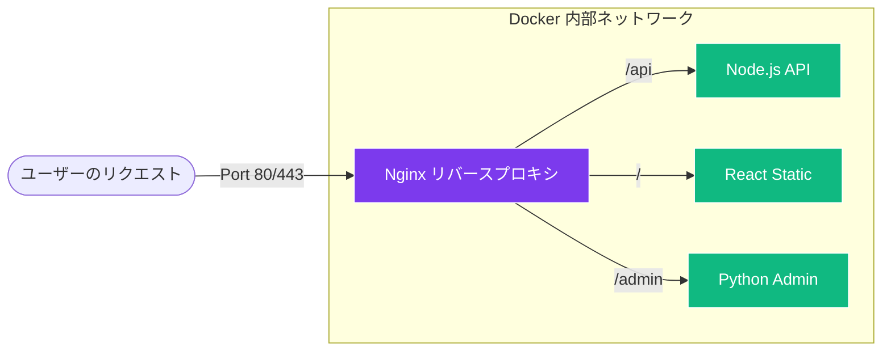

# ネットワークの深掘りとリバースプロキシ：トラフィックの制御 🌐

Day 09へようこそ！これまでに、同じネットワーク内でコンテナを相互に接続する方法を学びました。しかし、本番環境の厳しい現実はこうです：サーバーが持つパブリック IP アドレスは通常1つだけで、開放されているポートも 1〜2 個（HTTP 用の 80 番や HTTPS 用の 443 番など）に限られています。

アプリA、アプリB、アプリCを同時に動かし、ユーザーが `a.com`, `b.com`, `c.com` と入力するだけで正しい目的地に誘導するにはどうすればよいでしょうか？ そこで必要になるのが **リバースプロキシ** (#(Reverse Proxy)) です。

---

## 🪝 THE HOOK：「ポート衝突（Port Conflict）」という悲劇

あなたが1台の VPS 上で、クライアントのために3つの異なるプロジェクトをデプロイしていると想像してください。
- プロジェクト 1: Nginx が 80 番ポートで動作中。
- プロジェクト 2: これも Nginx を 80 番ポートで動かしたい。
- プロジェクト 3: さらに別の Web アプリも 80 番ポートを必要としている。

2つ目のプロジェクトのために `docker run -p 80:80 ...` を実行した瞬間、Docker デーモンから「拒絶」されます：
`Error response from daemon: driver failed programming external connectivity on endpoint ... Bind for 0.0.0.0:80 failed: port is already allocated.`

あなたには2つの選択肢があります：
1. VPS をあと3台追加で購入する（コストがかさむ）。
2. `8081` や `8082` のような非標準ポートで動かす（極めて不評です。`domain.com:8081` と入力したいユーザーはいません）。

**DevOps Master** はどちらも選びません。彼らは 80 番ポートにたった1つの「門番」を配置し、すべての流入トラフィックを適切に振り分けます。

---

## 🎭 ANALOGY：ホテルの受付と配送会社

### 1. リバースプロキシ：ホテルの受付係
あなたのサーバーを **ホテル** だと考えてみましょう。
- 顧客（ユーザー）はホテルのメインアドレス（住所）しか知りません。彼らはまず **受付（リバースプロキシ - Nginx）** にやってきます。
- ある顧客が「経理部に会いたい」と言います。受付係は彼を 201 号室（バックエンドコンテナ）に案内します。
- 別の顧客が「レストランのメニューを見たい」と言います。受付係は彼を 105 号室（フロントエンドコンテナ）に案内します。
顧客は具体的な部屋番号を知る必要はありません。ただ受付係と話せばよいのです。

### 2. Docker DNS：社内通称
大きな会社では、従業員は社会保障番号（IPアドレス）ではなく、名前（「佐藤さん」「田中さん」）で呼び合います。
**Docker DNS** を使えば、コンテナAは Compose ファイルで定義した「サービス名」を使ってコンテナBを呼び出すことができます。コンテナBがクラッシュして全く新しい IP アドレスで再起動したとしても、その「名前」は変わらないため、接続が途切れることはありません。

---

## ⚙️ UNDER THE HOOD：ドライバと転送の仕組み

### 1. Docker ネットワークドライバ（深掘り）
- **Bridge（ブリッジ）**: 仮想スイッチを作成します。コンテナは独自の IP 範囲（通常は `172.x.x.x`）を持ちます。ほとんどのアプリケーションのデフォルトの住処です。
- **Host（ホスト）**: すべての障壁を取り払います。コンテナはホストサーバーの IP とポートを直接共有します。極めて高速ですが、セキュリティ面では非常に脆弱です（アプリがホストサーバーを乗っ取ることが可能になります）。
- **Overlay（オーバーレイ）**: 異なる物理サーバー間（例：Google Cloud と AWS）にあるコンテナを接続する「魔法」です。

### 2. リバースプロキシ vs 正方向（フォワード）プロキシ
- **フォワードプロキシ**: ユーザーがインターネットにアクセスするために「ファイアウォールを乗り越える」のを助けます（ユーザーの正体を隠します）。
- **リバースプロキシ**: サーバーの前に立ち、クライアントを迎え入れます（サーバーの内部構造を隠します）。

### 3. Nginx - リバースプロキシの王
Nginx が非常に強力なのは、その **イベント駆動型アーキテクチャ（Event-driven）** (#(Event-driven)) によるものです。メモリ消費を最小限に抑えながら、数万件の同時接続を処理することができます。



---

## 💻 DEVOPS IN PRACTICE：Nginx によるトラフィック制御

シナリオ：フロントエンドアプリとバックエンドアプリがあります。Nginx を使ってトラフィックを振り分けたいとします。

### 1. 設定ファイル `nginx.conf`
```nginx
server {
    listen 80;
    server_name myapp.com;

    location / {
        proxy_pass http://frontend:3000; # Docker 内のサービス名を指定
    }

    location /api {
        proxy_pass http://backend:5000; # /api で始まるリクエストを振り分け
    }
}
```

### 2. すべてを接続する `docker-compose.yml`
```yaml
services:
  nginx:
    image: nginx:alpine
    volumes:
      - ./nginx.conf:/etc/nginx/conf.d/default.conf:ro
    ports:
      - "80:80"
    depends_on:
      - frontend
      - backend

  frontend:
    build: ./client
    # 外部にポートを公開する必要はありません

  backend:
    build: ./server
    # ポートを公開する必要はありません（絶対的なセキュリティ）
```

**メリット**: バックエンドは完全に内部ネットワーク内に隠蔽されます。ハッカーはバックエンドの 5000 番ポートを直接攻撃することはできません。なぜなら、そのポートはインターネットに開放されていないからです。すべてのトラフィックは Nginx のフィルターを通過しなければなりません。

---

## 🛡️ ADVANCED：負荷分散（Load Balancing）と SSL

- **負荷分散（ロードバランシング）**: アプリが過負荷になった場合、3つのバックエンドを実行できます。Nginx は **ラウンドロビン（Round Robin）** 方式で自動的にリクエストをそれらに振り分けます。
- **SSL ターミネーション**: Nginx が HTTPS の復号（443 番ポート）を担当します。内部サービスはリソース節約のために単純な HTTP で動作させることができます。これを **SSL オフロード（Offloading）** (#(Offloading)) と呼びます。

---

## 📝 QUICK QUIZ：ネットワークエンジニアへの挑戦

1. **バックエンドのポートを直接公開せず、リバースプロキシの背後に配置すべき理由は何ですか？**
    - A. アプリの実行速度を上げるため。
    - B. セキュリティを強化（内部システムを隠蔽）し、SSL 証明書の管理や負荷分散を1か所で容易に行えるようにするため。
    - C. Docker がそれを強制しているから。

2. **同じ Docker ネットワーク内のコンテナAがコンテナBにリクエストを送信する場合、どのアドレスを使用すべきですか？**
    - A. サーバーのパブリック IP アドレス。
    - B. 設定ファイルで定義された「サービス名」。
    - C. `localhost`。

3. **最小限のリソースで多数の同時接続を処理できる Nginx の機能は何ですか？**
    - A. マルチスレッド。
    - B. イベント駆動型アーキテクチャ。
    - C. 機械学習。

---
**まとめ**: あなたはプロフェッショナルで複雑なネットワークシステムを構築する方法を学びました。明日は Phase 1 の最終日です。攻撃や、最もありがちな「うっかりミス」から自分の成果を守るための **Docker Security** について学びます。

📊 文字数: ~4500文字
