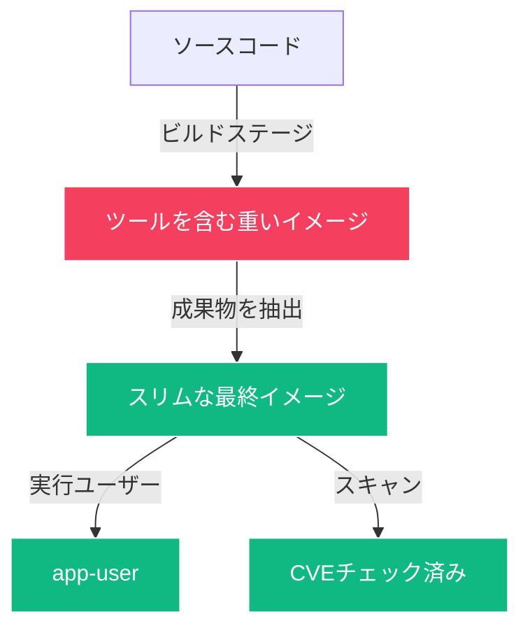

# Dockerのセキュリティとベストプラクティス：根本からの保護 🛡️

**Phase 1: Foundations & Containers** の最終レッスンへようこそ！構築、運用、そしてオーケストレーションの方法を習得してきました。しかし、もしシステムがハッカーに侵入されたり、単純な設定ミスでダウンしてしまえば、それまでの苦労はすべて台無しになってしまいます。

今日は、**Docker Security** (#(Docker Security)) について学びます。DevOps におけるセキュリティとは、プロジェクトの最後に「鍵」をかけることではありません。コードの最初の1行目から「安全への本能」を組み込んでいく作業なのです。

---

## 🪝 THE HOOK：「コンテナ脱出（Container Escape）」と Root 権限の悲劇

Docker を使ってシンプルな Web アプリを動かしていると想像してください。ユーザー設定を行っていないため、Docker はデフォルトでアプリを **root** (#(root)) 権限で実行しています。

ハッカーがあなたのコードに脆弱性（例：**リモートコード実行 - RCE**）を見つけました。アプリが root で動いているため、ハッカーはコンテナ内で全権限を持ちます。さらに深刻なのは、環境設定を誤っていた場合（例：Docker ソケットファイルを誤ってコンテナにマウントしていた場合）です。ハッカーは **コンテナ脱出（Container Escape）** (#(Container Escape)) を実行し、物理ホストサーバー全体の制御権を奪い取ることができます。

わずか数分のうちに：
- データベースがすべて消去されます。
- 会社の API キーが盗まれます。
- あなたのサーバーは、ハッカーのための仮想通貨マイニングマシンへと変貌します。

これらすべては、あなたが単純なユーザー設定を「面倒くさがった」ために起きたことです。今日、その無防備さに終止符を打ちましょう！

---

## 🎭 ANALOGY：要塞と F1 レーシングカー

### 1. ゼロトラスト（Zero Trust）：難攻不落の要塞
コンテナを鋼鉄の壁だと思わないでください。内部にいる全員が裏切り者である可能性がある **要塞** だと考えてください。
- **最小権限の原則（Least Privilege）** (#(Least Privilege)): 兵士には、絶対に必要な武器だけを持たせます。料理人に武器庫の鍵は必要ありません（アプリに Root 権限は不要です）。
- **堅牢化（Hardening）**: すべての穴を塞ぎ、不要な通路を排除します。Web サービスのみを動かすアプリなら、イメージ内に Bash や SSH ライブラリをインストールしてはいけません。

### 2. ベストプラクティス：F1 レーシングカー
F1 マシンが極めて速いのは、不要なものをすべて削ぎ落としているからです。
- **スリムなイメージ（Slim Image）**: 1GB のイメージはゴミを満載したトラックのようなもので、制御が難しく、ウイルスが隠れる場所もたくさんあります。50MB のイメージは F1 マシンのように、エンジンとタイヤだけで構成され、極めて安全で高速です。

---

## ⚙️ UNDER THE HOOD：DevOps Master の「黄金の10戒」

### 1. 常に非ルート（Non-root）ユーザーを使用する
Docker はデフォルトで Root で動作しますが、あなたのアプリケーション（Node, Python, Go）がそのレベルの権限を必要とすることはまずありません。
**マスターのテクニック**: Dockerfile 内で常に標準ユーザーを作成しましょう。
```dockerfile
RUN addgroup -S appgroup && adduser -S appuser -G appgroup
USER appuser
```

### 2. 脆弱性スキャン（Vulnerability Scanning）
IT の世界は刻一刻と変化しています。今日安全なライブラリでも、明日には脆弱性が見つかるかもしれません。以下のコマンドを活用しましょう：
`docker scan my-app:v1.0`
これにより、すべての脆弱性が深刻度（High, Medium, Low）とともにリストアップされます。

### 3. イメージ内にシークレット（Secret）を保存しない
イメージは「リバースエンジニアリング（逆解析）」が可能です。
- **間違い**: `ENV DB_PASSWORD=123456`
- **正解**: 実行時に渡される環境変数を使用するか、AWS Secrets Manager や HashiCorp Vault などのシークレットプロバイダーを使用します。

### 4. .dockerignore（ゴミ取りフィルター）の使用
`node_modules` や `.git`、個人的なドキュメントを Docker デーモンに送信してはいけません。ビルドプロセスが遅くなるだけでなく、機密情報の漏洩につながります。

### 5. マルチステージビルド（再訪）
**攻撃対象領域（Attack Surface）** を減らすための究極の秘策です。ステージ 1 でアプリをビルドし、その成果物（バイナリやファイル）だけをステージ 2（Alpine/Distroless イメージ）にコピーします。最終的なイメージにはコンパイラもソースコードも含まれないため、たとえハッカーが侵入しても、破壊活動を行うためのツールが手に入りません。



---

## 💻 DEVOPS IN PRACTICE：「鉄壁」の Dockerfile

これまでに学んだすべての知識を凝縮した、最高標準の Dockerfile を見てみましょう：

```dockerfile
# --- ステージ 1: ビルド ---
FROM node:18-alpine AS builder
WORKDIR /app
COPY package*.json ./
RUN npm ci
COPY . .
RUN npm run build

# --- ステージ 2: 本番用 ---
FROM node:18-alpine
# Rootを使用しないことでセキュリティを確保
RUN addgroup -S nodeapp && adduser -S nodeapp -G nodeapp
WORKDIR /app

# 前のステージから成果物のみをコピー
COPY --from=builder /app/dist ./dist
COPY --from=builder /app/node_modules ./node_modules
COPY package.json .

# 権限を制限
USER nodeapp

# 内部ヘルスチェック
HEALTHCHECK --interval=30s --timeout=3s \
  CMD curl -f http://localhost:3000/health || exit 1

EXPOSE 3000
CMD ["node", "dist/main.js"]
```

---

## 📝 QUICK QUIZ：Phase 1 最終試験

1. **コンテナ内でアプリケーションを Root 権限で実行すべきでない理由は何ですか？**
    - A. Root 権限を使うとコンテナの起動が遅くなるから。
    - B. アプリの脆弱性を突いてコンテナに侵入された際、ハッカーに物理ホストサーバーまで乗っ取られるリスクを防ぐため。
    - C. Root 権限は RAM を多く消費するから。

2. **イメージのビルドプロセスから機密ファイルを除外するために使用するのはどれですか？**
    - A. `docker rm`
    - B. .dockerignore
    - C. .gitignore

3. **「攻撃対象領域（Attack Surface）」という用語は何を意味しますか？**
    - A. ハードディスクの物理的なサイズ。
    - B. ハッカーが悪用できる脆弱性、開放されたポート、不要なライブラリなどの総称。イメージが小さいほど、この領域も小さくなる。
    - C. アンチウイルスソフトのインターフェース。

---
**Phase 1 のまとめ**: おめでとうございます！ あなたは正式に **コンテナ・スペシャリスト（Container Specialist）** となりました。Linux、Docker、Compose、そして Security の基礎をすべて習得しました。これがあなたの強固な土台となります。

明日からは **Phase 2: CI/CD & Automation** (#(Phase 2: CI/CD & Automation)) に入ります。これまでの手動操作を、すべて完全に自動化されたサイクルへと変貌させていきます。自動化の世界でお会いしましょう！

📊 文字数: ~4600文字
