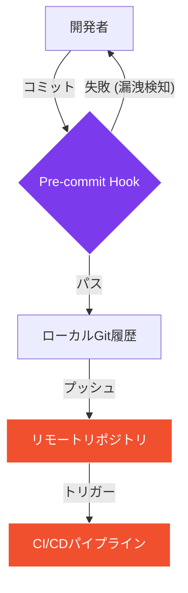

# DevOpsのためのGit：単なるコード保存場所ではない 🔗

**Phase 2: CI/CD & Automation** へようこそ！最初の10日間で、Docker を使って「貨物（アプリ）」をパッケージ化し、安全に保つ基礎を学びました。今日からは、**自動化された生産ライン（Automated Assembly Line）** (#(Automated Assembly Line)) の構築を始めます。そして、そのラインの心臓部となるのが **Git** (#(Git)) です。

Git を単にコードを `commit` して `push` するための場所だと思っているなら、今日のレッスンでその考えが変わるでしょう。DevOps エンジニアにとって、Git は **唯一の真実のソース（Source of Truth）** (#(Source of Truth)) であり、運用システム全体を動かす唯一のトリガーなのです。

---

## 🪝 THE HOOK：「マージコンフリクト」の悲劇とデプロイの崩壊

50人の開発者が共同で進めている大規模なプロジェクトを想像してください。
- 開発者Aが決済ゲートウェイの軽微なバグを修正しました。
- 開発者Bがセキュリティライブラリを更新しました。
- 二人は無秩序に `main` ブランチへ `push` しました。

CI/CD システムは新しいコードを自動的に検知してイメージのビルドを開始し、サーバーへデプロイします。
ドーン！ Web サイト全体がクラッシュしました。
- なぜでしょうか？ 開発者AとBのコードが干渉し合っていたのに、マージプロセスで誰もそれを制御していなかったからです。
- さらに深刻なのは、コミットメッセージが「Update」「Fix bug」「Final final final」ばかりで、サーバーで動いているのが誰のどのコミットなのか、正確に把握している人が誰もいないことです。

標準化された **Git 戦略（Git Strategy）** (#(Git Strategy)) がなければ、Git は巨大なゴミ捨て場と化し、自動化ツールは単に「ゴミをより速くサーバーへ送り込むための道具」に成り下がってしまいます。

---

## 🎭 ANALOGY：航空管制官と船長の航海日誌

### 1. Git 戦略：航空管制（ATC）
空港にたった一本の滑走路（`main` ブランチ）があると想像してください。
- すべての飛行機（機能コード）が好きな時に着陸しようとすれば、大惨事は免れません。
- DevOps は **着陸ルール**（ブランチ戦略）を作成します。飛行機はまず待機空域（フィーチャーブランチ）に入り、技術検査（プルリクエストとコードレビュー）を受け、管制塔から許可（マージ承認）が出た時に初めて `main` への着陸が許されます。

### 2. コンベンショナル・コミット（Conventional Commits）：船長の航海日誌
- 悪い船長は日誌にこう書きます。「今日は天気がいい」「何かが起きた」。船が沈没したとき、誰も何が起きたのか理解できません。
- マスターレベルの船長はこう書きます：`feat(engine): エンジンをV2にアップグレード`, `fix(radar): 信号消失を修理`。
この日誌を見れば、自動化システムは自動的に理解できます。「なるほど、新機能（feat）が追加されたな。アプリのバージョンを上げよう（Bump version）！」。

---

## ⚙️ UNDER THE HOOD：「進歩的」な Git 思考

### 1. ブランチ戦略（Branching Strategies）
マスターすべき主要な2つの流派があります：
- **Gitflow** (#(Gitflow)): 複数の長期ブランチ（`develop`, `master`, `release`）に分けます。リリースサイクルが比較的長く、確実性が求められるプロジェクトに適しています。
- **トランクベース開発（Trunk-based Development）** (#(Trunk-based Development)): 全員が1つのメインブランチ（トランク）で作業します。小さく、速く、継続的に。これは Google や Netflix のような高度な DevOps を実践する企業の「十八番」です。

### 2. コンベンショナル・コミット（標準化されたコミットメッセージ）
コンピューターがあなたのコミットを読み取れるように、以下の構造を使用します：
`<type>[optional scope]: <description>`
- `feat`: 新機能。
- `fix`: バグ修正。
- `docs`: ドキュメントの更新。
- `chore`: 雑用（ライブラリの更新、設定変更など）。

### 3. Git Hooks：セキュリティの「罠」
Git Hooks は、Git のアクション（コミットやプッシュなど）の際に自動的に実行されるスクリプトです。
- **pre-commit**: コミットする直前に、構文エラー（Lint）を自動スキャンしたり、誤って API キーをコミットしようとしていないかチェックしたりします。エラーがあればコミットを阻止します。素晴らしいと思いませんか？



---

## 💻 DEVOPS IN PRACTICE：Git Hooks による自動化

シナリオ：チームの誰もが、エラーチェック（Linting）を通さずにコードをプッシュできないようにしたいとします。

### ステップ 1：Husky（フック管理ツール）のインストール
Node.js プロジェクトの場合：
`npx husky-init && npm install`

### ステップ 2：Pre-commit スクリプトの作成
`.husky/pre-commit` ファイルを開き、以下を記述します：
```bash
#!/bin/bash
npm run lint
npm test
```

これで、コードにエラーが残っている限り、`git commit` することはできなくなります。これが、DevOps がコードの「純粋性」を根元から守る方法です。

### 面接での質問：「Git Rebase と Git Merge、どちらをいつ使うべきか？」
- **回答**: 
    - **Merge**: 履歴をすべて保持し、マージコミットを新しく作成します。複雑な歴史的経緯を残したい場合に適しています。
    - **Rebase**: 履歴を「磨き上げ」、一本の直線にします。メインブランチに統合する前にフィーチャーブランチを整理し、履歴をきれいで読みやすく保ちたい場合に適しています。

---

## 🛡️ セキュリティ：.gitignore と Git-crypt

- **.gitignore**: `node_modules`, `.env`, `dist`, IDE の一時ファイルなどは必ず除外してください。
- **秘策**: サーバーの設定ファイルなどの機密ファイルをどうしても Git に保存する必要がある場合は、**git-crypt** を使って暗号化しましょう。秘密鍵を持つ人だけが読み取ることができ、GitHub 上ではただの文字化けしたデータとして表示されます。

---

## 📝 QUICK QUIZ：Git Master 思考のチェック

1. **DevOps Master がトランクベース開発を好む理由は何ですか？**
    - A. Gitflow よりも実装が簡単だから。
    - B. 長期的なマージコンフリクトを最小限に抑え、継続的インテグレーション（CI）を最適にサポートするから。
    - C. rebase コマンドを使う必要がないから。

2. **以下のコミットメッセージのうち、コンベンショナル・コミット標準に準拠しているのはどれですか？**
    - A. `fix: 決済ボタンクリック時のクラッシュを修正`
    - B. `至急修正`
    - C. `ボスのためにコードを更新`

3. **Git Hook の 'pre-push' は通常何のために使われますか？**
    - A. 古いコードを自動的に削除するため。
    - B. コードを中央サーバーに実際にプッシュする前に、数分かかるような重いテストを実行するため。
    - C. Telegram でボスに通知するため。

---
**まとめ**: あなたはコードを守るためにプロフェッショナルに Git を使う方法を学びました。明日は、あなたが今「Git Commit」という名の最初の一撃を放ったばかりの、自動化生産ライン全体を制御する頭脳である **CI/CD の哲学（CI/CD Philosophy）** について学びます。

📊 文字数: ~4500文字
