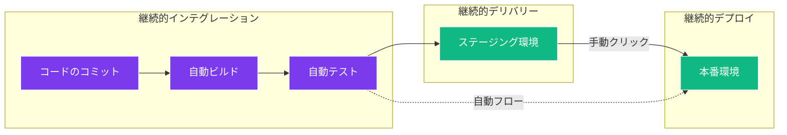

# CI/CD の哲学：自動化の思想 ⚙️

Day 12へようこそ！前回のレッスンでは、Git を使ってソースコードを安全に管理する方法を学びました。しかし、コードが Git の中にあるだけでは、まだ顧客に価値を届けることはできません。コードをテストし、パッケージ化し、そして実際の稼働環境へと送り出す必要があります。

今日は、**CI/CD** (#(CI/CD)) の世界に足を踏み入れます。これは単にツールをインストールすることではなく、ソフトウェアを「届ける」ことに対する私たちの考え方を根本から変えるプロセスです。

---

## 🪝 THE HOOK：「統合の地獄（Integration Hell）」という悪夢

DevOps が誕生する前、2000年代を振り返ってみましょう。
20人のチームが3ヶ月間コードを書き続けます。各開発者は自分のローカルマシンにコードを保持しています。四半期の終わりに、全員が一斉にコードを統合（**Integration**）し始めます。

数千もの衝突（コンフリクト）が発生します。
- 「えっ、なぜこの関数の名前を変えたんですか？」
- 「このライブラリ、私は新しいバージョンを入れましたが…？」

開発者は、マージエラーの修正だけでさらに2週間を費やすことになります。その後、テスターによる手動テストにさらに1週間。結果としてプロジェクトは遅延し、チームの士気はボロボロになります。テクノロジー業界ではこの現象を **統合の地獄（Integration Hell）** と呼びます。

**CI/CD** は、この「地獄」を壊滅させるために生まれました。3ヶ月待つ代わりに、私たちは「数時間ごと」にコードを統合します。

---

## 🎭 ANALOGY：現代的な自動車の生産ライン

CI/CD を理解するために、テスラの自動車生産ラインを想像してみてください：

### 1. CI（継続的インテグレーション）：自動部品検査
ロボットアームがネジを1本締め終えるたびに、レーザーセンサーが即座にネジの締まり具合をチェックします（ユニットテスト）。もしエラーがあれば、ラインはその場で停止し、赤いアラートが鳴ります。欠陥のある車をラインの最後まで流すことは決してありません。

### 2. Continuous Delivery（継続的デリバリー）：出荷待ちの車
ラインの最後で、車は駐車場へと運ばれ、ガソリンが満たされ、ピカピカに磨き上げられます。この車はいつでも **「販売可能な状態」** です。上司が「出荷」ボタンを押せば、すぐに配送されます。ただし、このボタンを押すかどうかは、まだ人間が判断します。

### 3. Continuous Deployment（継続的デプロイ）：顧客の自宅へ直送
生産ラインを出た直後、車は自動運転で顧客の自宅の玄関先まで直行します。人間の介入や手動の承認は一切必要ありません。これが自動化の最高レベルです。

---

## ⚙️ UNDER THE HOOD：3つの強力なアルファベットの解読

### 1. Continuous Integration (CI) - 継続的インテグレーション
誰かが Git にプッシュするたびに、自動的に **ビルド（Build）** と **テスト（Test）** を行うプロセスです。
- **目標**: エラーを可能な限り早期に発見すること（**Fail Fast**）。
- **作業**: ユニットテストの実行、セキュリティチェック（Lint）、イメージの脆弱性スキャン。

### 2. Continuous Delivery (CD) - 継続的デリバリー
CI ステップを通過したコードが、いつでも本番環境（Production）に **「デプロイ可能な状態」** にあることを保証します。
- **目標**: リリースのリスクを最小限に抑えること。
- **違い**: 本番環境へのデプロイには、まだ人間による「承認ボタン」が必要です。

### 3. Continuous Deployment (CD) - 継続的デプロイ
自動テストのすべてのステップを通過したすべてのコミットが、エンドユーザーが利用する実環境へ直接プッシュされます。
- **要件**: 自動テストシステムが極めて信頼できるものであること。テストが不十分だと、わずか5分で数百万人の顧客にバグ入りのコードを自動配布してしまうことになります。

---

## 💻 DEVOPS IN PRACTICE：マスターのワークフロー

標準的なパイプライン（Pipeline）は以下のステップをたどります：

1. **Commit**: 開発者がフィーチャーブランチにコードをプッシュ。
2. **Build**: システム（GitHub Actionsなど）がコードを取得し、依存関係をインストール。
3. **Test**: テストセットを実行。1つでも失敗すれば即停止し、開発者に通知（修正に必要な情報を添えて）。
4. **Analysis**: コード品質チェック（SonarQubeなど）を行い、「ゴミ」のようなコードが混入するのを防ぐ。
5. **Artifact**: Docker イメージとしてパッケージ化し、レジストリにプッシュ（Day 06で学習済み）。
6. **Deploy**: サーバーを更新して新しいイメージを実行。

### 「Fail Fast」の思考 (#(Fail Fast)):
エラーを恐れてはいけません。ステップ3ですぐにパイプラインがエラーを吐いたなら、それを喜びましょう。なぜなら、そこでエラーが出なければ、そのバグはステップ6で顧客の財布にまで到達してしまい、その時に支払う代償は100倍になるからです。

---

## 🛡️ BEST PRACTICES：パイプラインの黄金律

- **高速であること**: CI パイプラインは5〜10分以内に完了すべきです。それ以上かかると、開発者は意欲を失います。
- **同一の環境**: 開発者のマシン、CI 環境、そして本番環境で動くコードは、すべて同じ種類の Docker コンテナ内にあるべきです。
- **不変性（Immutable）** (#(Immutable)): ステップ5でイメージとしてパッケージ化されたら、二度とその中身を修正してはいけません。コードを直したいなら、新しいイメージを作成してください。

---

## 📝 QUICK QUIZ：DevOps 哲学への挑戦

1. **Continuous Delivery と Continuous Deployment の主な違いは何ですか？**
    - A. Delivery はモバイルアプリ用、Deployment は Web 用である。
    - B. Delivery は本番環境へ反映する前に人間による手動承認が必要だが、Deployment は最初から最後まで完全に自動化されている。
    - C. Deployment の方が Delivery よりも高速である。

2. **CI/CD パイプラインで Docker を使用すべき理由は何ですか？**
    - A. Docker を使うとコードが軽くなるから。
    - B. 一貫性（Consistency）を確保するため。コンテナ環境が変わらないおかげで、CI で正しく動いたコードは、他の環境でも確実に正しく動く。
    - C. 上司がそう求めたから。

3. **CI/CD における「アーティファクト（Artifact）」という用語は何を指しますか？**
    - A. ビルド後に残ったゴミ。
    - B. デプロイ可能な状態になった最終成果物（.bin ファイル、.jar、または Docker イメージなど）。
    - C. 芸術作品。

---
**まとめ**: あなたは DevOps の魂である「CI/CD の哲学」を理解しました。しかし、「言うは易く行うは難し」です。明日は、これらの哲学を実際の自動化コードに変えるために、**GitHub Actions** を使って「汗を流して」いきましょう。

📊 文字数: ~4200文字
