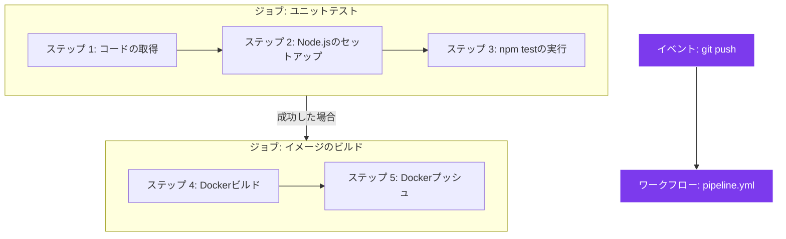

# GitHub Actions：最初の生産ラインの構築 🚀

Day 13へようこそ！昨日は CI/CD の哲学、つまり「考え方」について議論しました。今日は、いよいよそれを「実行」に移します。

DevOps の歴史において、以前は CI/CD を実現するために、巨大で複雑な設定が必要な Jenkins サーバーを構築しなければなりませんでした。しかし、**GitHub Actions** (#(GitHub Actions)) が誕生して以来、自動化はテキストファイルを書くのと同じくらい簡単になりました。

---

## 🪝 THE HOOK：コードベースを24時間守る「ロボット」

あなたに専属の仮想アシスタントがいると想像してください。あなたが `git push` と入力するたびに、このアシスタントは即座に以下の作業を行います：
1. ま新しい、クリーンなコンピューターを起動する。
2. あなたのコードをダウンロードする。
3. 必要なものをすべてインストールする。
4. すべてのテスト（Test）を実行する。
5. もしエラーがあれば、すぐにあなたに通知する。
6. すべてが「グリーン（成功）」なら、アプリをパッケージ化して関係者に報告する。

最も重要な点：このアシスタントは（個人プロジェクトなら）無料で働き、決して眠らず、そして極めて正確です。それが **GitHub Actions** です。これを使わないということは、本来ロボットがやるべき退屈で繰り返しの多い作業を、あなたが自分の手で行っているということです。

---

## 🎭 ANALOGY：料理のレシピとヘルパー

GitHub Actions がどのように動作するかを理解するために、キッチンで例えてみましょう：

### 1. Workflow：料理の工程
YAML ファイルは、まさに **料理のレシピ** (#(Workflow)) です。「フォー（Pho）を作るには、ステップ1、ステップ2、ステップ3…をやりなさい」と明記されています。

### 2. Events：目覚まし時計
ロボットはいつ料理を始めるのでしょうか？ それが **イベント（Events）** (#(Events)) です。
- 「客がチャイムを鳴らしたとき」（コードを `push` したとき）。
- 「毎日午前8時になったとき」（スケジュール実行 `schedule`）。

### 3. Runners：空っぽのキッチン
**ランナー（Runner）** は、GitHub が提供してくれるコンピューター（通常は Linux）です。これは、ピカピカに掃除された新しいキッチンのようなものです。ロボットが作業を始められるように、あなたが「鍋やフライパン」（Node.js, Docker など）を用意してあげる必要があります。

### 4. Actions：市販の合わせ調味料
「メールを送信する」ためのコードを自分で一から書く代わりに、マーケットプレイスにある既存の **アクション（Action）** を使うことができます。これは市販の調味料パックのようなものです。封を切って入れるだけで完了です。

---

## ⚙️ UNDER THE HOOD：自動化ファイルの構造

GitHub Actions のワークフローは、特定の「秘密の」パスに保存されます：`.github/workflows/main.yml`。

### コアとなる構成要素：
1. **name**: ロボットの名前（例：「CI パイプライン」）。
2. **on**: いつ実行するか？（例：`push`, `pull_request`）。
3. **jobs**: 大きな作業単位。例：ジョブ1はテスト、ジョブ2はビルド。ジョブは時間を節約するために並列で実行できます。
4. **steps**: ジョブ内の小さなステップ。
5. **uses**: 他の人が作ったアクションを使用する（手間を省けます）。



---

## 💻 DEVOPS IN PRACTICE：あなたの最初の CI ファイル

シナリオ：誰かがプルリクエスト（Pull Request）を作成するたびに、自動的にユニットテストを実行したいとします。

### ファイル：`.github/workflows/test.yml`
```yaml
name: Node.js CI

on:
  pull_request:
    branches: [ main ] # main ブランチをターゲットにした時のみ実行

jobs:
  test-and-lint:
    runs-on: ubuntu-latest # GitHub の最新の Linux マシンを使用

    steps:
      - name: Checkout code
        uses: actions/checkout@v3 # ロボットがあなたのコードを見るための必須ステップ

      - name: Setup Node.js
        uses: actions/setup-node@v3
        with:
          node-version: 18

      - name: Install dependencies
        run: npm ci # ライブラリのクリーンインストール

      - name: Run lint
        run: npm run lint

      - name: Run unit tests
        run: npm test
```

### なぜ `npm install` ではなく `npm ci` を使うのか？
- **回答**: `npm ci`（Clean Install）の方が高速であり、`package-lock.json` ファイルと 100% 一致するバージョンのライブラリがインストールされることを保証するからです。CI 環境において、一貫性は至上命題です。

---

## 🛡️ SECURITY：GitHub Secrets

DevOps の第一法則：YAML ファイルに **決して** パスワードを書いてはいけません。
- GitHub リポジトリの **Settings > Secrets and variables** セクションに行きます。
- そこにパスワードを保存します（例：`DOCKER_PASSWORD`）。
- YAML ファイル内では、`${{ secrets.DOCKER_PASSWORD }}` という構文で呼び出します。
GitHub はログ出力の中でこのパスワードを自動的にマスク（伏せ字に）してくれるため、誰にも見られることはありません。

---

## 📝 QUICK QUIZ：自動化エンジニアへの挑戦

1. **ワークフローの実行開始を決定する要素はどれですか？**
    - A. jobs
    - B. on (Events)
    - C. steps

2. **ワークフローを1つにまとめず、複数の小さなジョブ（Jobs）に分けるべき理由は何ですか？**
    - A. YAML ファイルを長く見せてプロっぽくするため。
    - B. 各タスクを並列実行（Parallel execution）させ、全体の待ち時間を短縮するため。
    - C. GitHub では最低2つのジョブが必要だから。

3. **GitHub マーケットプレイスの「アクション」を使う最大のメリットは何ですか？**
    - A. コードの実行速度が上がる。
    - B. 複雑なスクリプトを自分で書かずに、一般的なタスク（コードの取得や環境構築など）を再利用できる。
    - C. コミュニティを応援するため。

---
**まとめ**: あなたはコードリポジトリを守るロボットの作り方を学びました。しかし、ロボットはまだ「検査」ができるだけで、「パッケージ化」の方法を知りません。明日は、あなたがコミットするたびに、最高品質の Docker イメージを自動生成する方法をロボットに教えていきましょう。

📊 文字数: ~4200文字
