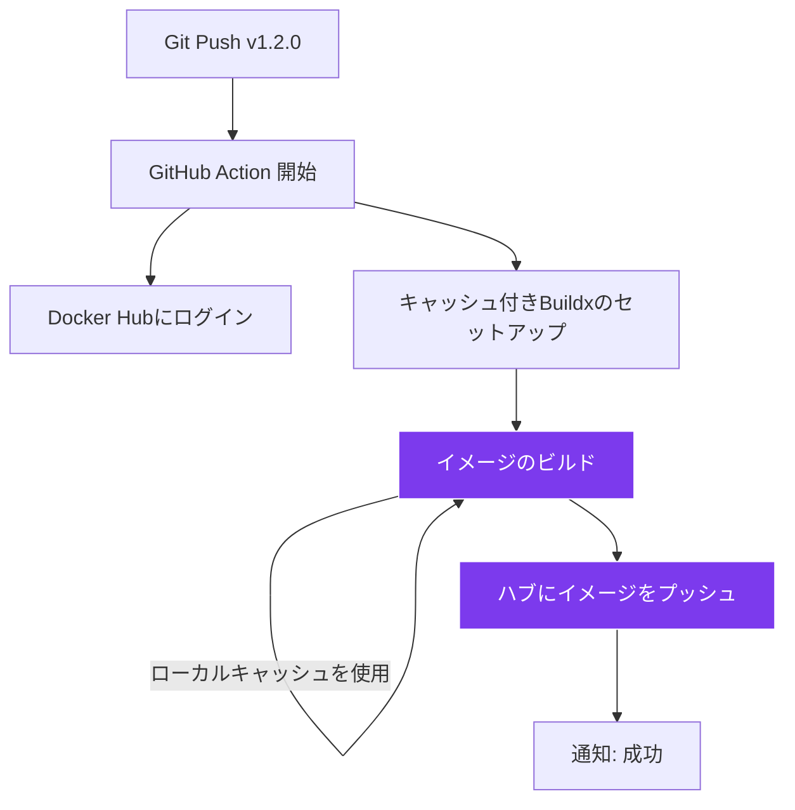

# 自動ビルド：イメージ・パッケージングの自動化 🐳

Day 14へようこそ！私たちは Docker の使い方（Phase 1）と GitHub Actions の使い方（Day 13）を習得しました。今日は、これら2つのテクノロジーを「結婚」させて、**CI システムの心臓部**を作り上げる日です。

現実の現場では、コードを修正するたびに自分のローカルマシンで `docker build` や `docker push` を手動で入力したくはありません。それは時間の無駄であり、帯域を消費し、人為的ミスを招きます。このプロセス全体を「クラウド」に委ねましょう。

---

## 🪝 THE HOOK：「カメ」のように遅いデプロイと、その解決策

CI/CD を始めたばかりのチームの多くが直面する問題があります。それは「パイプラインの実行が遅すぎる」ということです。
CSS を1行直しただけで、ロボットがすべてのライブラリを再ダウンロードし、イメージを最初からビルドし直すのに10分もかかってしまいます。
- 開発者はテスト結果を待つのにイライラします。
- 数十件のパイプラインが列をなし、システムがボトルネックになります。

なぜこれほど遅いのでしょうか？ それは、CI 環境で **Docker キャッシュ（Docker Cache）** (#(Docker Cache)) をまだ使っていないからです。今日は単に「自動化」を学ぶだけでなく、それを「風のように速く」実行する方法を学びます。

---

## 🎭 ANALOGY：自動缶詰工場

あなたの工場が自動缶詰工場であると想像してください：

### 1. Build-Push Flow：パッケージング・コンベア
製品（コード）がテストラインを通過すると、コンベアが自動的にそれを缶詰機（Docker Build）に運び、ラベル（Tag）を貼り、中央倉庫（Docker Hub）へと押し出します。プロセス全体に人間の介入は不要です。

### 2. Docker Cache on CI：スマートな厨房
フォー（Pho）を作るとします。
- **古い方法**: 客が注文するたびに、米を研ぎ、骨を煮込むところから始めます。
- **マスターの方法（キャッシュ）**: すでに煮込んであるスープ（古いビルド）を保管しておきます。客が注文したら、新しい麺（新しいコード）をサッと茹でてスープを注ぐだけです。完成までの時間は10時間から10秒に短縮されます。

---

## ⚙️ UNDER THE HOOD：プロフェッショナルな「Push-to-Build」ワークフロー

イメージのビルドを自動化するために、Docker が GitHub 専用に提供している「秘密」のツールセット **Buildx** を使用します。

### 技術的なプロセス：
1. **Setup Docker Buildx**: 高度なキャッシュをサポートする最新のビルドエンジンを作成します。
2. **Login to Registry**: Secrets を使用して Docker Hub や GitHub Registry に安全にログインします。
3. **Build and Push**: ビルドを実行し、1つのステップでイメージをレジストリにプッシュします。
4. **Caching**: `cache-from` と `cache-to` 機能を使用し、イメージのレイヤーを GitHub のサーバー自体に保存します。これにより、次回のビルドが劇的に速くなります。



---

## 💻 DEVOPS IN PRACTICE：実戦的なワークフローファイル

シナリオ：コードにタグ（例：`v1.0.0`）を付けるたびに、GitHub が自動的にイメージをビルドし、Docker Hub にプッシュするようにします。

### ファイル：`.github/workflows/docker-build.yml`
```yaml
name: Build and Push Docker Image

on:
  push:
    tags:
      - 'v*' # v1.0, v2.1 などのタグがプッシュされた時に実行

jobs:
  docker:
    runs-on: ubuntu-latest
    steps:
      - name: Checkout
        uses: actions/checkout@v3

      - name: Login to Docker Hub
        uses: docker/login-action@v2
        with:
          username: ${{ secrets.DOCKERHUB_USERNAME }}
          password: ${{ secrets.DOCKERHUB_TOKEN }}

      - name: Set up Docker Buildx
        uses: docker/setup-buildx-action@v2

      - name: Build and push
        uses: docker/build-push-action@v4
        with:
          context: .
          push: true
          tags: myuser/my-app:${{ github.ref_name }} # Gitのタグ名をそのままDockerのタグに使用
          cache-from: type=gha # GitHub Actions環境からキャッシュを取得
          cache-to: type=gha,mode=max # 最大限のキャッシュをGitHub Actionsに保存
```

### なぜパスワードではなく `DOCKERHUB_TOKEN` を使うのか？
- **回答**: パスワードは変更される可能性があり、個人のアカウントに紐付いています。**アクセス・トークン（Access Tokens）** はより安全で、いつでも無効化でき、権限（例：プッシュは許可するが、削除は禁止する）を制限できます。これが DevOps マスターのセキュリティ基準です。

---

## 🛡️ TỐI ƯU HÓA（最適化）：インテリジェントなタグ付け戦略

何でもかんでも `latest` というタグを付けないでください。GitHub の環境変数を使用して、賢くタグを付けましょう：
- **`sha-${{ github.sha }}`**: コードのコミットハッシュでタグを付けます。コードが変わればタグも変わるため、非常に安全です。
- **`branch-name`**: ブランチ（dev, staging など）ごとに個別のイメージを持つことができます。

---

## 📝 QUICK QUIZ：CI エンジニアへの挑戦

1. **Docker Buildx と GitHub キャッシュ (type=gha) を使う最大のメリットは何ですか？**
    - A. イメージのサイズを小さくする。
    - B. 前回のビルド済みのレイヤーを最大限再利用することで、ビルド時間を最小限に抑える。
    - C. コードのバグを防ぐ。

2. **なぜ通常の「Push」ごとではなく、「Tag」がプッシュされた時にビルドするように設定するべきなのですか？**
    - A. GitHub のコストを節約するため。
    - B. タグ付けは通常、リリース準備が整った完成版を意味するため。小さな変更のたびに「ゴミ」イメージをビルドするのを避ける。
    - C. Docker はブランチごとのビルドをサポートしていないから。

3. **構文 `${{ secrets.NAME }}` はどのような問題を解決しますか？**
    - A. パイプラインの速度を上げる。
    - B. 機密情報（パスワードやトークン）が公開ソースコードに漏洩するのを防ぎ、絶対的なセキュリティを確保する。
    - C. GitHub があなたにお金を払うようにするため。

---
**まとめ**: あなたは自動化された「パッケージング工場」を建設しました。「商品」（イメージ）はすでに倉庫（レジストリ）に保管されています。では、これらの商品をどのようにして最もプロフェッショナルで安全な方法で消費者に届けるのでしょうか？ 明日は、**GitOps** と現代的なデプロイ戦略（Deployment Strategies）について学びます。

📊 文字数: ~4400文字
