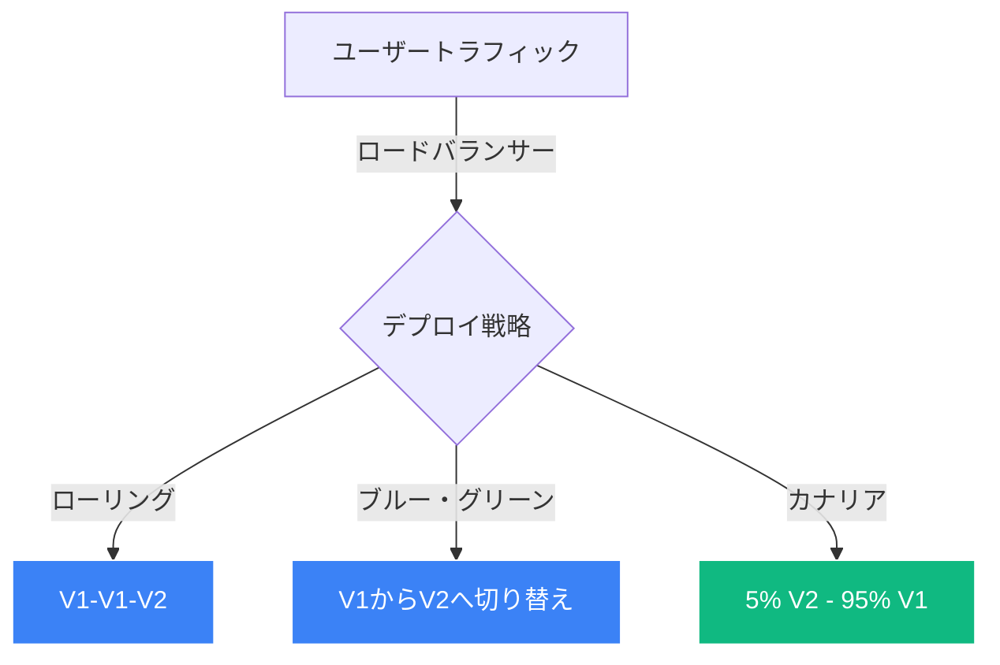

# GitOps とデプロイ戦略：現代的なリリース戦略 🏗️

Day 15へようこそ！あなたは DevOps Master への道のりの 25% のマイルストーンに到達しました。洗練された Docker イメージと自動化された CI パイプラインが手元にあります。いよいよ最後にして、最も「クール」なステップである **デプロイ（Deployment）** (#(Deployment)) に進みます。

一秒の停止もなしに（**Zero Downtime**）、どうやって新しいコードをユーザーに届けるのでしょうか？ もし新バージョンにバグがあった場合、どうやって何事もなかったかのように自動的に旧バージョンに戻すのでしょうか？ その答えは **GitOps** にあります。

---

## 🪝 THE HOOK：「うっかりミス」と GitOps の哲学

100台のサーバーがあると想像してください。ある晴れた日、システム全体の RAM 設定を変更することにしました。
- **素人のやり方**: 1台ずつサーバーに SSH でログインして修正します。87台目に来たとき、うっかりハードディスクを初期化するコマンドを打ってしまいました。
- **結果**: 他の台で何を変更したか正確に把握できず、変更履歴もなく、迅速な復旧も不可能です。

**GitOps** (#(GitOps)) は、強力な宣言と共に誕生しました。**「Git にないものは、サーバー上にも存在しない」**。
インフラのあらゆる変更、あらゆるデプロイは `git commit` を通さなければなりません。Git こそが唯一の「信頼できる情報源（Source of Truth）」です。RAM を変えたい？ Git 内の設定ファイルを修正してプッシュしてください。あとはロボットがやってくれます。

---

## 🎭 ANALOGY：指揮者とデジタルの楽譜

### 1. GitOps：楽譜とオーケストラ
- **Git** は **「楽譜」** のようなものです。オーケストラに演奏を速くしてほしいとき、一人ひとりの演奏者のところへ行って叩いたりはしません。ただ楽譜を書き換えるだけです。
- **GitOps Controller** は **「指揮者」** です。彼は常に楽譜（Git）とオーケストラ（サーバー）の両方を見ています。オーケストラが間違った音を弾いていることに気づいたら、楽譜通りになるように修正を命じます。

### 2. Blue-Green Deployment：2つの並行ステージ
2つのステージ、**ブルー（稼働中）** と **グリーン（準備中）** があると想像してください。
- 新しい出し物（新しいコード）が届いたら、グリーン・ステージで準備します。観客はまだブルー・ステージを見ています。
- グリーン・ステージの準備が完璧に整ったら、警備員に命じてグリーン・ステージのドアを開け、ブルー・ステージのドアを閉めるだけです。観客は一瞬で新バージョンへと切り替わります。

---

## ⚙️ UNDER THE HOOD：古典的なデプロイ戦略

旧バージョン（V1）を新バージョン（V2）に置き換えたいとき、主に3つの方法があります：

### 1. Rolling Update（ローリング・アップデート）
1台ずつ順番に置き換えていく方法。
- **方法**: V1 を1台停止させ、V2 を1台起動する。これを10台すべて終わるまで繰り返す。
- **メリット**: リソースを節約できる。
- **デメリット**: 更新中、システム内に新旧2つのバージョンが混在するため、データのロジックエラーが起きやすい。

### 2. Blue-Green Deployment（ブルー・グリーン・デプロイ）
完全に同じシステムを2つ並行して走らせる方法。
- **メリット**: ロールバックが極めて速い（トラフィックの向きを変えるだけ）。絶対的な安心感がある。
- **デメリット**: リソースが2倍かかる（2つのシステムを同時に動かすため）。

### 3. Canary Release（カナリア・リリース）
炭鉱夫が毒ガスを検知するためにカナリアを連れて行ったことに由来します。
- **方法**: ユーザーの 5% だけに新バージョン（V2）を使わせます。残りの 95% は旧バージョン（V1）のままです。
- **目標**: その 5% のユーザーに問題がなければ、徐々に 10, 20... 100% と増やしていきます。もしバグがあっても、影響を受けるのは 5% だけです。

---

## 💻 DEVOPS IN PRACTICE：「Infrastructure as Code」(IaC) の思考

サーバーを作るためにコマンドを打つ代わりに、コードを使います。サーバー上での Docker Compose を使ったシンプルな GitOps の例です：

1. **サーバー**にツール（Portainer やシンプルな Cron タスクなど）をインストール。
2. その**タスク**が1分ごとに `git pull origin main` を実行。
3. もし `docker-compose.yml` ファイルに変更があれば、`docker-compose up -d --remove-orphans` を実行。

**結果**: あなたは自宅のノート PC で `git push` と打つだけです。5分後、アメリカにあるサーバーが汗一つかかずに最新バージョンへと自動更新されます。これが **デプロイ自動化** の始まりです。

---

## 🛡️ SECURITY：マージ権限の制御

GitOps において、`main` ブランチは「究極の武器」です。したがって：
- **ブランチ保護（Branch Protection）**: 誰も `main` に直接プッシュしてはいけません。
- **プルリクエスト必須**: あらゆる変更は、少なくとも他の1人によるレビューを受けなければなりません。
- **ステータスチェック**: CI パイプライン（Day 13-14）が「合格（Passed）」して初めて、マージボタンが表示されるようにします。

---

## 📝 QUICK QUIZ：Master Phase 1 & 2 最終テスト

1. **GitOps の核となる概念は何ですか？**
    - A. Git を使ってチームの写真を保存すること。
    - B. Git を「唯一の信頼できる情報源」として使用し、インフラとアプリケーション全体を管理・自動化すること。
    - C. 全員に Git を強制的に学ばせること。

2. **少人数のユーザーグループで新機能をテストするのに、最も安全なデプロイ戦略はどれですか？**
    - A. ローリング・アップデート。
    - B. ブルー・グリーン・デプロイ。
    - C. カナリア・リリース。

3. **なぜブルー・グリーン・デプロイは、ほぼ瞬時のロールバック（切り戻し）が可能なのでしょうか？**
    - A. 旧バージョンが並行して動いたままであり、ロードバランサーのトラフィックを旧システムに戻すだけで済むから。
    - B. AI アルゴリズムを使っているから。
    - C. RAM の消費が少ないから。

---
**まとめ**: 最初の15日間を完走したことを祝福します！ あなたはゼロからスタートし、シリコンバレーで使われている最新のデプロイプロセスを習得しました。
少し休憩しましょう！ **Day 16** からは、**オーケストレーション（Orchestration）** の世界へと足を踏み入れます。数万個のコンテナを一斉に操る巨像、**Kubernetes** との出会いが待っています。

📊 文字数: ~4500文字
