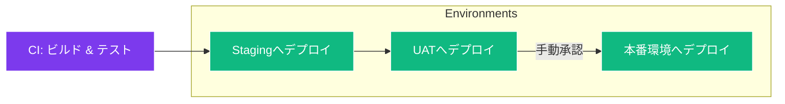

# マルチ環境パイプライン：Staging, UAT & Production 🏗️

Day 17へようこそ！昨日は CI/CD ツールの比較を学びましたが、その「ツール」を使って実際に何を行うのでしょうか？プロフェッショナルなプロジェクトでは、自分の PC で書いたコードをいきなり本番環境へ送り、数百万人のユーザーに公開するようなことは決してしません。

今日は、**マルチ環境パイプライン** (#(Multi-environment Pipelines)) について学びます。これは信頼性の高い運用のバックボーンであり、「うっかり本番環境を壊してしまった」という不安なしに、毎晩ぐっすり眠るための仕組みです。

---

## 🪝 THE HOOK：あるシニア開発者の「急ぎすぎた」告白

DevOps 界隈には有名な話があります。あるシニア開発者が、「決済」ボタンの色のわずかな修正を行いました。コードがあまりにも単純だったため、彼は自信を持っていました。彼はメインブランチに直接マージし、システムは自動的に本番（Production）サーバーへとデプロイされました。

結果：決済プロセス全体がダウンしました。CSS 設定ファイルの中で、うっかりコンマを1つ消してしまったため、古いブラウザでページが読み込めなくなっていたのです。
- 会社は1時間あたり数万ドルの損失を出しました。
- 数千人の顧客からクレームが届きました。

これらすべては、プロジェクトに **「緩衝地帯（Buffer Zone）」** が欠けていたために起こりました。一般公開する前に、本番環境と「全く同じ」環境でコードをチェックする場所が必要です。DevOps マスターは、決してそのようなリスクを放置しません。

---

## 🎭 ANALOGY：練習場と国立競技場

サッカーチームを想像してみてください：

### 1. Development（開発環境）：自宅のミニコート
ここでは一人でボールを蹴る練習をします。シュートを外しても、窓ガラスを割っても構いません。最新のテクニックを試している場所です。

### 2. Staging / UAT：親善試合（サブスタジアム）
決勝戦の前に、チームは親善試合を行います。
- **Staging** (#(Staging)): このスタジアムは、サイズ、芝生、照明に至るまで国立競技場と全く同じです。ここでロボット（CI）がコードが正しく動くかをチェックします。
- **UAT** (#(User Acceptance Testing)): 「VIP 顧客」や「テスター」を招待して、製品を実際に見て使ってもらう場所です。彼らは「これは私のイメージと違う、直してくれ！」と言うかもしれません。

### 3. Production（本番環境）：決勝戦（国立競技場）
ここでは数万人の観客（ユーザー）がリアルタイムで見ています。ここでのミスはすべてレッドカードと、ファンを失望させることにつながります。親善試合を完璧に通過したコードだけが、ここに入場できます。

---

## ⚙️ UNDER THE HOOD：マルチ環境パイプラインの構造

標準的なマスター・パイプラインは、通常以下の **ステージ（Stages）** に分かれています：

### 1. Build Stage
Docker イメージのパッケージ化を「一度だけ」行います。このイメージには `v1.2.0-rc1`（リリース候補）のようなラベルが付けられます。

### 2. Deploy to Staging
ユニットテストを通過するとすぐに、自動的にイメージを Staging 環境へプッシュします。
- ここでは、**統合テスト（Integration Tests）**（アプリと DB の接続確認など）を実行します。
- また、**性能テスト（Performance Tests）**（1,000人が同時アクセスしても耐えられるか）を実行します。

### 3. Deploy to UAT（または Pre-prod）
顧客による最終確認のための場所です。このステップには通常、**「手動承認（Manual Approval）」** (#(Manual Approval)) が含まれます。プロジェクトマネージャーがボタンを押さない限り、コードは先へ進めません。

### 4. Deploy to Production
これが最後のステップです。`v1.2.0-rc1` イメージは安定版の `v1.2.0` にリネームされ、Day 15で学んだブルー・グリーン戦略やカナリア戦略を用いて展開されます。



---

## 💻 DEVOPS IN PRACTICE：GitHub Actions での環境管理

GitHub は、これをプロフェッショナルに管理するための **Environments** 機能を提供しています。

### ファイル：`.github/workflows/deploy.yml`
```yaml
jobs:
  deploy-staging:
    runs-on: ubuntu-latest
    environment: staging # 環境ラベルの付与
    steps:
      - name: Deploy to Staging
        run: ./scripts/deploy.sh staging

  deploy-production:
    runs-on: ubuntu-latest
    needs: deploy-staging # Staging が完了した時のみ実行
    environment: 
      name: production
      url: https://myapp.com
    # GitHub はここでパイプラインを自動停止し、上司の承認を待ちます
    steps:
      - name: Deploy to Prod
        run: ./scripts/deploy.sh production
```

### なぜ `needs: deploy-staging` で分けるのか？
- **回答**: 順序性を保証するためです。Staging でのデプロイやテストが失敗した場合、パイプラインは即座に停止し、バグのあるコードが本番環境に「近づく」機会を一切与えません。これこそが究極の防御網です。

---

## 🛡️ SECURITY：環境保護ルール（Environment Protection）

DevOps マスターは、鉄の掟を設定します：
- **Reviewers**: 本番環境へのデプロイボタンを押す権限を持つ人を、特定の2名に限定します。
- **Wait Timer**: コードが Staging にデプロイされてから最低30分間は、安定性を確認するために次のステップへ進むのを待機させます。
- **Secrets per Environment**: Staging の DB パスワードは、本番環境のものと完全に別物にするべきです。もしハッカーが Staging のパスワードを盗んでも、本物のシステムには手を出せません。

---

## 📝 QUICK QUIZ：インフラ設計者への挑戦

1. **なぜ Docker イメージをビルドステージで一度だけ作成し、それをすべての環境（Staging, Prod）で使い回すべきなのですか？**
    - A. ビルド時間を節約するため。
    - B. 一貫性（Consistency）を保証するため。Staging でテストしたコードと、本番で動くコードが、再ビルドによるコンマ一つの違いもなく「全く同じもの」であることを保証するため。
    - C. Docker Registry が複数回のビルドを許可していないから。

2. **パイプラインにおける「手動承認（Manual Approval）」の主な目的は何ですか？**
    - A. 開発者を困らせるため。
    - B. 人間（PM や QA）が UAT の最終結果を確認し、新バージョンのリリースに責任を持つため。
    - C. 安全のためにシステムをあえて遅くするため。

3. **「UAT（User Acceptance Testing）」環境は、主に誰のためのものですか？**
    - A. 顧客やステークホルダーが、機能がビジネス要件を満たしているかを確認するため。
    - B. ハッカーが実験するため。
    - C. 開発者がコードを修正するため。

---
**まとめ**: あなたはシステムを守るための「フィルタリング階層」の構築方法を理解しました。しかし、Staging でのチェックプロセスを、人間がボタンをクリックすることなく完全に自動化するにはどうすればいいでしょうか？ 明日は **Testing in CI/CD** について学びます。ロボットに「良いアプリ」と「ダメなアプリ」を判別させる方法です。

📊 文字数: ~4500文字
