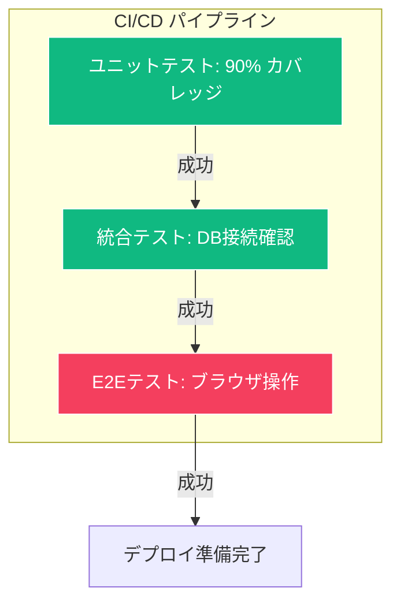

# CI/CD におけるテスト：自信を持ってリリースするための自動テスト 🧪

Day 18へようこそ！私たちはすでに「パイプライン」と「環境」を手に入れました。しかし、バグのあるコードがそのパイプラインを通り抜けてしまうのを防ぐものは何でしょうか？ それが **自動テスト（Automated Testing）** (#(Automated Testing)) です。

DevOps マスターの世界では、開発者の「自分のマシンでは動いていました」という言葉は信じません。私たちが信じるのは、テストロボットが導き出した数字と、「グリーン（成功）」という結果だけです。

---

## 🪝 THE HOOK：ソフトウェアにおける「バタフライ効果」

あなたが、消費税を計算するためのごく小さな関数を修正したと想像してください。あなたはそれが正しく動くことを確認しました。しかし、あなたはその関数が、倉庫部門の保管料計算や、配送部門の通行料計算にも使われていることを全く知りませんでした。

あなたはコードをデプロイします。
- 販売サイトは依然として動いています（あなたのユニットテストは合格しているかもしれません）。
- しかし月末、経理部門は保管料の計算が完全に間違っていたために、数十億ドルの損失が出ていることに気づきます。

自動化された **統合テスト（Integration Test）** や **E2E テスト（End-to-End Test）** がなければ、あなたはデプロイボタンを押すたびに「運試し」をしていることになります。

---

## 🎭 ANALOGY：テストピラミッドと玩具の製造工程

LEGO セットの製造を考えてみましょう：

### 1. ユニットテスト：各ブロックの検査（安価、高速）
パッケージ化の前に、機械が各ブロックのサイズや色が正しいかをチェックします。これが **ユニットテスト** (#(Unit Test)) です。もし不良品があれば、その場ですぐに捨てられます。非常に安価で高速です。

### 2. 統合テスト：ブロックの組み合わせ確認（中程度）
4つのブロックを組み合わせてみて、正しく噛み合うかを試します。これが **統合テスト** (#(Integration Test)) です。個々のブロックは正しくても、突起の位置がずれていれば、それらは一緒に機能することができません。

### 3. E2E テスト：お城全体の完成検査（高価、低速）
LEGO のお城全体を組み立てて、しっかりと立っているか、扉が開くかを確認します。これが **E2E テスト** (#(E2E Test)) です。時間はかかりますが、顧客が満足するという確信を得るための最も重要なステップです。

---

## ⚙️ UNDER THE HOOD：DevOps におけるテストピラミッド

DevOps マスターは、常に **テストピラミッド** (#(Testing Pyramid)) の形に従ってテスト戦略を設計します：

1. **ピラミッドの底辺（ユニットテスト）**: 数が最も多く（数千件）なければなりません。数秒で完了します。
2. **ピラミッドの中間（統合テスト）**: アプリと DB の接続、あるいは外部 API との連携をチェックします。数分で完了します。
3. **ピラミッドの頂点（E2E テスト）**: ツール（Cypress や Playwright など）を使い、ロボットがブラウザを立ち上げて本物の人間のように操作します。「決済フロー」などの最も重要な経路だけで十分です。数十分かかります。

### 「テスト・コンテナ」という仕組み
CI/CD において、本物のデータベースを汚さずに統合テストを実行するにはどうすればいいでしょうか？
Docker を使います！ パイプラインは以下を行います：
1. 一時的なデータベースコンテナを起動する。
2. それに対して接続テストを実行する。
3. 終わったらそのコンテナを削除する。
=> 環境は常にクリーンで隔離された状態に保たれます。



---

## 💻 DEVOPS IN PRACTICE：GitHub Actions へのテスト統合

シナリオ：Jest（Node.js 用）を実行し、テストカバレッジ（網羅率）が 80% 以上であることを保証したいとします。

### `package.json` の設定：
`"test": "jest --coverage --threshold=80"`

### ワークフローファイル：`.github/workflows/test.yml`
```yaml
steps:
  - name: テストの実行
    run: npm test
  - name: テストレポートのアップロード
    uses: actions/upload-artifact@v3
    with:
      name: coverage-report
      path: coverage/
```

**なぜアーティファクト（Artifact）をアップロードするのか？**
- **回答**: パイプライン終了後に、レポートを自分のマシンにダウンロードして、どの行のコードがテストされていないかを詳細に確認するためです。これを DevOps では **可視性（Visibility）** (#(Visibility)) と呼びます。

---

## 🛡️ MASTER THINKING：「テスト駆動型インフラ」

アプリケーションのコードだけでなく、インフラもテストしましょう！
- Dockerfile を書きましたか？ **Hadolint** を使ってセキュリティ基準を満たしているかテストしましょう。
- K8s 用の YAML ファイルを書きましたか？ **Kube-linter** を使って設定ミスがないかチェックしましょう。
すべてがコード（Everything as Code）であり、すべてがテストされるべきなのです。

---

## 📝 QUICK QUIZ：品質保証エンジニアへの挑戦

1. **なぜ CI パイプラインに大量の E2E テスト（ブラウザテスト）を詰め込むべきではないのですか？**
    - A. E2E テストは書くのが非常に難しいから。
    - B. 実行が非常に遅く、「Flaky（ネットワークの影響などで結果が不安定になりやすい）」なため、チーム全体のリリース速度を下げてしまうから。
    - C. ブラウザが CI サーバーの RAM を大量に消費するから。

2. **「コードカバレッジ（網羅率）」という用語は何を意味しますか？**
    - A. テストによって実行されたソースコードの行数の割合。
    - B. 発見されたバグの数。
    - C. コードファイルのサイズ。

3. **コンテナ内で「一時的」なデータベースを使って統合テストを行うメリットは何ですか？**
    - A. 電気代を節約するため。
    - B. テストデータが本物のデータに影響を与えないようにし、テストが常にクリーンな初期状態で開始されることを保証するため。
    - C. 本物のデータベースは GitHub と接続できないから。

---
**まとめ**: あなたは品質の「検問所」を設置する方法を学びました。明日の Day 19 は、非常に重要で「熱い」トピックである **Advanced Secrets Management** です。自動化の世界で、パスワードやトークンをどこにも書き留めることなく保護する方法を学びます。

📊 文字数: ~4500文字
