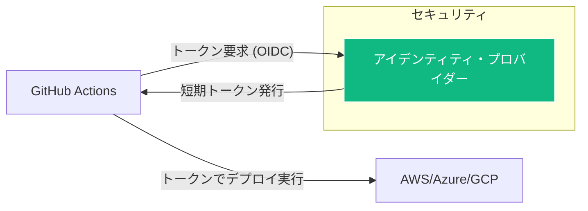

# 高度なシークレット管理：最高機密（Crown Jewels）を守り抜く 🔐

Day 19へようこそ！あなたはコード、パイプライン、テストを手にしました。しかし、パイプラインが AWS や Azure にコードをデプロイするためには、パスワード、トークン、API キーといった「鍵」が必要です。

DevOps の世界では、これらを **シークレット（Secrets）** (#(Secrets)) と呼びます。もしこれらの鍵がハッカーの手に渡れば、コードが盗まれるだけではありません。あなたの会社のクレジットカードを使って、ビットコインをマイニングするための数千台のサーバーを勝手に起動されてしまうかもしれません。今日は、真のマスターとしてシークレットを管理する方法を学びます。

---

## 🪝 THE HOOK：5万ドルの「タイポ（打ち間違い）」

ジュニア開発者がよくやってしまうミスは、「テストのため」に AWS のアクセスキーをソースコードに直接書き込み（ハードコード）、そのまま忘れてパブリックな GitHub リポジトリにプッシュしてしまうことです。
- わずか **2分以内** に、ハッカーの自動ボットがその鍵をスキャンして見つけ出します。
- **5分以内** に、あなたのネットワークアカウント上に数百台の超高額な GPU サーバーが作成されます。
- 翌朝、あなたの会社には AWS から **5万ドル** の請求書が届きます。

DevOps マスターは、決して「有効期限のないシークレット（Long-lived Secrets）」を使いません。私たちは、使用後に消えてしまう「目に見えない鍵」を使います。

---

## 🎭 ANALOGY：マスターキー vs 使い捨ての QR コード

自宅のセキュリティを想像してみてください：

### 1. 従来のシークレット：物理的な鍵
配達員に荷物を家の中に入れてもらうために、家の合鍵を渡すとします。
- **リスク**: 配達員が鍵を失くしたら？ 誰かに複製されたら？ 安心するためには、錠前（シリンダー）ごと交換しなければなりません。これが、永続的な **AWS_ACCESS_KEY** を使うリスクです。

### 2. 高度なシークレット：使い捨ての QR コード（動的シークレット）
配達員に、14:00から14:05の間だけ有効で、一度だけ門を開けられる QR コードを送ります。それ以降、その QR コードはただの紙くずになります。
- **メリット**: たとえ 14:06 にハッカーがその QR コードを盗んでも、中には入れません。これが **ゼロトラスト（Zero Trust）** (#(Zero Trust)) の考え方です。

---

## ⚙️ UNDER THE HOOD：現代のシークレット保護技術

DevOps マスターは、主に3つの防御レイヤーを使い分けます：

### 1. シークレットスキャン（予防的防衛）
**Gitleaks** や **GitHub Secret Scanning** などのツールが「警備員」として働きます。
- すべてのコミットを自動的にスキャンします。
- パスワードのような文字列（例：`amzn.key.123...`）を検知すると、即座にプッシュをブロックするか、緊急アラートを送信します。

### 2. OIDC (OpenID Connect) - 「鍵を持たない」革命
これが現在、最も進んだ手法です。GitHub Actions に「パスワード」を保存する代わりに、GitHub と AWS の間に **信頼関係（Trust Relationship）** (#(Trust Relationship)) を構築します。
- GitHub が言います：「やあ AWS、私は GitHub だ。リポジトリ 'my-app' のジョブを実行中だよ。デプロイさせてくれないか？」
- AWS はジョブの「身元（Identity）」を確認し、そのジョブのためだけに **短期間有効なトークン（Short-lived Token）**（有効期限1時間など）を発行します。
=> どこにも永続的なパスワードを保存する必要がありません！

### 3. HashiCorp Vault（中央金庫）
大規模な企業では、シークレットを GitHub や AWS に保存しません。**Vault** と呼ばれる中央の「金庫」に保存します。
- アプリが Vault を呼び出し、身元を確認されると、データベースにアクセスするための一時的な「動的シークレット（Dynamic Secret）」を受け取ります。



---

## 💻 DEVOPS IN PRACTICE：AWS で OIDC を使う

`AWS_ACCESS_KEY_ID` や `AWS_SECRET_ACCESS_KEY` を使う代わりに、以下のようなワークフローを使用します：

### `.github/workflows/deploy.yml`
```yaml
permissions:
  id-token: write # OIDC に必須
  contents: read

steps:
  - name: AWS 認証情報の取得
    uses: aws-actions/configure-aws-credentials@v2
    with:
      role-to-assume: arn:aws:iam::123456789:role/github-actions-role
      aws-region: us-east-1
  - name: デプロイ実行
    run: aws s3 sync ./build s3://my-bucket
```

**なぜこれがより安全なのですか？**
- **回答**: たとえ GitHub アカウントがハッキングされても、設定画面（Settings）に盗むべき「アクセスキー」が存在しないからです。アクセス権は、特定のパイプラインが動いている時にのみ、動的に付与されます。

---

## 🛡️ MASTER THINKING：最小権限の原則

DevOps マスターは常に **「最小権限の原則」** (#(Least Privilege)) に従います：
- パイプラインが S3 にファイルをアップロードするだけなら、「S3:PutObject」の権限だけを与えます。
- CI/CD ロボットに「管理者（Admin）」や「フルアクセス（Full Access）」の権限を絶対に与えてはいけません。万が一ロボットが乗っ取られても、被害を最小限に抑えるためです。

---

## 📝 QUICK QUIZ：セキュリティ・アーキテクトへの挑戦

1. **永続的なアクセスキーを使う場合と比較して、OIDC を使う最大のメリットは何ですか？**
    - A. パイプラインの実行速度が上がる。
    - B. GitHub に永続的なパスワード（シークレット）を保存・管理する必要がなくなり、鍵の流出リスクを激減させられる。
    - C. 無料で使える。

2. **誤ってシークレットをパブリックリポジトリにプッシュしてしまった場合、どうすべきですか？**
    - A. ファイルを削除して再度コミットする。
    - B. リポジトリを削除する。
    - C. 即座にプロバイダー（AWS/Google等）側でそのシークレットを無効化（削除）し、不正利用がないかログを確認した上で、関連するすべてのシークレットを更新（ローテーション）する。（Git 履歴に残るため、コミット削除だけでは不十分です！）

3. **「シークレットスキャン（Secret Scanning）」は何のために使われますか？**
    - A. 他人のパスワードを見つけるため。
    - B. パスワードやトークンが誤ってソース管理（Git）にプッシュされるのを自動的に検知し、防ぐため。
    - C. コードを暗号化するため。

---
**まとめ**: あなたはシステムの「最高機密（Crown Jewels）」を守る術を身につけました。Phase 2 の終了まであと少しです！ 明日の Day 20 はこのフェーズの最終日です。クラウドだけでは不十分な場合に、自分だけの「ロボット工場」を作る方法、**Self-hosted Runners** について学びます。

📊 文字数: ~4500文字
