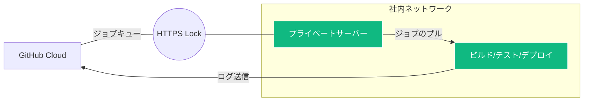

# Self-hosted Runners：クラウドだけでは不十分なとき ☁️

Day 20へようこそ！この19日間、私たちは GitHub が「貸し出している」サーバーを使って CI/CD を実行してきました。これらは非常に便利ですが、DevOps マスターの世界では、時に「便利」であることが「最適」であるとは限りません。

今日は、**Self-hosted Runners** (#(Self-hosted Runners))（セルフホスト・ランナー）のインストールと運用方法を学びます。これはインフラを完全に掌握し、数千ドルのサービス利用料を節約し、最も困難なセキュリティパズルを解くためのスキルです。

---

## 🪝 THE HOOK：高額な請求書と内部ネットワークの壁

あなたの会社が巨大な AI アプリケーションを構築していると想像してください。
- 1回のイメージビルドに30分かかります。
- チームは月に1,000回コードをプッシュします。
- **請求書**: GitHub からランナー利用料として2,000ドルの請求が届きます。上司は請求書を見て... 顔をしかめ始めます。

さらに、GitHub クラウドからは見ることができない、社内ネットワーク（VPN）の奥深くにあるサーバーにコードをデプロイする必要があります。あなたには2つの選択肢があります：
1. 社内サーバーのポートをインターネットに開放する（極めて危険）。
2. 社内ネットワークの中に最初から存在する「ロボット」を設置し、自分からコードをプル（Pull）してデプロイさせる。

これこそが、**Self-hosted Runner** が救世主となる瞬間です。

---

## 🎭 ANALOGY：タクシーに乗るか、社用車を持つか？

GitHub-hosted（クラウド型）と Self-hosted（自前型）の違いは、以下のようなものです：

### 1. GitHub-hosted：クラウドタクシー（Uber/Grab）
- **メリット**: 車の修理やガソリン代を心配する必要はありません。呼べばすぐに来ます。車は常に新しくて清潔です。
- **デメリット**: 走った距離（時間）分だけ料金を支払う必要があります。車内に極めて機密性の高いものを置いておくべきではありません。また、運転手に「進入禁止」や「私道」に入るよう頼むことはできません。

### 2. Self-hosted：会社の自家用車
- **メリット**: どこへでも運転していけます（社内ネットワークへも自由に入れます）。好きなように改造できます（AI ビルド用に GPU を積む、RAM を増やす、CPU を強化するなど）。いくら走っても追加料金はかかりません。車はあなたのものだからです。
- **デメリット**: 自分でガソリンを入れ、自分でメンテナンスを行い、駐車スペース（サーバー管理）を確保する必要があります。

---

## ⚙️ UNDER THE HOOD：セルフホスト・ランナーの仕組み

従来のサーバーとは異なり、セルフホスト・ランナーは GitHub からの呼び出しを待つことはありません。これは **Long Polling** (#(Long Polling))（ロングポーリング）という仕組みで動作します。

### 「能動的」なプロセス：
1. あなたのサーバー（Ubuntu, Windows, Mac）に、小さなソフトウェア（Runner Application）をインストールします。
2. このランナーは自動的に GitHub（ポート 443）に接続し、「準備ができました。何か仕事はありますか？」と尋ねます。
3. あなたがコードをプッシュすると、GitHub はその「開いたままの接続」を通じてジョブを送信します。
4. ランナーはあなたのハードウェア上で直接ビルドやテストを実行し、結果を GitHub に返します。

**セキュリティ上のメリット**: ランナーが自分からインターネットへ「外向き」に通信するため、会社のファイアウォール（Firewall）でインターネットからの「内向き」の接続を許可するポートを開放する必要がありません。あなたのサーバーは外部からは完全に隠されたままになります。



---

## 💻 DEVOPS IN PRACTICE：3ステップでランナーを設置

GitHub はこの作業を非常にシンプルにしています。
**Settings > Actions > Runners > New self-hosted runner** へ進みます。

### 基本コマンド：
```bash
# 1. ランナーソフトウェアのダウンロード
curl -o actions-runner-linux-x64.tar.gz -L https://...
# 2. トークンを使った認証設定
./config.sh --url https://github.com/myuser/myrepo --token ABCXYZ...
# 3. ランナーの実行
./run.sh
```

### YAML ファイルでの使用方法：
`runs-on` 属性を変更するだけです：
`runs-on: self-hosted`

### 最適化思考：Ephemeral Runners（エフェメラル・ランナー）
セルフホストの課題の一つは、ビルドのたびに残る「ゴミ（残骸）」です。DevOps マスターは **Ephemeral Runners** (#(Ephemeral Runners)) を使用します。
- ロボットが Docker や K8s 内に、1つのジョブ専用の新しいランナーを自動生成します。
- 実行が終わると、そのランナーは完全に自己消滅します。
=> これにより、毎回のコミットに対して、ビルド環境を常に 100% クリーンに保つことができます。

---

## 🛡️ SECURITY WARNING：パブリック・リポジトリでの使用禁止！

**極めて重要**: オープンソース（Public）プロジェクトでセルフホスト・ランナーを有効にしてはいけません。
- 悪意のあるユーザーが、有害なコード（例：`rm -rf /`）を含むプルリクエスト（PR）を作成する可能性があります。
- あなたのパイプラインは、その有害なコードを社内のサーバー上で自動的に実行してしまいます。
安全を確保するため、セルフホスト・ランナーは **プライベート・リポジトリ（Private Repositories）** でのみ使用してください。

---

## 📝 QUICK QUIZ：Phase 2 総括 - オートメーション・マスター

1. **「ランナーが自分から問い合わせる」仕組み（ロングポーリング）の最大のセキュリティ上の利点は何ですか？**
    - A. ビルドが速くなる。
    - B. インターネットから社内ネットワークへの接続を許可するために、ファイアウォールのポートを開放する必要がないため、インフラを保護できる。
    - C. 帯域幅を節約できる。

2. **大規模プロジェクトでセルフホスト・ランナーがコストを節約できる理由は何ですか？**
    - A. GitHub がクーポンをくれるから。
    - B. 会社にある既存のサーバーインフラを活用でき、GitHub-hosted のような分単位の課金が発生しないから。
    - C. CPU の使用量が少ないから。

3. **自前で設置するのではなく、GitHub-hosted ランナーを選ぶべきなのはどのような時ですか？**
    - A. プロジェクトに極めて高いセキュリティが求められるとき。
    - B. プロジェクトが小規模で、標準的かつクリーンな環境が必要であり、サーバーの管理や保守に手間をかけたくないとき。
    - C. GPU を使いたいとき。

---
**まとめ**: 最初の 20 日間を無事に完了しました、おめでとうございます！ 基本的な Docker の概念から、最も複雑で安全な CI/CD システムの運用までを網羅しました。
自分を誇りに思ってください！ **Day 21** からは、**Phase 3: The Orchestration King** に突入します。いよいよ **Kubernetes** を攻略する旅が始まります。ゆっくり休んで、次に備えましょう。

📊 文字数: ~4500文字
