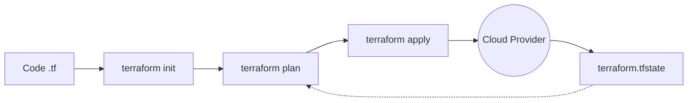

# IaC with Terraform：Click-Ops 時代の終焉 🌍

Day 21へようこそ！私たちは今、DevOps Master の旅の中でも最も重要な章の一つに足を踏み入れようとしています。これまでの数日間がアプリケーションを「梱包（Docker）」し、「出荷（CI/CD）」する方法についての学びだったとすれば、今日はそのアプリケーションが住む **「都市を建設する」** 方法を学びます。ただし、レンガやモルタル、あるいはマウスのクリックではなく、**「コード」** を使って建設します。

**Infrastructure as Code** (#(Infrastructure as Code)) — IaC（コードによるインフラ構成管理）の世界へようこそ。

---

## 🪝 THE HOOK：「Click-Ops」の惨劇と SRE の眠れない夜

あなたが AWS 上で 50 台の EC2 サーバー、10 台のロードバランサー、そして 5 つのデータベースクラスターを管理していると想像してください。すべてはマネジメントコンソール（UI）から細心の注意を払って設定されました。

ある晴れた朝、上司から依頼が来ました。「新機能をテストするために、本番（Production）と全く同じ **Staging** (#(Staging)) 環境を構築してくれ。今日の午前中までにな！」

あなたは作業を開始します：
1. ブラウザのタブを2つ開きます。
2. タブ1で本番環境の設定を確認し、タブ2でステージング環境の設定をクリックして選択します。
3. クリック、クリック、クリック... 4時間が経過しました。
4. ステージング環境のデータベースに、節約用のタイプではなく、月額 5,000 ドルもする超高性能なインスタンスタイプをうっかり選択してしまいました。
5. 翌朝、上司に請求書が届き... 悲劇的な結末が待っています。

これが **Click-Ops** (#(Click-Ops)) と呼ばれる悪夢です。遅く、ミスが起きやすく、再利用もできず、監査も極めて困難です。DevOps マスターはこのようなことはしません。インフラが「勝手に生えてくる」ようにコードを書くのです。

---

## 🎭 ANALOGY：建築設計図と巨大な 3D プリンター

**Click-Ops** を、コテを持って自分でモルタルを塗り、壁を作る作業だと考えてください。あなたが作るすべての壁は、少しずつ形が異なってしまいます（**Configuration Drift** / 設定の乖離）。

対照的に、**IaC (Terraform)** は、コンピュータ上で非常に詳細な 3D CAD 設計図を作成するようなものです。そして、そのファイルを **巨大な 3D プリンター**（AWS や GCP などのクラウドプロバイダー）に投入します。
- 家が 10 軒欲しいですか？ 変数 `count = 10` を変えるだけです。
- 窓を追加したいですか？ コードを修正して「印刷（Print）」を押すだけです。
- 取り壊して建て直したいですか？ 「削除（Delete）」を押すだけです。

1回印刷しても 100 回印刷しても、得られる結果は **常に同一** です。これこそが一貫性（Consistency）の力です。

---

## ⚙️ UNDER THE HOOD：Terraform の仕組み

**Terraform** (#(Terraform)) は、HashiCorp 社によるオープンソースの IaC ツールです。**HCL** (#(HashiCorp Configuration Language)) という言語を使用します。これは **宣言型（Declarative）** (#(Declarative)) の言語です。

### 1. 宣言型（Declarative） vs 命令型（Imperative）
- **命令型（Ansible や Shell）**: 「サーバーを1台作って、次に nginx をインストールして、次にポート 80 を開けてください。」（手順をステップごとに教える）。
- **宣言型（Terraform）**: 「最終的な目標は、nginx が動いていてポート 80 が開いている 3 台のサーバークラスターがあることです。どうやるかはあなた（Terraform）に任せます。」（最終状態だけを伝える）。

### 2. Terraform のワークフロー図



- **Terraform State** (#(Terraform State)): これは Terraform の「記憶」です。インフラの実際の状態を JSON ファイルに保存しています。これがあるおかげで、Terraform は何が既に存在し、何を追加し、何を削除すべきかを知ることができます。

### 3. 基本的な Terraform ファイル構造

```hcl
# 1. プロバイダーの宣言
provider "aws" {
  region = "us-east-1"
}

# 2. リソースの宣言
resource "aws_instance" "web_server" {
  ami           = "ami-0c55b159cbfafe1f0" # Ubuntu
  instance_type = "t2.micro"

  tags = {
    Name = "Supernova-Web-Server"
  }
}
```

---

## 💻 DEVOPS IN PRACTICE：マスター基準のデプロイフロー

シナリオ：あなたはプロジェクトに参加したばかりで、NestJS アプリケーション用のインフラをデプロイする必要があります。

### ステップ 1：初期化 (Init)
`terraform init` を実行します。これは `npm install` に似ています。Terraform は、必要な **プロバイダー（Providers）**（AWS, Google Cloud, Azure...）をあなたのマシンにダウンロードします。

### ステップ 2：計画 (Plan)
`terraform plan` を実行します。これは **極めて重要なステップ** です。Terraform はあなたのコードと実際のインフラを比較し、「これを実行すると、リソースを X 個追加し、Y 個変更し、Z 個削除します」と報告します。
> **DevOps Tip**: `plan` の結果を注意深く読まずに `apply` してはいけません。変数の名前を変えただけで、本番環境のデータベースをうっかり全削除してしまう可能性があるからです！

### ステップ 3：実行 (Apply)
`terraform apply` を実行します。Terraform はクラウドプロバイダーに API リクエストを送り、建設を開始します。完了すると、サーバーの IP アドレスなどの情報（Outputs）を返します。

---

## 🛡️ MASTER THINKING：「不変のインフラ（Immutable Infrastructure）」

DevOps マスターの世界では、SSH でサーバーにログインして細かい設定を修正するようなことはしません。設定を変更したい場合（例：RAM の増設）、次のようにします：
1. Terraform ファイルを修正する。
2. Terraform が古いサーバーを **破壊（Destroy）** し、標準設定の新しいサーバーを **作成（Create）** する。

これにより、インフラは常にクリーンで、コードに記述された通りの状態に保たれます。「修理するのではなく、交換する（Don't repair, replace!）」のが鉄則です。

---

## 💻 INTERVIEW QUESTION：シニア DevOps レベル

**質問：同じチームの複数のメンバーが、お互いのデータを上書きすることなく同じ Terraform コードで作業するにはどうすればよいですか？**

**回答（マスターレベル）：**
**リモートバックエンド（Remote Backend）** (#(Remote Backend)) と **ステートロック（State Locking）** (#(State Locking)) を使用する必要があります。
`terraform.tfstate` ファイルを個人の PC に保存するのではなく、一元管理された場所（例：AWS S3）に保存します。2人が同時に `apply` を実行して衝突（Conflict）が起きないように、ロック機構（例：DynamoDB）を使用します。一人が実行している間、もう一人は「State is locked」という通知を受け取り、待機する必要があります。これにより、共有インフラの絶対的な一貫性が保証されます。

---

## 📝 QUICK QUIZ：インフラ・アーキテクトへの挑戦

1. **Terraform で「宣言型」言語を使う最大のメリットは何ですか？**
    - A. コードが長くはなるが、理解しやすくなる。
    - B. リソース間の依存関係を自動的に処理してくれる（Dependency Management）。
    - C. Ansible よりも実行速度が速い。

2. **`terraform.tfstate` ファイルは何のために使われますか？**
    - A. HCL コードを保存するため。
    - B. クラウドプロバイダーのパスワードを保存するため。
    - C. 現在のインフラのマップを保存し、Terraform が何を変更すべきかを知るため。

3. **クラウドに実際に影響を与えずに、Terraform が何を変更するかを事前に確認できるコマンドはどれですか？**
    - A. terraform init
    - B. terraform plan
    - C. terraform show

---

## 📊 文字数: ~4500文字

**まとめ**: あなたは「Infrastructure as Code」の思考をマスターしました。明日（Day 22）は、Terraform コードを **モジュール（Modules）** (#(Modules)) を使って整理し、巨大なシステムをプロフェッショナルに管理する方法を学びます。真のシニアアーキテクトへの第一歩です！
