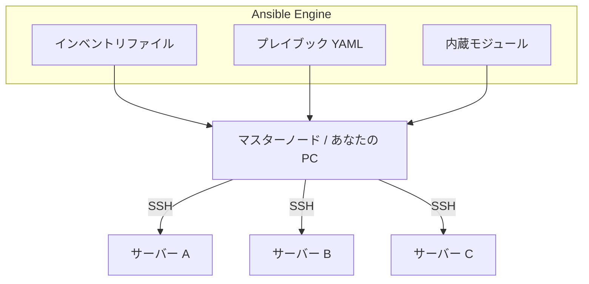

# Ansible：大量サーバーの構成を自動化する 🤖

Day 23へようこそ！

ここ2日間、私たちは **Terraform** を使って「ガワ（Infrastructure）」、つまり空っぽのサーバーを作成してきました。今日は、そこに「魂」を吹き込む方法を学びます。一つ一つのサーバーに手動で SSH ログインすることなく、数百台のサーバーに対して同時にソフトウェアのインストール、セキュリティ設定、ユーザー作成などを行う方法です。

**構成管理（Configuration Management）** (#(Configuration Management)) と **Ansible** (#(Ansible)) の世界へようこそ。

---

## 🪝 THE HOOK：「SSH ループ」の悪夢と深夜のセキュリティインシデント

あなたが 20 台の Linux サーバーを管理していると想像してください。極めて深刻なセキュリティ脆弱性（例：Log4j）が発表されたばかりです。あなたは今すぐ、全 20 台のサーバーでこのライブラリをアップグレードしなければなりません。

あなたは作業を開始します：
1. `ssh server-01` -> `sudo apt update` -> `sudo apt upgrade ...` -> `exit`
2. `ssh server-02` -> ...
15 台目のサーバーに差し掛かった頃、目がかすみ、眠気に襲われ、うっかり `/etc/` フォルダを削除するコマンドを打ち間違えてしまいました。サーバーがダウンします。そのサーバーを救出しようと冷や汗を流している間も、残りの 5 台は脆弱性が放置されたままです。

これこそが、**Click-Ops**（ターミナル版）が効率を奪う瞬間です。DevOps マスターはこのようなことはしません。Ansible を使って、コマンドを一斉に「放射」するのです。

---

## 🎭 ANALOGY：指揮者とオーケストラ

あなたのインフラを、巨大な交響楽団（オーケストラ）と考えてみましょう：
- 一つ一つのサーバーは演奏者（チェロ、バイオリン、フルート...）です。
- **Ansible** は、指揮台に立つ **「指揮者」** です。

指揮者が一人一人の耳元へ走り寄り、「ドの音を弾いてください」とささやく必要はありません。指揮者がタクトを振り、テンポを刻むだけで十分です。楽団全体が、あらかじめ書かれた楽譜（**Playbook** / プレイブック）通りに正確に演奏します。

もし新しい演奏者が加わっても、彼はその楽譜を見るだけで、すぐに全員と息を合わせることができます。これこそが絶対的な同期（Synchronization）です。

---

## ⚙️ UNDER THE HOOD：Ansible の仕組み

「構築」に焦点を当てる Terraform とは異なり、Ansible は「構成（設定）」に焦点を当てます。

### 1. Agentless（エージェントレス / 導入不要）
これが Ansible の最大の利点です。対象となるサーバーに特別な管理用ソフトウェアをインストールする必要はありません。Ansible は **SSH** (#(SSH)) と **Python** (#(Python)) さえあれば、すべてを制御できます。

### 2. 主要な構成要素

- **Inventory** (#(Inventory))：管理したいサーバーのリスト（`hosts` ファイル）。
- **Modules** (#(Modules))：タスクを実行するための小さな「道具」（例：ソフトウェアをインストールする `apt` モジュール、ファイルを送る `copy` モジュール）。
- **Playbook** (#(Playbook))：実行したい「シナリオ」を記述した YAML ファイル。
- **Roles** (#(Roles))：プレイブックをプロフェッショナルに整理し、タスクを再利用しやすくするための仕組み。

### 3. 動作フロー図



---

## 💻 DEVOPS IN PRACTICE：最初のプレイブックを書く

全 Web サーバーに Nginx をインストールする、極めてシンプルなプレイブックを見てみましょう：

```yaml
---
- name: Web サーバーのセットアップ
  hosts: web_servers # インベントリで定義されたサーバーグループ
  become: yes # sudo 権限で実行
  
  tasks:
    - name: Nginx のインストール
      apt:
        name: nginx
        state: latest
        update_cache: yes

    - name: Nginx サービスの起動
      service:
        name: nginx
        state: started
        enabled: yes
```

`ansible-playbook setup.yml` というコマンド一つで、あなたがコーヒーを淹れている間に、Ansible が 100 台のサーバーに対して勤勉に作業を完了させてくれます。

---

## 🛡️ MASTER THINKING：「冪等性（べきとうせい / Idempotency）」

これは DevOps において最も重要な用語の一つです。**冪等性（Idempotency）** (#(Idempotency)) とは、「プレイブックを 1 回実行しても 100 回実行しても、最終的なサーバーの状態は常に同じになり、エラーが発生しない」という性質です。

もし Nginx が既にインストールされていれば、Ansible は「OK」と報告し、何もしません。上書きしたり、無意味に再起動したりすることはありません。これにより、インフラは常に「あるべき状態（Desired State）」に保たれます。

---

## 💻 INTERVIEW QUESTION：ミドル/シニア DevOps レベル

**質問：Ansible のプレイブック内にあるパスワードや API キーを、Git に公開せずに保護するにはどうすればよいですか？**

**回答（マスターレベル）：**
**Ansible Vault** (#(Ansible Vault)) を使用します。
これは、機密ファイルや変数をパスワードで暗号化できるツールです。Git にコミットしても、そのファイルはただの無意味な文字列として表示されます。プレイブックを実行する際に、Vault パスワード（またはパスワードファイル）を提供することで、Ansible が実行時に復号して使用します。よりプロフェッショナルな現場では、**HashiCorp Vault** や **AWS Secrets Manager** などのシークレット管理ソリューションと連携させることもあります。

---

## 📝 QUICK QUIZ：自動化エンジニアへの挑戦

1. **なぜ Ansible は「エージェントレス」と呼ばれますか？**
    - A. インターネットが不要だから。
    - B. 管理対象のサーバーに、特別な管理用ソフトウェアをインストールする必要がないから。
    - C. Linux でしか動かないから。

2. **Ansible でタスクを記述するための YAML ファイルを何と呼びますか？**
    - A. Dockerfile
    - B. Jenkinsfile
    - C. プレイブック（Playbook）

3. **「冪等性（べきとうせい）」は DevOps にどのようなメリットをもたらしますか？**
    - A. コードの実行速度を上げる。
    - B. 何度実行しても副作用を起こさず、サーバーを常に期待通りの状態に保つことができる。
    - C. コードのミスを自動的に修正する。

---

## 📊 文字数: ~4500文字

**まとめ**: あなたはサーバーという「楽団」を操る指揮の技術を習得しました。明日（Day 24）は、**GitOps** (#(GitOps)) モデルと **ArgoCD** (#(ArgoCD)) というツールを使って、CI/CD のさらに先の未来へと足を踏み入れます。本物の「魔法」を見る準備をしておいてください！
