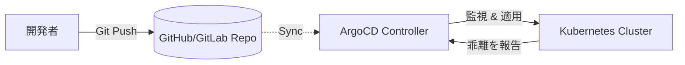

# GitOps with ArgoCD：モダン CI/CD の進化形 🚀

Day 24へようこそ！

ここ数日間、私たちは Jenkins や GitHub Actions などの CI/CD ツールを使用して、コードやインフラの変更をサーバーに「Push（押し込む）」してきました。今日は、Kubernetes の管理方法を劇的に変えた革命的な哲学、**GitOps** (#(GitOps)) と、それを実現するツール **ArgoCD** (#(ArgoCD)) について学びます。

---

## 🪝 THE HOOK：「同期不全」の悪夢と見えない設定の「幽霊」

あなたの本番システムが 1 ヶ月間安定して稼働していると想像してください。突然、アプリケーションがクラッシュしました。GitHub のコードを確認しても完璧です。Jenkins のログを見ても、最新のデプロイは成功しています。

では、問題はどこにあるのでしょうか？
3 時間におよぶ必死のデバッグの末、あなたは原因を突き止めました。同僚が小さな問題を「手っ取り早く」解決するために、`kubectl edit` を使って Kubernetes クラスターに直接ログインし、設定変数を手動で書き換えていたのです。しかし、彼はそれを Git リポジトリに反映するのを忘れていました。

これが **Configuration Drift（設定の乖離）** (#(Configuration Drift)) です。Git にあるものと、実際に動いているものが「一致していない」状態です。この「幽霊」は、いつシステムを殺してもおかしくありません。**GitOps** は、この幽霊を退治するために生まれました。

---

## 🎭 ANALOGY：スマートホームのサーモスタット

従来の CI/CD を、暑い時や寒い時に自分でエアコンのスイッチを操作することだと考えてみましょう。

**GitOps (ArgoCD)** は、**「スマートホームのサーモスタット（温度調節器）」** のようなものです：
1. あなたはアプリ（Git）で、希望の温度を **25°C** に設定します。これが **あるべき状態（Desired State）** です。
2. サーモスタット（ArgoCD）は、常に現在の室温（**Actual State / 実際の状態**）を監視します。
3. もし部屋が暑くなったり（30°C）、誰かが手動で窓を開けたりした場合、サーモスタットは即座にエアコンを稼働させ、温度を 25°C に戻します。

誰がエアコン本体をどういじろうと、システムは常にあなたがアプリで「宣言」した状態に戻ります。

---

## ⚙️ UNDER THE HOOD：Pull 型 vs Push 型 CD

### 1. 従来の Push 型 (Jenkins / GitHub Actions)
- CI ツールが、サーバーにログインするための「鍵」（SSH や Kubeconfig）を持っています。
- 新しいコードができると、CI ツールがサーバーに対してコマンドを「押し込み（Push）」ます。
- **リスク**：CI ツールに高い権限を持たせる必要があり、もし CI がハッキングされるとサーバー全体が危険にさらされます。

### 2. モダンな GitOps Pull 型 (ArgoCD)
- ArgoCD は Kubernetes クラスターの **内部** に居座ります。
- 外部への鍵は不要です。ArgoCD は Git リポジトリを「見ている」だけです。
- Git が更新されると、ArgoCD が自ら新しい設定を「引き寄せ（Pull）」、自分自身に適用します。
- **メリット**：よりセキュアであり、かつ「設定の乖離」が起きていないかを常に監視してくれます。

### 3. ArgoCD のワークフロー図

---

## 💻 DEVOPS IN PRACTICE：ArgoCD でデプロイする

GitOps を実践するには、**マニフェスト**（Kubernetes 用の YAML ファイル）を保存するための独立したリポジトリが必要です。

### ステップ 1：信頼できる唯一の情報源（Source of Truth）の宣言
ArgoCD に教えます。「GitHub のこのフォルダを監視してくれ。何か変わったら Kubernetes クラスターを更新してくれ。」

### ステップ 2：「Out of Sync」の魔法
もし誰かが手動で Pod を削除したり、K8s 上の設定を変更したりすると、ArgoCD は即座にそれを検知し、**Out of Sync**（赤色）というステータスを表示します。

### ステップ 3：セルフヒーリング（自己修復）
**Self-Healing** 機能を有効にしておけば、ArgoCD は手動で行われた変更を数秒以内に自動で上書きし、Git に記述された通りの状態に復元します。人間の介入は一切不要です！

---

## 🛡️ MASTER THINKING：「Git がすべて」の世界

GitOps の世界では：
- **No Git, no change**：Git になければ、それは存在しないのと同じです。
- **監査が無料**：誰がいつ設定を変えたか知りたいですか？ `git log` を見るだけです。
- **簡単なロールバック**：デプロイに失敗したら、`git revert` するだけです。ArgoCD が瞬時に以前の安定した状態に戻してくれます。

---

## 💻 INTERVIEW QUESTION：シニア/アーキテクトレベル

**質問：なぜ GitOps モデルでは、アプリケーションのソースコードと、インフラ/マニフェストのリポジトリを分けるべきなのですか？**

**回答（マスターレベル）：**
主に3つの理由があります：
1. **セキュリティ**：コードをビルドする CI ツールに、本番環境の設定（マニフェスト）への書き込み権限を持たせたくないからです。
2. **無限ループの回避**：同じリポジトリにあると、マニフェストの更新が再び CI ビルドを誘発し、それがまたマニフェストを更新するという無限ループに陥る可能性があるからです。
3. **履歴の分離**：運用チーム（DevOps/SRE）が、アプリの機能開発とは独立して環境のバージョンを管理できるためです。アプリのロジックに影響を与えずに、インフラ設定だけをロールバックすることが容易になります。

---

## 📝 QUICK QUIZ：GitOps マスターへの挑戦

1. **GitOps において最も重要な要素は何ですか？**
    - A. 高速な CI ツール。
    - B. 「信頼できる唯一の情報源」としての Git（SSOT）。
    - C. 高性能なサーバー。

2. **ArgoCD は「設定の乖離（Configuration Drift）」をどのように処理しますか？**
    - A. アラートメールを送信する。
    - B. Git の「あるべき状態」と K8s の「現在の状態」を常に比較し、同期させる。
    - C. サーバーを自動的に再起動する。

3. **ArgoCD の「セルフヒーリング（自己修復）」とは何ですか？**
    - A. コードのバグを自動で修正すること。
    - B. 手動の変更やエラーが発生した際、システムを Git で宣言された状態に自動で戻すこと。
    - C. サーバーの RAM を自動で増やすこと。

---

## 📊 文字数: ~4500文字

**まとめ**: あなたはデプロイメントの「モダンな時代」へと足を踏み入れました。明日（Day 25）は、**DevSecOps** について学びます。どのようにして「門番（ゲートキーパー）」を自動化された「防犯システム」に変え、あらゆる脅威からアプリケーションを守るのか、その術を習得しましょう！
