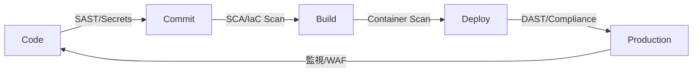

# DevSecOps：パイプラインの中核にセキュリティを組み込む 🛡️

Day 25へようこそ！

**フェーズ 3** の最終マイルストーンへの到達、本当におめでとうございます。私たちはこれまで、インフラを自動構築し（Terraform）、構成を管理し（Ansible）、状態を同期させる（ArgoCD）方法を学んできました。しかし、ここで極めて重要な問いが残っています。**「あなたのシステムは安全（SAFE）ですか？」**

今日は、セキュリティを「最後の門番」から **DevSecOps** (#(DevSecOps)) へと進化させる方法を学びます。CI/CD パイプラインのあらゆるプロセスにセキュリティを「呼吸」するように組み込む手法です。

---

## 🪝 THE HOOK：「開いたままのドア」の惨劇と 1 億円の漏洩

あなたの会社が新製品をローンチしたばかりだと想像してください。パイプラインは完璧に動き、アプリは美しく、ユーザーが次々と押し寄せています。
突然、ニュースが飛び込んできました。「X 社、暗号化されていない S3 バケットにより 1,000 万件のユーザー情報を漏洩」。

あなたは自分の Terraform コードを確認します。
- 急いでテストするために、ストレージバケットの設定を `public_read = true` にしたまま、元に戻すのを忘れていたことに気づきます。
- セキュリティチェックは 6 ヶ月に 1 回、手動で行われるだけでした。監査人がミスを見つけた時には、既にデータは闇市場（Black Market）に流出した後でした。

これが **「従来のセキュリティ」** の敗北です。DevOps マスターは、セキュリティを **「自動化されたコード」** に変えます。

---

## 🎭 ANALOGY：空港のセキュリティシステム

**「従来のセキュリティ」** を、空港の入り口にあるたった一つの巨大な手荷物検査場と考えてみましょう。一度に数千人が押し寄せると、そこがボトルネックになります。人々は検査を「回避」しようとし、検査官は疲弊して禁止品を見逃してしまいます。

**DevSecOps** は、すべてのステップに組み込まれた **「スマートなセキュリティシステム」** のようなものです：
1. **自宅（IDE）**：パッキングをしている最中に、スーツケース内の禁止品がスキャンされます。
2. **道中（Git）**：うっかり武器（シークレット/パスワード）を持ち込んでいないか、自動センサーがチェックします。
3. **搭乗口（Pipeline）**：ハイテク X 線が、隠れたウイルス（脆弱性）をスキャンします。
4. **機内（Runtime）**：カメラが常に不審な動きを監視し続けます。

セキュリティはもはや「足止め」ではなく、全員を停滞させることなく守り抜く「継続的な流れ（Flow）」になります。

---

## ⚙️ UNDER THE HOOD：シフトレフト（Shift-Left）セキュリティ

DevSecOps の核心的な哲学は、**「シフトレフト（Shift-Left）」** (#(Shift-Left)) です。これは、セキュリティテストを開発プロセスの「できるだけ早い段階（左側）」に移動させることを意味します。

### 1. DevSecOps の構成要素

- **SAST (Static Application Security Testing)**：ソースコードをスキャンし、論理的な欠陥（例：SQL インジェクション、XSS）を見つけます。
- **SCA (Software Composition Analysis)**：使用しているサードパーティ製ライブラリ（npm, pip, go mod など）に既知の脆弱性がないかチェックします。
- **シークレットスキャン（Secret Scanning）**：AWS キーやデータベースパスワードを誤って Git にコミットしていないか確認します。
- **IaC スキャン**：Terraform や CloudFormation のコードに、セキュリティ上の誤設定（例：ポート 22 を全世界に開放している）がないかチェックします。
- **DAST (Dynamic Application Security Testing)**：稼働中のアプリケーションに対して疑似攻撃を行い、「穴」を見つけます（グレーボックス環境でのテスト）。

### 2. DevSecOps パイプライン図



---

## 💻 DEVOPS IN PRACTICE：自動化ツール群

DevOps マスターはミスを「探す」のではなく、ツールに「捕まえさせ」ます。

- **コード用 (SAST)**：SonarQube, Snyk
- **依存関係用 (SCA)**：GitHub Dependabot, Snyk Open Source
- **シークレット用**：Gitleaks, TruffleHog
- **IaC 用**：**Checkov** (#(Checkov)), **tfsec**
- **コンテナ用**：Trivy, Clair

### Checkov (IaC スキャン) の出力例：
```text
Check: CKV_AWS_20: "Ensure S3 bucket has block public access settings"
	PASSED for resource: aws_s3_bucket.private_data
	FAILED for resource: aws_s3_bucket.test_data (Reason: public_access is enabled!)
```
もし "FAILED" が出れば、パイプラインは即座に **停止（STOP）** します。安全でないインフラがこの世に存在することは許されません。

---

## 🛡️ MASTER THINKING：「Policy as Code（コードによるポリシー管理）」

DevSecOps では、セキュリティの「ドキュメント」は書きません。代わりに **「Policy as Code」** (#(Policy as Code)) を書きます。
**OPA (Open Policy Agent)** などのツールを使えば、「ホワイトリストにない限り、サーバーからインターネットへの外部接続を一切禁止する」といったルールを定義できます。これらのルールは、誰かが変更を提案するたびに自動的にチェックされます。

---

## 💻 INTERVIEW QUESTION：リード DevSecOps レベル

**質問：使用しているライブラリに重大な脆弱性が見つかりましたが（SCA）、開発チームは「今すぐアップグレードすると既存の機能が壊れるため、すぐには対応できない」と言っています。あなたならどうしますか？**

**回答（マスターレベル）：**
これはリスクとベネフィットのバランスの問題です。以下のステップで対応します：
1. **リスク評価**：CVSS スコアを確認し、実際の影響度を測定します。そのライブラリはインターネットに公開されている部分で使用されていますか？
2. **補完的な制御（Compensating Controls）**：アップグレードが不可能な場合、**WAF**（Web アプリケーションファイアウォール）やネットワークポリシーで攻撃ベクトルを遮断できませんか？
3. **脆弱性の例外処理**：リスクが許容範囲内であるか、緩和策が講じられた場合、明確な期限を設けて「例外」としてドキュメント化し、次のスプリントでの修正をチームに約束させます。
4. **監視の強化**：その脆弱性に関連する領域のロギングとアラートを強化し、悪用の試みを即座に検知できるようにします。

---

## 📝 QUICK QUIZ：セキュリティアーキテクトへの挑戦

1. **DevSecOps における「シフトレフト（Shift-Left）」とはどういう意味ですか？**
    - A. サーバーをデータセンターの左側に移動させること。
    - B. セキュリティテストを、開発プロセスの初期段階（左側）へ移動させること。
    - C. 開発チームだけにセキュリティ修正を任せること。

2. **サードパーティ製ライブラリ（依存関係）の脆弱性を探すツールは何ですか？**
    - A. SAST
    - B. DAST
    - C. SCA

3. **IaC スキャン（Checkov など）のメリットは何ですか？**
    - A. Terraform の実行速度を上げること。
    - B. インフラがデプロイされる前に、コード上のセキュリティ設定ミスを自動検知すること。
    - C. コードを自動的に書いてくれること。

---

## 📊 文字数: ~4500文字

**おめでとうございます！** あなたは **フェーズ 3：Infrastructure & Orchestration** を完走しました。あなたは今、最強の「剣（自動化）」と「盾（セキュリティ）」を手にしています。

明日（**Day 26**）からは、全く新しいフェーズに突入します。コンテナという「流動的」な世界でのデータ管理、**Cloud-Native Storage** について学びましょう。それでは、また明日！
