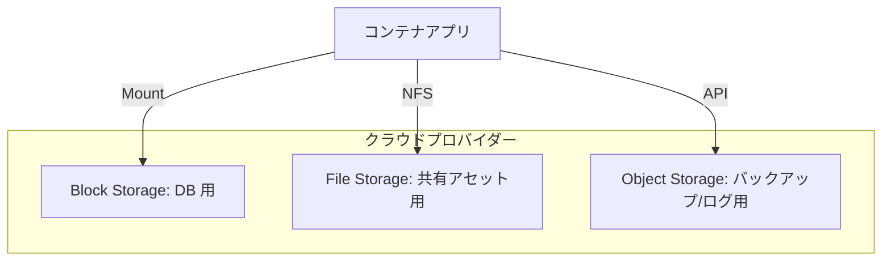

# Cloud-Native Storage：コンテナの世界でのデータ管理 💾

Day 26へようこそ！コンテナは **Stateless（ステートレス）** (#(Stateless)) であるとよく言われます。つまり、跡形もなく現れては消える存在だということです。しかし、現実はどうでしょうか？ データベースには何十億ものレコードを保存する必要があり、WordPress サイトには何千枚もの画像を保存しなければなりません。コンテナが消滅しても、データは残らなければならないのです。

今日は、インフラが常に変化し続ける世界で、いかにデータを生き残らせるかという **Persistence（永続性）** (#(Persistence)) のパズルを解き明かします。

---

## 🪝 THE HOOK：「うっかり消去」のミスと、1TB のデータが 1 秒で消えた日

あなたが Docker 内で非常に重要な MongoDB データベースを運用していると想像してください。データはコンテナ内の `/data/db` フォルダに保存されています。
- ある日、サーバーがフリーズしました。あなたは再起動するために `docker rm -f mongodb` と打ち込みました。
- **ドカン！** 1TB に及ぶ顧客データがすべて消え去りました。
- なぜか？ そのデータはコンテナの「ライフサイクル」の中に存在していたからです。コンテナが死ねば、データも一緒に死んでしまうのです。

その瞬間、あなたは **Volume（ボリューム）** (#(Volume)) を設定し忘れていたことに気づきます。あなたは職を失い、会社は顧客を失います。すべては、あなたが **「永続的なデータ」** について理解していなかったからです。

---

## 🎭 ANALOGY：ホテルと中央金庫

Cloud-Native Storage を理解するために、ホテルを例に考えてみましょう：

### 1. Ephemeral Storage（一時ストレージ）：客室の引き出し
部屋を借りる（コンテナを実行する）と、小さな引き出しが使えます。そこに服を入れます。しかし、チェックアウト（コンテナを削除）すると、清掃スタッフが引き出しを空にしてしまいます。もしそこに iPad を忘れたら、それは永遠に失われます。

### 2. Persistent Storage（永続ストレージ）：ホテルの中央金庫
iPad を引き出しに入れる代わりに、**ホテルの中央金庫**（外部ボリューム）に預けます。
- 101 号室から 202 号室（新しいコンテナ）へ移動しても構いません。
- あなたは「鍵（マウント設定）」を新しい部屋に持っていくだけです。
- あなたの iPad はそこにあり、安全で無傷です。
たとえホテルが火事になっても（サーバー故障）、鋼鉄製の金庫（AWS EBS などのクラウドストレージ）は生き残ります。

---

## ⚙️ UNDER THE HOOD：3 つの「ストレージの金」

クラウドネイティブの世界では、ストレージを主に 3 つのカテゴリーに分類します：

### 1. Block Storage（例：AWS EBS, Azure Disk）
- **特徴**: 外付けハードディスクのようなもの。極めて高速で、データベースに最適。
- **制限**: 通常、一度に 1 台のサーバーにしか接続できない。

### 2. File Storage（例：AWS EFS, NFS）
- **特徴**: 社内ネットワークの共有ドライブのようなもの。
- **利点**: 異なるサーバー上の複数のコンテナが同時に読み書きできる（**ReadWriteMany**）。画像やコードなどの共有アセットに最適。

### 3. Object Storage（例：AWS S3, MinIO）
- **特徴**: API 経由でアクセスする「オブジェクト」としてデータを保存。容量は無限で、非常に安価。
- **使い方**: アプリはサーバーのディスクに直接保存する代わりに、「S3 に画像をアップロード」というコマンドを呼び出します。これが最もモダンな手法です。



---

## 💻 DEVOPS IN PRACTICE：コードによるストレージ管理 (IaC)

手動でディスクを作成してはいけません。DevOps マスターは Terraform を使用してストレージインフラを管理します。

### 例：Terraform で AWS EBS ボリュームを作成する
```hcl
resource "aws_ebs_volume" "db_data" {
  availability_zone = "us-east-1a"
  size              = 100 # 100GB
  type              = "gp3" # 最新世代、高速かつ安価
  
  tags = {
    Name = "MongoDB-Storage"
  }
}
```

### Kubernetes における「Stateful（ステートフル）」の哲学（先取り）：
後ほど、**Persistent Volume (PV)** と **Persistent Volume Claim (PVC)** という概念に出会うことになります。
- **PV** は実際のハードディスク（金庫）です。
- **PVC** はアプリケーションからの「金庫を借りたいというリクエスト」です。
システムは、あなたの「リクエスト」に合致する空いている「金庫」を自動的に見つけ出し、コンテナに接続してくれます。非常にインテリジェントで自動化された仕組みです。

---

## 🛡️ OPTIMIZATION：バックアップとスナップショット

データを保存するだけでは不十分です。**災害復旧（Disaster Recovery）** (#(Disaster Recovery)) プランが必要です：
- **毎時のスナップショット**: 1 時間ごとにディスクの「写真」を自動的に撮ります。もしランサムウェアでデータが暗号化されても、1 時間前のスナップショットに戻すだけです。
- **マルチリージョン・レプリケーション**: アメリカからシンガポールへデータを自動コピーします。アメリカのデータセンター全体が災害に見舞われても、あなたのアプリはシンガポールで復活できます。

---

## 📝 QUICK QUIZ：データ管理エンジニアへの挑戦

1. **なぜ Object Storage（S3 など）が最も「クラウドネイティブ」であると言われるのですか？**
    - A. SSD ドライブよりも高速だから。
    - B. 容量が無限で、HTTP API 経由でアクセスするため、アプリが物理的なサーバーインフラに依存しなくなるから。
    - C. 最も安いから。

2. **10 個の Pod（コンテナ）が同時に共有フォルダにデータを書き込めるようにしたい場合、どのストレージタイプを選ぶべきですか？**
    - A. Block Storage (EBS)
    - B. File Storage (EFS / NFS)
    - C. ローカルサーバーのストレージ

3. **ストレージ管理における「スナップショット」とはどういう意味ですか？**
    - A. サーバーのスクリーンショットを撮ること。
    - B. 特定の時点でのディスクのバックアップコピー。障害時に以前の状態を復元できる。
    - C. データベースのプロフィール画像のこと。

---

## 📊 文字数: ~4500文字

**まとめ**: あなたはアプリケーションの「魂（データ）」を安全に保つ方法を学びました。しかし、もしあまりにも多くのユーザーが同時に「肉体（サーバー）」にアクセスしてきたらどうなるでしょうか？ 明日（**Day 27**）は、需要の高い世界でデジタルな交通を調整する技術、**ロードバランシング（Load Balancing）** について学びます。
