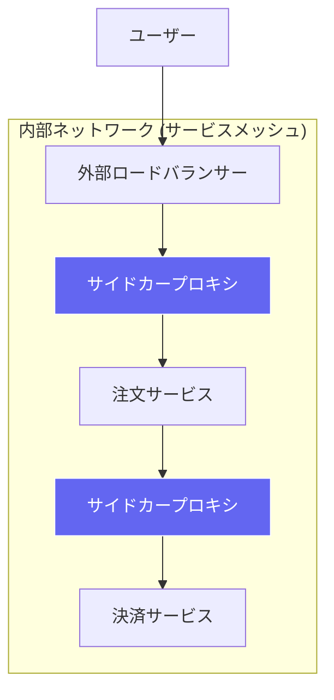

# Load Balancing & Service Mesh：トラフィック調整の極意 🚢

Day 27へようこそ！ 成功したアプリケーションとは、多くのユーザーを抱えるものです。しかし、ユーザーが多すぎることは負担にもなり得ます。もし 100 万人が 1 台のサーバーに同時にアクセスすれば、そのサーバーは「火を吹く」でしょう。

今日は、**ロードバランシング（Load Balancing）** (#(Load Balancing)) を使ってその負担を複数の異なるサーバーに分散する方法を学び、マイクロサービスにおける最高峰の概念である **サービスメッシュ（Service Mesh）** (#(Service Mesh)) に触れていきます。

---

## 🪝 THE HOOK：セール祭りと深夜 0 時のシステムダウン

あなたが E コマースサイトを運営していると想像してください。11 月 11 日の午前 0 時、何百万人もの人々が一斉に「決済」ボタンを押しました。
- あなたは 10 台の超高性能サーバーを用意しました。
- しかし、設定ミスにより、すべてのトラフィックがサーバー 1 号機だけに集中してしまいました。
- 1 号機はダウン。残りの 9 台は何もせずに「お茶を飲んでいる」状態です。
- 顧客は決済できず、上司からは真夜中に怒りの電話がかかってきます。

ここでの問題は、サーバーが足りないことではなく、スマートな **「交通整理員（ロードバランサー）」** が不在だったことです。

---

## 🎭 ANALOGY：スーパーマーケットとレジ誘導係

あなたのシステムを巨大なスーパーマーケットと考えてみましょう：

### 1. ロードバランサー：ロビーの誘導係
客（トラフィック）が大量に押し寄せた時、一人のスタッフ（ロードバランサー）が列の先頭に立ち、「お客様は 1 番レジへ、次の方は 2 番レジへ」と指図します。
- これにより、特定のレジが過負荷になるのを防ぎます。
- もし 3 番レジのコンピュータが故障したら（サーバーエラー）、誘導係はそこへ客を送るのを即座に止めます（**Health Check / ヘルスチェック**）。

### 2. サービスメッシュ：スタッフ専用のインカムシステム
スーパーマーケットが巨大（マイクロサービス）になると、レジ担当は倉庫に連絡し、倉庫は警備員に連絡する必要があります。
- 各自が個人のスマホを使う（アプリが個別に接続ロジックを持つ）代わりに、店は全員に統一されたインカムシステムを支給します。
- このシステムは自動的に情報を暗号化し（MTLS）、通話履歴を記録し（Observability）、話し中の場合は自動でリダイヤル（Retry）してくれます。これが **サービスメッシュ** です。

---

## ⚙️ UNDER THE HOOD：マスター級の 3 つの調整レイヤー

### 1. L4 ロードバランシング (Transport Layer)
- **仕組み**: IP アドレスとポート番号に基づきます。
- **速度**: パケットの中身を気にしないため、極めて高速です。
- **例**: AWS NLB (Network Load Balancer)。

### 2. L7 ロードバランシング (Application Layer)
- **仕組み**: HTTP の内容を読み取ります。パスに基づいてトラフィックを振り分けることができます（例：`/api` はサーバー A へ、`/images` はサーバー B へ）。
- **例**: Nginx, AWS ALB (Application Load Balancer)。

### 3. サービスメッシュ (Sidecar Pattern)
サービスメッシュは入り口に座っているのではなく、あなたの各サービスの **「すぐ隣」** に座っています。
- **Istio** (#(Istio)) はその最も有名な代表格です。
- アプリケーションのコードを一行も変えることなく、「10% のユーザーだけに新バージョンを試させる（カナリアリリース）」といった複雑なシナリオを実現できます。



---

## 💻 DEVOPS IN PRACTICE：シンプルな Nginx ロードバランサーの設定

シナリオ：3 台のバックエンドサーバーがあり、Nginx でトラフィックを均等に分散させたい場合。

### `nginx.conf` の設定例：
```nginx
upstream my_backend {
    server 10.0.0.1:3000 weight=3; # 性能の高いサーバーにより多くのトラフィックを送る
    server 10.0.0.2:3000;
    server 10.0.0.3:3000 backup; # 上記の 2 台がダウンした時だけ稼働する
}

server {
    listen 80;
    location / {
        proxy_pass http://my_backend;
    }
}
```

### 高可用性（HA）の思考：
DevOps マスターは、ロードバランサーを **単一障害点（Single Point of Failure）** (#(Single Point of Failure)) にすることはありません。もしロードバランサー自体が壊れたらどうしますか？ **Keepalived** や **Anycast IP** などの仕組みを使い、少なくとも 2 台のロードバランサーを並列で動かします。

---

## 🛡️ MASTER THINKING：「サーキットブレーカー（遮断器）」

サービスメッシュには、**サーキットブレーカー（Circuit Breaker）** (#(Circuit Breaker)) という素晴らしい概念があります。
もしサービス B にエラーが発生し、応答が非常に遅くなっている場合、サービスメッシュは自動的に「回路を遮断」し、サービス A が B を呼び出さないようにします。これにより、サービス A まで道連れでフリーズするのを防ぎます。
これは、連鎖的な障害に対してシステムを強くする **レジリエンス（Resilience / 回復力）** (#(Resilience)) をもたらします。

---

## 📝 QUICK QUIZ：トラフィック調整エンジニアへの挑戦

1. **L4 と L7 ロードバランシングの最大の違いは何ですか？**
    - A. L4 はクラウドで動き、L7 はオンプレミスで動く。
    - B. L4 は IP/ポートに基づいて調整し、L7 はアプリケーションの内容（HTTP ヘッダー、パス、クッキー）に基づいて調整する。
    - C. L7 の方が L4 より安い。

2. **なぜロードバランサーにとって「ヘルスチェック」フィルタが極めて重要なのですか？**
    - A. スタッフの健康状態を確認するため。
    - B. 故障しているサーバーを自動的に検知してトラフィック配信対象から外すことで、ユーザーがエラーに遭遇するのを防ぐため。
    - C. サーバーのウイルススキャンをするため。

3. **サービスメッシュ（Istio など）が内部トラフィック管理に使用するプロキシモデルは何ですか？**
    - A. セントラルプロキシ。
    - B. サイドカープロキシ（各サービスの横に添えられるプロキシ）。
    - C. リバースプロキシ。

---

## 📊 文字数: ~4500文字

**まとめ**: あなたはトラフィックの流れを支配する術を学びました。あなたのシステムは今や、数百万人ものユーザーにスケールする準備ができています。しかし、もしデータセンター全体が災害でダウンしても、アプリを生き残らせるにはどうすればよいでしょうか？ 明日（**Day 28**）は、 「不死身」のシステムを設計する **高可用性（HA）** について学びます。
