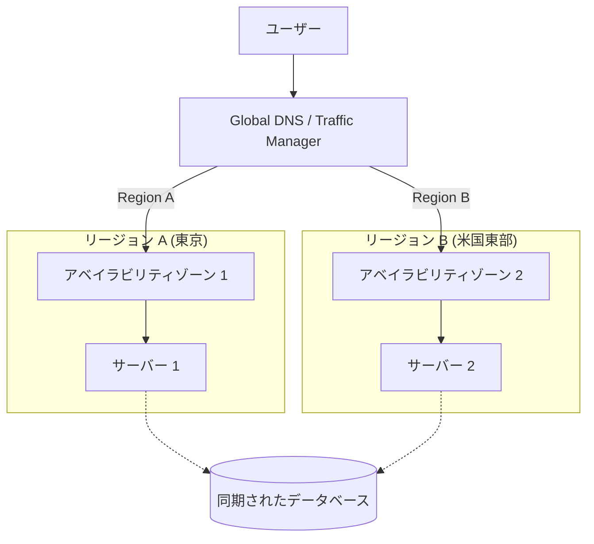

# High Availability (HA)：「不死身」のシステムを設計する ⚡

Day 28へようこそ！ テックの世界には、**Downtime（ダウンタイム）** (#(Downtime)) という名の強迫観念があります。システムが停止している時間のことです。Facebook や Amazon のわずか 1 分間のシステム停止は、数百万ドルの損失をもたらす可能性があります。

今日は、**高可用性（High Availability / HA）** (#(High Availability)) システムの設計方法を学びます。サーバー、ネットワークスイッチ、あるいはデータセンターのビル全体が爆発したとしても、アプリケーションが何事もなかったかのように顧客にサービスを提供し続ける仕組みです。

---

## 🪝 THE HOOK：ハリケーン「サンディ」とデータセンターの血の教訓

2012 年、超大型ハリケーン「サンディ」がニューヨークを襲いました。多くのデータセンターが浸水被害を受けました。
- いくつかの企業は、バックアップの発電機があるから大丈夫だと自信を持っていました。
- しかし、その発電機は地下室に設置されており、水没してしまいました。
- ニューヨークにしかサーバーを置いていなかった企業は、何日間もインターネットの地図から完全に「消滅」してしまいました。

生き残ることができたのは、複数の異なる都市にサーバーを配置する **マルチリージョン HA（Multi-region HA）** (#(Multi-region HA)) の思考を実践していた組織だけでした。あなたは災害の犠牲者になる道を選びますか、それともゲームの支配者になる道を選びますか？

---

## 🎭 ANALOGY：三本脚の椅子と街灯システム

HA を理解するために、比較してみましょう：

### 1. シングルインスタンス：たった一つのオイルランプ
家全体を照らすために 1 つのランプしか持っていない状態です。オイルが切れたり、風で消えたり（サーバー故障）すれば、家全体が真っ暗になります。これは **SLA** (#(SLA)) が最も低いシステムです。

### 2. 高可用性（HA）：都市の街灯システム
あなたは何百もの電球を持っています。
- もし電球が 1 つ切れても、他の電球は灯り続けます。
- 電球は 2 つの異なる電源系統から電力を供給されています（**マルチ AZ / Multi-AZ**）。
- たとえ発電所 A が故障しても、発電所 B が自動的に補填します（**フェイルオーバー / Failover**）。
基本的に、都市が完全に闇に包まれることはありません。これが HA の精神です。

---

## ⚙️ UNDER THE HOOD：「不死身」を実現する 3 つのレベル

### 1. ローカルレベル：冗長化（Redundancy）
1 台のサーバーの中に、2 つの電源ユニット（デュアル電源）、2 つのネットワークカードを搭載し、RAID ディスクを構成します。片方が壊れても、もう片方が即座に引き継ぎます。しかし、サーバー全体がショートしてしまえば、やはりダウンしてしまいます。

### 2. データセンターレベル：アベイラビリティゾーン (AZs)
クラウドプロバイダー（AWS/GCP）は、一つのリージョン（例：東京）を複数の **AZs** (#(AZs)) に分割しています。各 AZ は、独自の電源とネットワークインフラを持つ、物理的に離れた建物群です。
- DevOps マスターは、常に最低 2 台のサーバーを 2 つの異なる AZ で動かします。
- AZ-1 に雷が落ちても、AZ-2 は正常に動作し続けます。

### 3. グローバルレベル：マルチリージョン
これが究極のレベルです。アプリケーションを東京とバージニア（アメリカ）の両方にデプロイします。
- **グローバル・ロードバランサー**（Cloudflare や AWS Route53 など）を使用して調整します。
- 日本近海の海底光ケーブルが切断されても、トラフィックは自動的にアメリカのサーバーへ流れます。

---

## 💻 DEVOPS IN PRACTICE：可用性の「9（ナイン）」を計算する

技術サービス契約では、よく **SLA (Service Level Agreement)** (#(SLA)) という言葉を耳にします。
- **99% (Two Nines)**: 年間に 3.6 日間の停止が許容されます（非常に低い水準です）。
- **99.9% (Three Nines)**: 年間に 8.7 時間しか停止できません。
- **99.99% (Four Nines)**: 年間に 52 分間しか停止できません（大企業の標準的な水準です）。
- **99.999% (Five Nines)**: 年間にわずか 5 分間しか停止できません（マスターが目指す頂点です）。

### 「Stateless Anywhere（どこでもステートレス）」の設計思考
HA を達成するためには、アプリケーションはサーバーのローカルディスクにデータを保存してはいけません。
- すべての状態（セッション）は **Redis** に保存します。
- すべての画像は **S3** に保存します。
そうすることで、サーバーはいつでも交換可能な「雇われの身」になります（**Cattle, not Pets / ペットではなく家畜として扱う**）。

---

## 🛡️ MASTER THINKING：「Fail Fast & Self-Healing」

人間がエラーに気づくのを待ってはいけません。HA システムは **自己修復（Self-healing）** (#(Self-healing)) 能力を持つ必要があります。
**オートスケーリング・グループ（Auto Scaling Group）** (#(Auto Scaling Group)) を活用しましょう：
- 1 台のサーバーがヘルスチェックに失敗してダウンしたとします。
- システムはそれを自動的に削除し、テンプレート画像から全く同じ新しいサーバーを「ひねり出し（Spin up）」ます。
- ロードバランサーは新しいサーバーを自動的に認識し、トラフィックを流し始めます。
これらすべては、あなたがぐっすり眠っている間に進行します。

---

## 📝 QUICK QUIZ：HA システム設計エンジニアへの挑戦

1. **なぜ、同じ AZ 内の 2 台のサーバーにデプロイするよりも、2 つの異なるアベイラビリティゾーン (AZs) にデプロイする方が重要なのですか？**
    - A. 異なる AZ を使うと IP アドレスが変わるから。
    - B. AZs は電源、インフラ、冷却システムが独立したデータセンターだから。これにより、建物全体の単一障害点（Single Point of Failure）を回避できる。
    - C. 1 つの AZ にデプロイする方が安いから。

2. **DevOps における「ファイブナイン」(99.999%) という表記はどういう意味ですか？**
    - A. システムが非常に信頼性が高く、年間の最大停止時間が約 5 分間しかないこと。
    - B. システムに 5 台のサーバーが並列で動いていること。
    - C. システムが 9 層のレイヤーで保護されていること。

3. **「フェイルオーバー（Failover）」の仕組みはどのように動作しますか？**
    - A. エラー発生時にデータを保護するためにシステムを自動シャットダウンする。
    - B. 故障したコンポーネントから、正常に動作している予備のコンポーネントへトラフィックを自動的に切り替える。
    - C. 壊れたファイルを削除する。

---

## 📊 文字数: ~4500文字

**まとめ**: あなたは自分のシステムを「不死身」にする方法を学びました。しかし、実際にシステムがダウンする前に、そのシステムが「健康」なのか「虚弱」なのかをどうやって知ることができるでしょうか？ 明日（**Day 29**）は、システムの隅々まで 24 時間 365 日見通すための神の目、**継続的なオブザーバビリティ（Continuous Observability）** について学びます。
