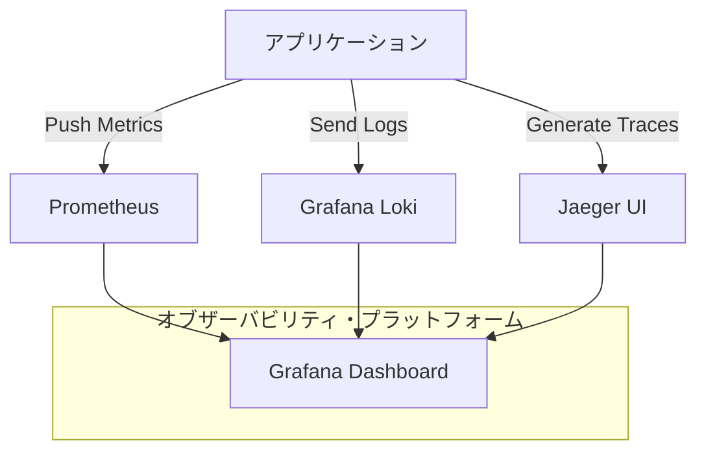

# Continuous Observability：DevOps マスターの「神の目」 👁️

Day 29へようこそ！ この 28 日間、私たちは複雑な自動化の「機械」を構築してきました。しかし、どれほど優れた機械であっても、いつかは不具合が生じます。問題は、実際にクラッシュする **「前」** に、壊れそうであることをどうやって知るかです。

今日は、単なる監視（Monitoring）ではなく、出力データに基づいてシステムの内部状態を「見透かす」能力、**継続的なオブザーバビリティ（Continuous Observability）** (#(Continuous Observability)) について学びます。

---

## 🪝 THE HOOK：「奇妙な挙動」のエラーと 48 時間に及ぶ捜査

あなたのシステムが、毎日午後 2 時になると突然重くなると想像してください。
- CPU をチェック：正常。
- RAM をチェック：正常。
- しかし、顧客からは「決済が完了できない」という苦情が絶えません。

もしあなたが従来の **監視（Monitoring）** システム（緑や赤のランプが表示されるだけのもの）しか持っていなければ、完全にお手上げ状態でしょう。何百万行ものログを 2 日間かけて漁っても、何も見つからないかもしれません。

実は、特定の地域からのトラフィックがある時だけ、サードパーティのサービス（決済ゲートウェイ）のレスポンスが遅くなっていたのです。もし **分散トレーシング（Distributed Tracing）** (#(Distributed Tracing)) を導入していれば、わずか 5 秒でその「ボトルネック」を特定できていたはずです。砂漠の中で針を探すような「アマチュア探偵」になってはいけません。

---

## 🎭 ANALOGY：定期検診とスマート健康管理デバイス

監視（Monitoring）とオブザーバビリティ（Observability）の違いを、健康管理の例で理解しましょう：

### 1. 監視 (Monitoring)：体温測定（エラー表示灯）
体温だけを測るようなものです。「37 度 -> 健康」、「39 度 -> 病気」。これは **「何が（What）」** 起きているか（熱がある）という問いには答えてくれますが、**「なぜ（Why）」** については教えてくれません。

### 2. オブザーバビリティ (Observability)：多機能健康トラッカー（スマートウォッチ＋血液検査）
心拍数、血中酸素濃度、血圧、睡眠パターンなどを複合的に追跡します。
- 階段を上ると心拍数が上がるのを確認します。
- 食事を抜くと血糖値が下がるのを確認します。
これは **「なぜ（Why）」** それが起きているのかという問いに答えてくれます。これらの関連し合うデータ（コンテキスト）のおかげで、医師（DevOps エンジニア）は推測に頼ることなく、正確に根本原因（**Root Cause**）を診断できるのです。

---

## ⚙️ UNDER THE HOOD：オブザーバビリティの 3 つの柱 (The Three Pillars)

システムが「観測可能（Observable）」であるためには、主に 3 種類のデータが必要です：

### 1. メトリクス (Metrics / 定量的指標)
- **特徴**: 時間経過に伴う数値（1 秒あたりのリクエスト数、CPU 使用率、RAM 使用率など）。
- **ツール**: **Prometheus** (#(Prometheus)), **Grafana** (#(Grafana))。
- **目的**: 傾向（トレンド）の把握。

### 2. ログ (Logs / イベント履歴)
- **特徴**: 何が起きたかを記述したテキスト（例：「10:00 にユーザー A がログイン」、「エラー：データベース接続タイムアウト」）。
- **ツール**: **ELK Stack** (Elasticsearch, Logstash, Kibana) や **Loki**。
- **目的**: エラーの詳細な掘り下げ。

### 3. トレース (Traces / 行跡)
- **特徴**: 一つのリクエストが異なるマイクロサービス間を通過していく過程を追跡。
- **ツール**: **Jaeger** (#(Jaeger)), **Zipkin**。
- **目的**: どのサービスがシステムを遅延させているかの特定。



---

## 💻 DEVOPS IN PRACTICE：インテリジェントなアラート設定

意味のない何千もの通知に溺れてはいけません。DevOps マスターは **SRE アラート（SRE Alerting）** の哲学に従います：

1. **症状ベースのアラート（Symptom-based Alerting）**：ユーザーに影響を与える症状がある時のみ通知します（例：5xx エラー率が 1 分間で 5% を超えた場合）。CPU 使用率が高いというだけでアラートを出してはいけません（通常のバッチ処理を行っているだけかもしれません）。
2. **実効性のあるアラート（Actionable Alerts）**：Discord や Slack の各通知には、ダッシュボードへのリンクと、対処手順書（**Runbook**）が添えられている必要があります。

### Prometheus のアラート設定例：
```yaml
groups:
- name: api_alerts
  rules:
  - alert: HighErrorRate
    expr: rate(http_requests_total{status=~"5.."}[5m]) > 0.05
    for: 2m
    labels:
      severity: critical
    annotations:
      summary: "{{ $labels.instance }} で API エラー率が高すぎます"
```

---

## 🛡️ MASTER THINKING：「ゴールデン・シグナル (Golden Signals)」

Google SRE によれば、以下の 4 つの指標を監視するだけで、問題の 90% を管理できます：
1. **レイテンシ（Latency / 遅延）**：1 リクエストの処理時間。
2. **トラフィック（Traffic / 流量）**：流入しているリクエスト数。
3. **エラー（Errors）**：失敗したリクエストの割合。
4. **サチュレーション（Saturation / 飽和度）**：リソースの余力（例：空き RAM 容量）。

---

## 📝 QUICK QUIZ：監視＆オブザーバビリティ・エンジニアへの挑戦

1. **なぜ複雑なマイクロサービス・システムを管理するのにログだけでは不十分なのですか？**
    - A. ログはディスク容量を多く消費するから。
    - B. ログだけでは、複数のサービス間を跨ぐリクエストの流れを追跡するのが非常に困難だから。そのためにはトレース（Traces）が必要。
    - C. ログには色がないから。

2. **Prometheus のデータから美しいダッシュボードを作成するために一般的に使われるツールは何ですか？**
    - A. Kibana
    - B. Grafana
    - C. Microsoft Excel

3. **「ゴールデン・シグナル」を構成する 4 つの要素は何ですか？**
    - A. CPU, RAM, Disk, Network
    - B. Latency, Traffic, Errors, Saturation
    - C. Login, Logout, Signup, Payment

---

## 📊 文字数: ~4500文字

**まとめ**: あなたは神の目を手に入れました。もはやどんなインシデントもあなたの視線から逃れることはできません。自動化ステージの旅の終盤に到達したことを祝福します！ 明日（**Day 30**）は、これまでの総復習を行い、**Capstone Project** に挑戦します。これを完了すれば、自動化フェーズのマスター証明を正式に手にすることになります。
