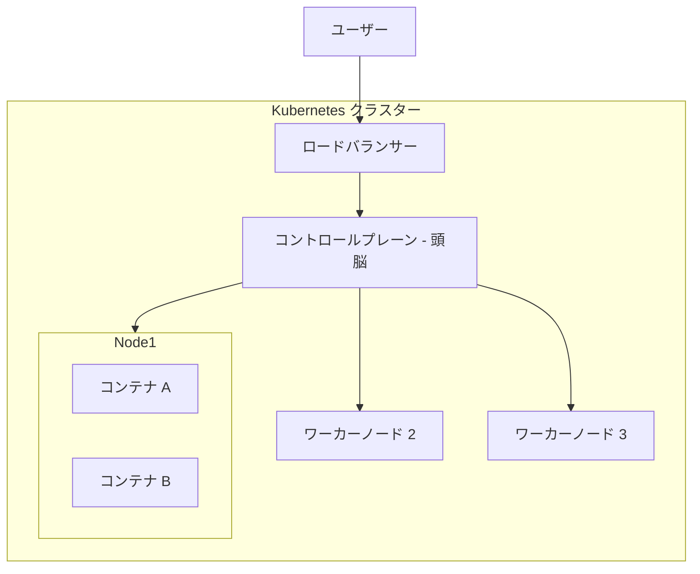

# Kubernetes 概要：インフラ・オーケストレーションの革命 🎡

Day 31へようこそ！ DevOps マスターへの道のりにおいて、最後にして最も壮大な章が幕を開けます。それが **Kubernetes Orchestration** (#(Kubernetes Orchestration)) です。

フェーズ 1 で Linux やサーバーを理解し、フェーズ 2 で CI/CD と自動化を学んだあなた。このフェーズ 3 では、数行のコードだけで何千台ものサーバーを自由自在に操る、真の **インフラ・アーキテクト** へと変貌を遂げます。

**Kubernetes** (#(Kubernetes)) — 通称 **K8s** の世界へようこそ。

---

## 🪝 THE HOOK：「成功しすぎた」がゆえの悪夢

あなたがリリースしたばかりのアプリが、爆発的なヒットを記録したと想像してください。
- **1日目**: ユーザー 100 人。1 台のサーバーで 2 つの Docker コンテナを動かせば十分です。順調な滑り出しです。
- **2日目**: ユーザー 10 万人。10 台のサーバーで 50 個のコンテナを動かす必要があります。あなたは各マシンに SSH で入り、`docker run` コマンドを手動で打ち始めます。これだけで午前中が潰れました。
- **3日目**: ユーザー 100 万人。1 台のサーバーが電源トラブルで炎上し、ダウンしました。その上で動いていた 10 個のコンテナも道連れです。20 万人のユーザーが 500 エラーに遭遇しています。あなたは徹夜でコンテナを他のマシンに移し替える作業に追われます。

この時、あなたはもはや DevOps マスターではありません。疲れ果てた「消防士」です。これらすべてを自動で行ってくれるスマートな「脳」が必要です。それこそが K8s なのです。

---

## 🎭 ANALOGY：船長とコンテナ船の船員たち

あなたのインフラを、巨大な貨物船の船団と考えてみましょう：
- 各 **コンテナ** は、アプリケーションが詰め込まれた輸送用コンテナです。
- 各 **サーバー（Node）** は、一隻の船です。
- **Docker** は、コンテナを梱包し、船に積み込むのを手伝う勤勉な作業員です。

しかし、以下のことは誰が決定するのでしょうか？
- どの船に空きスペースがあり、荷物を積めるか？
- もし一隻の船が沈没したら、どうやってその荷物を救出し、即座に別の船に移し替えるか？
- 顧客からの注文が急増（スケールアップ）した時、どうやって新しい船を呼び出すか？

**Kubernetes** は、司令塔に立つ **船長（Helmsman）** (#(Helmsman)) です。船長は自ら荷物を運ぶことはありませんが、地図と無線を持ち、荒波や強風の中でも船団全体がスムーズに運行できるよう調整する権限を持っています。K8s のロゴが「船の舵（かじ）」である理由はここにあります。

---

## ⚙️ UNDER THE HOOD：なぜ K8s はこれほど重要なのか？

Kubernetes は単にコンテナを動かすためのツールではありません。アプリケーションに「生存能力」を与えるプラットフォームです：

### 1. Service Discovery & Load Balancing
K8s はコンテナのグループに自動的に IP アドレスと DNS 名を割り当てます。ある船が過負荷になり、別の船が暇を持て余すことがないよう、トラフィックを自動で調整します。

### 2. Storage Orchestration
ローカルディスクであれ、クラウドストレージ（AWS S3 や Google Cloud Storage）であれ、ストレージをコンテナに自動でマウントします。

### 3. Automated Rollouts & Rollbacks
アプリをアップデートしたいですか？ K8s は古いコンテナを一つずつ新しいものへと段階的に置き換えていきます（**Rolling Update**）。もし新バージョンに不具合があれば？ 瞬時に旧バージョンへ自動で戻します（ロールバック）。

### 4. Self-healing（自己修復）
これが最大の「魔法」です。コンテナがフリーズすれば、K8s はそれを破棄して新しいものを作成します。サーバーが故障すれば、その上のすべてのコンテナを生きている別のサーバーへ移動させます。あなたはサーバーのダウンを心配することなく、土曜の夜にぐっすり眠ることができます。

### インフラにおける K8s の構成図

---

## 💻 DEVOPS IN PRACTICE：「命令」ではなく「宣言」

K8s を使う際の DevOps マスターの最大の違いは、**Declarative（宣言的）** (#(Declarative)) な思考にあります。
- **従来のモデル（命令的）**: 「コンテナを 3 つ動かして。image は v1 を使い、ポート 80 を開けて...」（一歩一歩命令する必要があります）。
- **K8s モデル（宣言的）**: 「私のシステムには **常に** ポート 80 で動く v1 のコンテナが 3 つある状態にしておいて」。

K8s は常に現状を **監視（Watch）** し、比較し続けます：
- 「おや、今は 2 つしかないぞ？ 持ち主の希望通り、あと 1 つ起動しよう。」
- 「おや、1 つ死んでしまったぞ？ 即座に代わりの 1 つを起動しよう。」

システムは常に自らを **「望ましい状態（Desired State）」** (#(Desired State)) へと戻そうとするのです。

---

## 🛡️ MASTER THINKING：「サーバーをペットのように扱うな」

K8s の世界では、サーバーを **家畜（Cattle）** (#(Cattle)) として扱い、**ペット（Pets）** (#(Pets)) としては扱いません。
- **ペット**: サーバーに名前を付け（例：Server-Tokyo）、細心の注意を払って世話をし、病気（故障）になれば悲しみます。
- **家畜**: 番号で管理します（Node-01, Node-02...）。もし 1 頭が病気になれば、別の個体と入れ替えます。

あなたのインフラは、アプリケーションを中断させることなく、いつでも犠牲にし、交換できる状態でなければなりません。

---

## 💻 INTERVIEW QUESTION：K8s 初級レベル

**質問：Kubernetes は Docker に取って代わるものですか？**

**回答（マスターレベル）:**
全く違います。これらは互いに補完し合う関係です。**Docker** はアプリケーションをコンテナにパッケージングする役割を担います。**Kubernetes** は、それら何千ものコンテナを管理し、調整（オーケストレート）する役割を担います。Docker を「兵士」、Kubernetes を「指揮官」と考えると分かりやすいでしょう。兵士がいなければ指揮官は操る相手がいませんし、指揮官がいなければ兵士たちはバラバラに動いて混乱してしまいます。

---

## 📝 QUICK QUIZ：オーケストレーション思考への挑戦

1. **K8s の「自己修復（Self-healing）」機能の最大のメリットは何ですか？**
    - A. 開発者のバグを自動で修正してくれる。
    - B. 故障したコンテナを自動で再起動したり、ノードがダウンした際に別のノードへ移動させたりする。
    - C. ウェブサイトの速度を 10 倍速くする。

2. **なぜ Kubernetes のロゴは船の舵（かじ）なのですか？**
    - A. 開発者が海が好きだから。
    - B. インフラという船の上でコンテナを「操縦（調整）」する役割を持っているから。
    - C. K8s は海の近くのデータセンターでしか動かないから。

3. **「望ましい状態（Desired State）」という用語はどういう意味ですか？**
    - A. プログラマーの理想の状態。
    - B. あなたが宣言したシステム構成。K8s は常にシステムをこの構成に保とうと努力する。
    - C. システムが完全にダウンした状態。

---

## 📊 文字数: ~4500文字

**まとめ**: あなたは K8s マスターの「ビジョン」を掴みました。明日（**Day 32**）は、この船長の体を「解剖」して、**頭脳（コントロールプレーン）** と **筋肉（ワーカーノード）** がどのように動いているのかを見ていきましょう！
