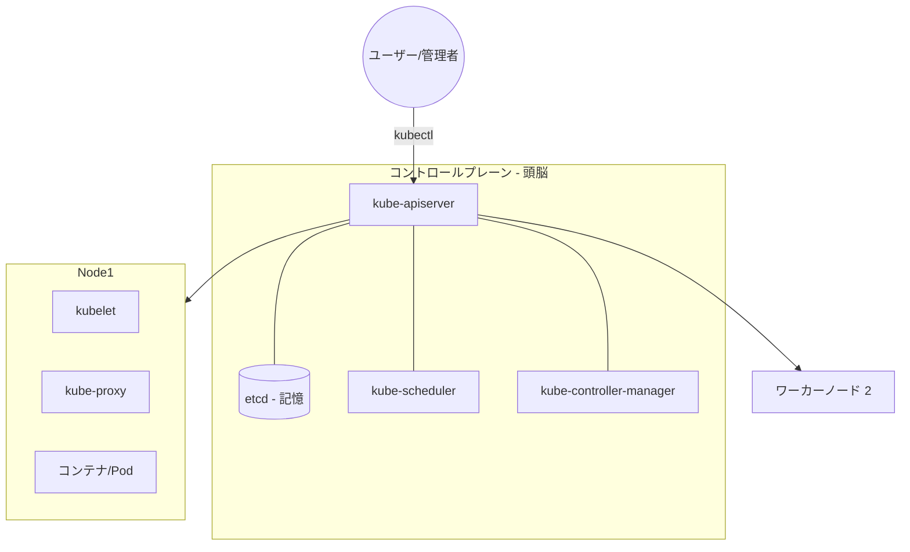

# K8s アーキテクチャ：クラスターの「頭脳」と「筋肉」を解剖する 🧠

Day 32へようこそ！ 昨日は、Kubernetes (K8s) が有能な「船長」であることを学びました。しかし、巨大な船を操るために、船長は一人で働いているわけではありません。彼には参謀将校、エンジニア、そして専門の船員たちのチームがいます。

今日は、K8s クラスターのアーキテクチャを「解剖」して、それぞれのコンポーネントの役割を深く理解していきましょう。

---

## 🪝 THE HOOK：「記憶喪失」エラーとシステム全体の崩壊

あなたが 100 台のノードからなるクラスターを運用していると想像してください。すべてが非常に安定して動いています。
ところがある日、システム内のある特別なサーバーのハードディスクが故障しました。残りの 99 台のサーバーは正常に動いているにもかかわらず、突然新しい Pod を作成できなくなり、アプリのスケールもできず、エラーが発生しても K8s が自動復旧しなくなりました。あなたの K8s クラスターは「魂の抜けた死体」と化してしまったのです。

なぜか？ それは、クラスターのすべての「記憶」と設定を保存している唯一のデータベース、**etcd** (#(etcd)) を失ったからです。K8s において、すべてのノードが等しく重要というわけではないのです。

---

## 🎭 ANALOGY：本社と建設現場

イメージしやすいように、K8s クラスターを巨大な建設会社に例えてみましょう：

### 1. コントロールプレーン（頭脳 - 本社）
ここは指揮官たちが集まる場所です。彼らが直接レンガを積むことはありませんが、すべての決定を下します：
- 取締役会 (**API Server**): 顧客からのリクエストを受け取ります。
- 保管秘書 (**etcd**): すべての契約書や設計図を記録します。
- 調整部長 (**Scheduler**): どの作業員がどの建設現場で働くかを決定します。
- 監視チーム (**Controller Manager**): 実際の進捗が約束通りであるかを確認します。

### 2. ワーカーノード（筋肉 - 建設現場）
ここは実際の作業が行われる場所です。各ノードは建設現場であり、以下を備えています：
- 現場監督 (**Kubelet**): 本社からの命令を受け取り、作業員（コンテナ）に働くよう促します。
- 郵便配達員 (**Kube-proxy**): 郵便物（ネットワークトラフィック）が正しい住所に届くようにします。

---

## ⚙️ UNDER THE HOOD：「頭脳」を構成する部品たち

**コントロールプレーン（Control Plane）** (🔊) のコンポーネントを詳しく見ていきましょう：

### 1. kube-apiserver
クラスターと通信するための唯一の「ゲートウェイ」です。`kubectl` コマンドを使おうが、ウェブインターフェースを使おうが、すべてはここを通ります。実行を許可する前に、あなたに権限があるかどうかをチェックします。

### 2. etcd
極めて安定したキーバリューストア（データベース）です。クラスターの全状態を保存します。etcd が「3 つの Pod が動いている」と記録していれば、それが絶対的な真実となります。
> **Master Rule**: etcd は必ずバックアップしてください。etcd を失うことは、クラスター全体を失うことを意味します。

### 3. kube-scheduler
その役割は「適材適所」です。あなたが新しい Pod の作成を命じると、スケジューラーは「どのノードに RAM や CPU の空きがあるか？ 適切なストレージが接続されているのはどのノードか？」を確認し、そのノードに Pod を「放り込み」ます。

### 4. kube-controller-manager
これは「約束を守る人」です。継続的なループを実行し、「持ち主は 3 つの Pod が必要だと言っているが、今は 2 つしかない。API サーバー、あと 1 つ作ってくれ！」とチェックし続けます。

### K8s アーキテクチャ構成図

---

## 💻 DEVOPS IN PRACTICE：ノードの「守衛」 - Kubelet & Kube-proxy

ワーカーノードは、あなたのアプリケーションが実際に「生きている」場所です。

- **kubelet** (🔊): 各ノードで動く小さな「エージェント」です。Pod 内のコンテナが健康に動いていることを保証します。コンテナが死んだら、kubelet はコントロールプレーンに報告します。
- **kube-proxy** (🔊): ネットワーク管理者です。外部からのトラフィックが、ノードの奥深くにある正しい Pod を見つけられるようにルールを設定します。

---

## 🛡️ MASTER THINKING：「和解ループ (Reconciliation Loop)」

K8s のパワーの秘密は、**和解ループ（Reconciliation Loop）** (#(Reconciliation Loop)) にあります。
以下の公式で動いています：
1. **Observe (観察)**: 実際の状態を観察する。
2. **Diff (比較)**: 望ましい状態（設定値）と比較する。
3. **Act (行動)**: 現実を望ましい状態に戻すためのアクションを起こす。

このサイクルが 1 秒ごとに絶え間なく行われることで、K8s は地球上で最も強力な **自己修復（Self-healing）** (🔊) システムとなっているのです。

---

## 💻 INTERVIEW QUESTION：K8s 上級レベル

**質問：ワーカーノードが動いている間にコントロールプレーンが完全にダウンしたら何が起きますか？**

**回答（マスターレベル）:**
これは深い理解を問う良い質問です。
1. ワーカーノード上の既存のアプリケーションは **そのまま動き続けます**。なぜなら kubelet がそれらを見守り続けているからです。
2. しかし、クラスターは「フリーズ」状態になります。新しく作成したり、削除したり、設定を変更したりすることは一切できなくなります。
3. もしワーカーノード上の Pod が死んでも、**二度と復活したり他のノードへ移動したりすることはありません**。なぜなら「頭脳」が意識を失っており、移動の指示を出せないからです。
そのため、本番環境（Production）では、少なくとも 3 台のマスターマシンを使ってコントロールプレーンの **高可用性（HA）** を常に構築します。

---

## 📝 QUICK QUIZ：K8s アーキテクトへの挑戦

1. **クラスターの唯一の「記憶」であり、すべての設定を保存しているコンポーネントは何ですか？**
    - A. kube-apiserver
    - B. etcd
    - C. kube-scheduler

2. **Pod 内のコンテナが常にワーカーノードで動いていることを保証する直接の責任者は誰ですか？**
    - A. Kube-proxy
    - B. コントロールプレーン
    - C. Kubelet

3. **'kubectl get pods' コマンドを打ったとき、頭脳の中のどのコンポーネントが最初にリクエストを受け取りますか？**
    - A. kube-scheduler
    - B. etcd
    - C. kube-apiserver

---

## 📊 文字数: ~4500文字

**まとめ**: あなたは K8s 「船長」の構造を明確に理解しました。明日（**Day 33**）は、最小単位でありながら最も重要なユニット、**Pod** (#(Pod)) の操作を開始します。最初の Pod を作るための YAML ファイルの書き方を学んでいきましょう！
