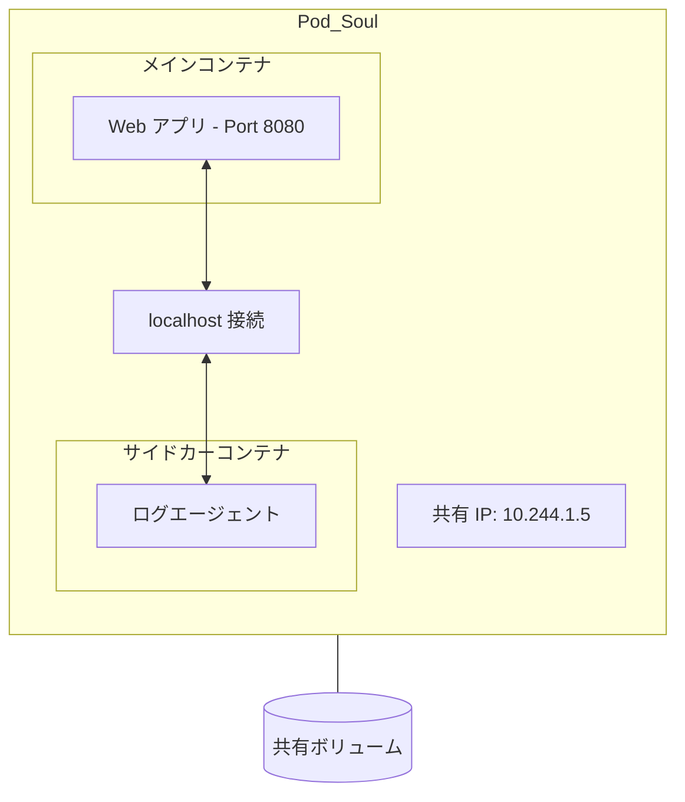

# Pods：Kubernetes の最小単位にして心臓部 🧬

Day 33へようこそ！ 

私たちはすでに「頭脳（Master）」と「筋肉（Worker）」について理解しました。今日は、クラスターに生命を吹き込む「細胞」である **Pod** (#(Pod)) について学びます。

巨大なマイクロサービス・アプリケーションを動かしていようと、小さなウェブサイトを動かしていようと、Kubernetes が管理し調整する最小単位は常に Pod であり、個別のコンテナではありません。なぜそうなっているのでしょうか？ その謎を解き明かしていきましょう。

---

## 🪝 THE HOOK：「見知らぬ隣人」エラーと内部接続のトラブル

ウェブアプリケーション（Node.js）と、ログ収集担当（ファイルからログを抽出する Log Collector）があると想像してください。
- これらを 2 つの別々の Docker コンテナとして実行した場合、Log Collector はどうやって Node.js のファイルを見つけるのでしょうか？
- 共有ボリュームをマウントし、共通のネットワークを設定し... 非常に面倒な作業になります。
- ある日、サーバーが過負荷になり、Docker が Node.js をサーバー A に「押し出し」ましたが、Log Collector はサーバー B に残ったままでした。その結果、Log Collector はファイルを見つけられず「失業」状態になってしまいます。

Kubernetes では、これら「仲の良い友人」が引き離されることは決してありません。私たちはそれらを一つの Pod にまとめてパッケージングします。

---

## 🎭 ANALOGY：エンドウ豆のさやと中の豆

**Pod** を **エンドウ豆のさや（Pea pod）** と考えてみましょう：
- さやの中には、1 つまたは複数の **豆（コンテナ）** が入っています。
- これらの豆は同じさやを共有しています。つまり、同じ住所（IP アドレス）、同じ空気（ネットワーク）、そして同じリソース（ボリューム）を共有します。
- あなたが豆を一粒ずつ別々に運ぶことはありません。常に「さやごと」運びます。

さやがどこへ移動（どのサーバーへ転送）されても、中の豆たちは常に一緒であり、`localhost` を通じて親密に会話することができます。

---

## ⚙️ UNDER THE HOOD：Pod の正体とは？

Pod は、1 つまたは複数のコンテナを包み込むラッパー（wrapper）です。

### 1. 1 つの Pod、1 つの IP
各 Pod は生成時に、クラスター内で一意の IP アドレスが割り当てられます。その Pod 内のすべてのコンテナはこの IP を共有します。これにより、従来の Docker で発生していたポートの競合問題が解決されます。

### 2. サイドカーパターン (Sidecar Pattern) (🔊)
これが Pod の真の威力です。「メインコンテナ（アプリ）」と、それをサポートする「サイドカーコンテナ」（例：ログ記録、セキュリティプロキシ、監視用）を一緒に動かすことができます。彼らは「一蓮托生」、共に生き、共に死ぬ運命にあります。

### Pod の構造図



---

## 💻 DEVOPS IN PRACTICE：最初の YAML ファイルを書く

DevOps マスターは、YAML 形式の定義ファイル（**Manifests / マニフェスト**）を通じて K8s とやり取りします。

### `pod.yaml` ファイルの例：
```yaml
apiVersion: v1
kind: Pod
metadata:
  name: nginx-pod
  labels:
    app: web
    env: prod
spec:
  containers:
  - name: my-nginx
    image: nginx:1.14.2
    ports:
    - containerPort: 80
```

### 重要な項目：
- **apiVersion**: K8s の API バージョン。
- **kind**: リソースの種類（Pod, Service, Deployment など）。
- **metadata**: 名前や、Pod を識別するための **Labels（ラベル）** (🔊)。
- **spec**: 望ましい状態の詳細（どのイメージを使うか、どのポートを開けるかなど）。

---

## 🛡️ MASTER THINKING：「Pod のライフサイクル」

Pod が「修理（Repair）」されることはありません。設定が変更されると、古い Pod は削除され、新しい Pod が作成されます。Pod には以下の状態があります：
- **Pending**: スケジューラーが適切なサーバーを探している最中。
- **Running**: 正常に稼働中。
- **Succeeded**: タスクを完了して終了した状態（主に Job で使用）。
- **Failed**: 内部のコンテナがクラッシュした状態。
- **Unknown**: ノードとの通信が途絶えた状態。

---

## 💻 INTERVIEW QUESTION：K8s 中級レベル

**質問：なぜ Kubernetes は Docker のようにコンテナを直接使うのではなく、Pod という概念を設計したのですか？**

**回答（マスターレベル）:**
主な理由は 3 つあります：
1. **グループ管理**: ネットワークやディスクリソースを共有する補助的なコンテナ（サイドカー）を実行できるため、同一ユニット内のマイクロサービス間の連携が極めて容易になります。
2. **ネットワークの抽象化**: 各 Pod が 1 つの IP を持つことで、同じアプリの複数のインスタンスを 1 つのノードで動かす際のポート競合を回避できます。
3. **将来の拡張性**: この設計により、K8s は Docker 以外のランタイム（例：containerd, CRI-O）も、実行ユニットの管理方法を変えることなくサポートできるようになります。

---

## 📝 QUICK QUIZ：Pod 運用エンジニアへの挑戦

1. **同じ Pod 内のコンテナ同士は、どのアドレスを通じて通信しますか？**
    - A. ノードの IP。
    - B. localhost。
    - C. Google の DNS 名。

2. **Pod の状態が長時間 'Pending' のままの場合、よくある原因は何ですか？**
    - A. アプリのコードにエラーがある。
    - B. スケジューラーが、Pod を収容するのに十分なリソース（RAM/CPU）を持つノードを見つけられていない。
    - C. Docker イメージが重すぎる。

3. **クラスター内の Pod を「タグ付け」して分類するために使用されるコンポーネントは何ですか？**
    - A. apiVersion
    - B. Labels (ラベル)
    - C. containerPort

---

## 📊 文字数: ~4500文字

**まとめ**: あなたは「細胞」である Pod をマスターしました。明日（**Day 34**）は、それを「軍隊」レベルへと引き上げる **Deployments** (#(Deployments)) に進みます。1 つの Pod から 1000 個の Pod へとスケールさせ、ユーザーに気づかれることなく一斉にコードをアップデートする方法を学んでいきましょう！
