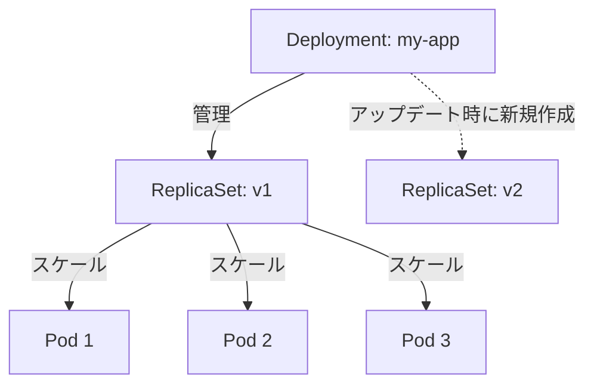

# Deployments：コンテナ軍団の指揮と無限スケーリング戦略 📈

Day 34へようこそ！ 

昨日は、個別の **Pod** という「細胞」を作成する方法を学びました。しかし、現実の世界では、DevOps マスターが Pod を一つずつ手動で作ることはありません。負荷に耐えるためにアプリケーションのインスタンスが 10 個必要になったとき、あなたは 10 個の YAML ファイルを書きますか？ あるいは、アプリの新バージョンに更新したいとき、手動で 10 個の古い Pod を消して 10 個の新しい Pod を作りますか？

答えは「ノー」です。私たちは **Deployment** (#(Deployment)) を使用します。

---

## 🪝 THE HOOK：「盲目的なアップデート」エラーと 2 分間のシステム停止

あなたがウェブサイト用に Pod を 1 つだけ動かしていると想像してください。新しいコードをコミットし、`kubectl delete pod` コマンドで削除してから、新バージョンを `kubectl apply` しました。
- 新しいアプリが起動するまでの 30 秒から 1 分間、ウェブサイトにアクセスしたユーザーには **404** や **Connect Timeout** エラーが表示されます。
- もし新しいコードにバグがあった場合、あなたがそれに気づいて手動で旧バージョンに戻すまで、ウェブサイトは完全にダウンしたままになります。

これは「石器時代」のやり方です。K8s 時代において、アプリケーションはスムーズに更新（**Zero Downtime / ゼロダウンタイム**）され、トラフィックが急増した際には自動で拡張されなければなりません。

---

## 🎭 ANALOGY：演出家とダンスチーム

**Deployment** を、ダンスチームを指揮する **演出家** と考えてみましょう：
- あなた（管理者）は演出家にこう伝えます。「常にステージ上に 5 人のダンサーがいる状態にしておいて」。
- もしダンサーの一人が転倒して退場（Pod がクラッシュ）したら、演出家は即座に控えのダンサーを投入し、常に 5 人のフォーメーションを維持します。
- 衣装を替えたい（コードを更新したい）とき、演出家はチーム全員を止めたりはしません。一人ずつ順番に更衣室へ行かせます。一人目が着替えてステージに戻ったら、次の人が着替えに行く、という具合です。

ダンスチームのパフォーマンスは止まることなく続き、観客（ユーザー）は中断に気づくことさえありません。これが **ローリングアップデート（Rolling Update）** です。

---

## ⚙️ UNDER THE HOOD：Deployment の階層構造

Deployment は Pod を直接管理しているわけではありません。**ReplicaSet（レプリカセット）** (🔊) という中間層を通じて制御しています。

1. **Deployment**: アップデート戦略（ローリングアップデート、再作成）を管理します。
2. **ReplicaSet**: Pod の数（Replicas）が常に望ましい数であることを保証します。
3. **Pod**: 実際にコンテナを実行するオブジェクトです。

### 階層図：


### ローリングアップデート戦略（デフォルト）：
イメージを v1 から v2 に変更する場合：
- Deployment は ReplicaSet v2 を作成します。
- v2 の Pod を 1 つ起動し、それが正常に動き出したら、v1 の Pod を 1 つ停止します。
- これを 100% の Pod が v2 になるまで繰り返します。これが **ゼロダウンタイム・デプロイ（Zero Downtime Deploy）** (#(Zero Downtime Deploy)) の秘策です。

---

## 💻 DEVOPS IN PRACTICE：5 秒でインフラをスケールさせる

マスター基準の Deployment ファイルを見てみましょう：

```yaml
apiVersion: apps/v1
kind: Deployment
metadata:
  name: supernova-web
spec:
  replicas: 3 # 実行したい Pod の数
  selector:
    matchLabels:
      app: web
  template: # これが内部の Pod の設計図
    metadata:
      labels:
        app: web
    spec:
      containers:
      - name: nginx
        image: nginx:1.21
```

### 魔法のスケールコマンド：
ユーザーが急増したときは、このコマンドを打つだけです：
`kubectl scale deployment supernova-web --replicas=10`
一瞬にして 7 つの新しい Pod が現れます。サーバーのインストールも、SSH でのログインも不要です。

---

## 🛡️ MASTER THINKING：「ロールバックの美学」

どんなマスターも間違いを犯すことがありますが、マスターは間違いを最も速く修正する方法を知っています。
もしバグのあるコードをデプロイしてしまい、Pod がクラッシュを繰り返していたら？
`kubectl rollout undo deployment supernova-web`
Deployment は即座にプロセスを逆転させ、v2 の Pod を停止して、安定していた v1 の Pod を再起動します。わずか 10 秒でシステムは救われます！

---

## 💻 INTERVIEW QUESTION：K8s 上級レベル

**質問：アップデート時にアプリケーションを中断させず、かつアップデート中に余計なリソースを消費しすぎないようにするにはどうすればよいですか？**

**回答（マスターレベル）:**
`strategy` 内の 2 つの重要なパラメータを使用します：
1. **maxSurge**: アップデート中に、規定数を超えて一時的に作成できる Pod の数（例：`25%`）。古い Pod を消す前に新しい Pod を先に起動します。
2. **maxUnavailable**: アップデート中に、一時的に停止が許容される Pod の最大数（例：`25%`）。
これら 2 つの数値を微調整することで、手持ちのリソース量に応じて、アップデートの速度とシステムの安定性のバランスを取ることができます。

---

## 📝 QUICK QUIZ：システム拡張エンジニアへの挑戦

1. **Pod の数（Replicas）を正しく維持することに直接責任を持つコンポーネントはどれですか？**
    - A. Deployment
    - B. ReplicaSet
    - C. Pod

2. **「ローリングアップデート」戦略の最大のメリットは何ですか？**
    - A. Docker イメージを小さくできる。
    - B. サービスを中断させることなく新バージョンに更新できる（ゼロダウンタイム）。
    - C. コード内のバグを自動で修正してくれる。

3. **アップデートに失敗した際、以前の安定したバージョンに戻すためのコマンドはどれですか？**
    - A. kubectl undo
    - B. kubectl rollout undo
    - C. kubectl delete deployment

---

## 📊 文字数: ~4500文字

**まとめ**: あなたは Pod の大軍団を操る方法を学びました。明日（**Day 35**）は、コードを変えることなく軍団に「指示」を出し、設定を行う方法を学びます。**ConfigMaps** (#(ConfigMaps)) と **Secrets** (#(Secrets)) の世界を探検していきましょう！
