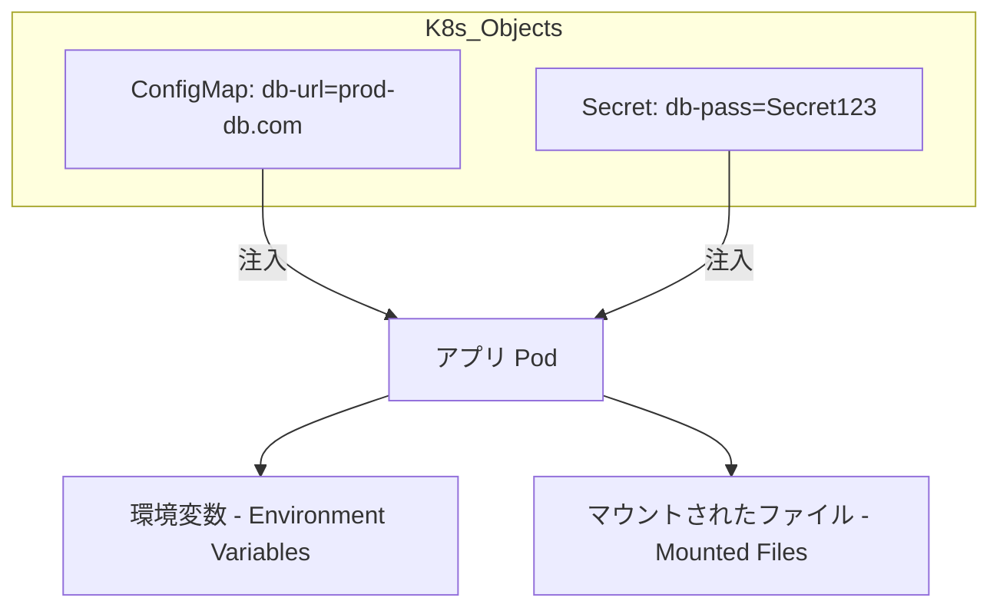

# ConfigMaps & Secrets：設定の分離とデータセキュリティの芸術 🔒

Day 35へようこそ！ 

私たちはすでに強力な Pod の「軍団」を作る方法を知っています。しかし、その軍団はどうやってどのデータベースに接続すべきかを知るのでしょうか？ あるいはパスワードは何でしょうか？ 
- もしパスワードをコードに直接書き込んだら（ハードコード）？ 極めて危険です。
- もしパスワードを `Dockerfile` に書き込んだら？ イメージをダウンロードした誰もがそれを見ることができます。 

今日は、**Code**（アプリケーション・ロジック）と **Configuration**（設定）を完全に分離する手法である **ConfigMaps** と **Secrets** (#(Secrets)) について学びます。

---

## 🪝 THE HOOK：「二重人格」エラーとパスワード漏洩事件

あなたが非常に優れた Docker イメージをビルドしたと想像してください。それを **Dev（開発）** と **Prod（本番）** 両方の環境で使用します。
- Dev では、データベースは `dev-db.supernova.com` です。
- Prod では、データベースは `prod-db.supernova.com` です。 
- もしイメージの中に DB のアドレスを埋め込んでしまったら、ドメイン名を 1 つ変えるためだけに 2 つの異なるイメージをビルドしなければなりません。 

さらに悪いことに、本番データベースのパスワードが含まれた設定ファイルを誤って公開 GitHub リポジトリにコミットしてしまいました。わずか 5 分後、ハッカーがスクリプトでそれをスキャンし、すべての顧客データが暗号化され、身代金を要求されてしまいます。 

DevOps マスターは、常にコードを「クリーン」かつ「ニュートラル」に保ちます。すべての設定は、起動時に外部から「注入（Inject）」されます。

---

## 🎭 ANALOGY：万能リモコンと電池

**Pod** を **テレビのリモコン** と考えてみましょう：
- リモコン本体（コード/イメージ）は、工場で全く同じものが大量生産されます。それ自体は、どのテレビを操作するのかを知りません。
- **ConfigMap** は、ボタンの設定のようなものです。「1 番は HBO、2 番はディズニーチャンネル」。家ごとに異なる設定をします。
- **Secret** は **電池（Battery）** (🔊) のようなものです。それは機密性の高いエネルギーです。電池をリモコンの中に永久に鋳込むことはありません。使うときにだけ装着します。もしリモコンが壊れたら、電池を抜いて新しいリモコンに入れ替えます。

リモコン自体は同じものですが、外部から設定と電池を変えるだけで、どんなテレビにも対応できるようになります。

---

## ⚙️ UNDER THE HOOD：ConfigMap vs. Secret

最も重要な違いは、その使用目的にあります：

### 1. ConfigMap（一般設定）
- **用途**: 非機密情報（例：データベース名、ログレベル、サードパーティ API の URL）。
- **保存**: プレーンテキストとして保存されます。

### 2. Secrets（機密情報）
- **用途**: パスワード、API キー、トークン、SSH キーなど。
- **保存**: K8s はこれらを **Base64** (🔊) 形式でエンコードします。 
> **Master Warning**: Base64 は単なる難読化（Obfuscation）であり、真の暗号化ではありません。Secret の絶対的な安全性を確保するには、HashiCorp Vault のようなソリューションや、K8s のストレージ層での暗号化を組み合わせる必要があります。

### データ注入（Injection）フロー図



---

## 💻 DEVOPS IN PRACTICE：Pod へデータを「注入」する 2 つの方法

アプリケーションが K8s から設定を読み取る主な方法は 2 つあります：

### 1. 環境変数（Environment Variables）経由
小規模なアプリケーションや、単純な設定に適しています。
```yaml
env:
- name: DB_URL
  valueFrom:
    configMapKeyRef:
      name: my-config
      key: database_url
```

### 2. ボリューム（ファイルの追加）経由
大規模な設定ファイルや、ファイルの読み込みを必要とするアプリ（例：`nginx.conf`, `settings.json`）に適しています。
K8s は ConfigMap を、コンテナのハードドライブ内にある本物のファイルに変換します。ConfigMap を更新すると、このファイルも自動的に更新されるため、Pod を再起動する必要はありません！

---

## 🛡️ MASTER THINKING：「不変の設定（Immutable Config）」

大規模なシステムでは、稼働中に ConfigMap を変更するとリスクが生じる場合があります（アプリが新しい設定を読み込んだものの、準備が整っていないなど）。 
シニア DevOps はよくこのような考え方をします：**「設定を変えるたびに、新しいバージョンとして新しい ConfigMap を作成する」**（例：`my-config-v1`, `my-config-v2`）。そして、Deployment が新しい方を指すように更新します。これにより、設定自体の **ロールバック** も安全に行えるようになります。

---

## 💻 INTERVIEW QUESTION：K8s 上級レベル

**質問：Kubernetes で Secret を最もプロフェッショナルに保護するにはどうすればよいですか？**

**回答（マスターレベル）:**
1. **RBAC**: Secret へのアクセス権限を制限します（必要な役割を持つ人だけが見られるようにする）。
2. **Encryption at Rest**: `etcd` に保存される前に、Secret データを K8s が暗号化するように設定します。
3. **External Secrets**: **External Secrets Operator** (#(External Secrets Operator)) を使用して、AWS Secrets Manager や HashiCorp Vault などの本格的な保管庫から直接パスワードを取得します。K8s 内の Secret は単なる一時的な「キャッシュ」として扱います。
4. **GitOps**: たとえ Base64 であっても、Secret を Git に保存してはいけません。**SealedSecrets** や **Sops** などのツールを使用して、コミット前に暗号化する必要があります。

---

## 📝 QUICK QUIZ：データ守護者への挑戦

1. **ConfigMap と Secret の最大の違いは何ですか？**
    - A. ConfigMap の方が動作が速い。
    - B. Secret は機密情報を保持するために使用され、露出を減らすために Base64 でエンコードされる。
    - C. ConfigMap は Docker でしか使えない。

2. **K8s の API を読み取るコードを書かずに、アプリケーションが新しい設定を受け取るための方法はどれですか？**
    - A. システムにメールを送る。
    - B. ConfigMap をボリューム（ファイル）としてマウントする。
    - C. kubectl apply コマンドを連打する。

3. **K8s Secret の Base64 エンコードは、プロのハッカーに対して本当に安全ですか？**
    - A. はい、非常に安全です。
    - B. いいえ、単なるデータ形式の変換に過ぎず、K8s へのアクセス権を持つ人なら誰でも簡単に復号できます。

---

## 📊 文字数: ~4500文字

**まとめ**: あなたはアプリケーションの「魂（データ）」と「性格（設定）」を守る方法を学びました。このフェーズの一連のレッスン、お疲れ様でした！ これであなたはプロフェッショナルとして K8s を運用する準備が整いました。次の挑戦でお会いしましょう！
