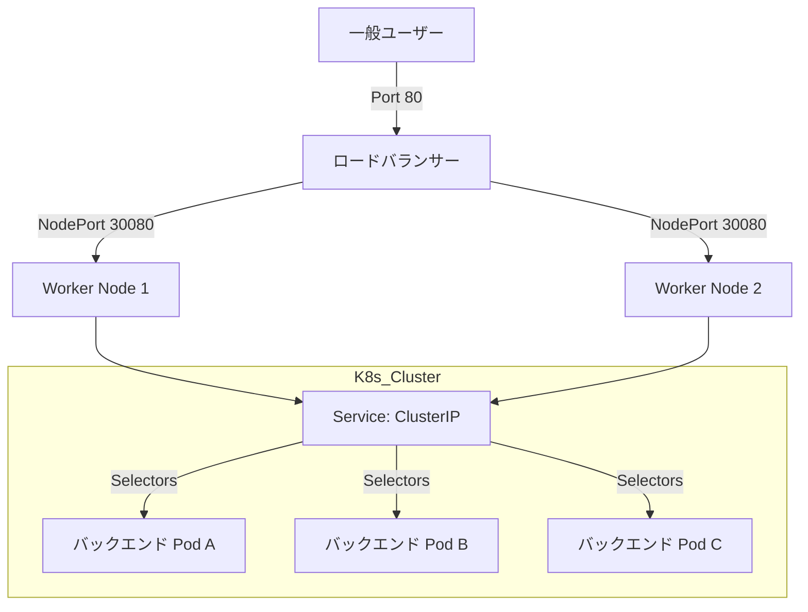

# Kubernetes Services：分散化された世界における接続の芸術 🌐

Day 36へようこそ！私たちは **Kubernetes** (#(Kubernetes)) の「宇宙」へと深く踏み込んでいます。 

これまでのレッスンで、**Pod** (🔊) は一時的な存在であることを学びました。それらはいつでも（エラー、ノードのダウン、コードの更新などにより）生成され、働き、そして消えていきます。ここで問題となるのは、「バックエンドが再起動するたびに IP アドレスがコロコロ変わるのに、フロントエンドはどうやってバックエンドにリクエストを送ればいいのか？」ということです。

その解決策こそが、**Kubernetes Service** (#(Kubernetes Service)) です。

---

## 🪝 THE HOOK：「IP 追いかけっこ」エラーとマイクロサービスの崩壊

3 つのバックエンド Pod で構成されるアプリケーションがあると想像してください。それらの IP アドレスをフロントエンドのコードに手動で設定しました。
- 午前 10:00：Backend-1 (10.1.1.5) が快調に動作中。
- 午前 11:00：Backend-1 がクラッシュ。Kubernetes は自動的に Backend-1-new を作成しましたが、新しい IP アドレスは 10.1.1.20 になりました。
- フロントエンドは依然として 10.1.1.5 にリクエストを送り続けます -> **Connection Refused**。システム自体は動いているのに、ウェブサイトは完全に麻痺してしまいます。

クラウドネイティブの世界において、個々のコンテナの IP を信頼することは、致命的な「うぶさ」です。私たちは、Pod のグループを代表する「大使館」のような存在を必要としています。それが Service です。

---

## 🎭 ANALOGY：コールセンターの代表番号とオペレーター

**Service** を、**「1800-xxxx」のようなコールセンターの代表番号** と考えてみましょう。
- 顧客（フロントエンド）は、その代表番号に電話をかけるだけで済みます。電話の向こう側で具体的にどの従業員が対応しているかを気にする必要はありません。
- オペレーター（**Pods**）は、退職したり、休憩に行ったり、あるいは新しく採用されたり（新しい Pod が増えたり）します。
- 交換台（**Kubernetes Service**）は、どの従業員が対応可能かを自動的に把握し、適切な人へ通話を「振り分け（ロードバランス）」ます。

従業員の名前や個人の電話番号が変わっても、代表番号は 24 時間 365 日変わりません。顧客は常に接続されます。

---

## ⚙️ UNDER THE HOOD：4 種類の「ゲートウェイ」

Kubernetes は、アプリケーションへの「門」を開くために 4 つの主要な Service タイプを提供しています：

### 1. ClusterIP（デフォルト）
- **特徴**: Kubernetes クラスター内部でのみ有効な IP アドレスを割り当てます。
- **目的**: クラスター内のアプリ同士が会話するため（例：フロントエンドがバックエンドを呼び出す）。外部からはこの IP は見えません。

### 2. NodePort
- **特徴**: クラスター内の「全ノード」の特定のポート（通常は 30000-32767）を開放します。
- **目的**: `NODE_IP:NODE_PORT` を通じて外部からアプリにアクセスできるようにします。高機能なロードバランサーがない場合に、外部からクラスターにアクセスする最も簡単な方法です。

### 3. LoadBalancer
- **特徴**: クラウドプロバイダー（AWS, GCP, Azure）の API を自動で呼び出し、本物のロードバランサーを作成します。
- **目的**: インターネットユーザーがアクセスするための単一のドメイン/IP を提供します。本番環境（Production）における最も「公式」な方法です。

### 4. ExternalName
- **特徴**: 内部名を外部の DNS 名にマッピングします。
- **目的**: クラスター内に存在するかのように、外部のデータベース（例：AWS RDS）などを呼び出すのに役立ちます。

### Service フロー図



---

## 💻 DEVOPS IN PRACTICE：「ラベルセレクター」 - ルーティングの魔法

Service は、自分がどの Pod を代表すべきかをどうやって知るのでしょうか？ その答えは、**Labels（ラベル）** (🔊) と **Selectors（セレクター）** (#(Selectors)) にあります。

### Service 定義の YAML 例：
```yaml
apiVersion: v1
kind: Service
metadata:
  name: backend-service
spec:
  selector:
    app: supernova-backend # Service はこのラベルを持つ Pod を探します
  ports:
    - protocol: TCP
      port: 80 # Service が待ち受けるポート
      targetPort: 3000 # バックエンドアプリが実際に動作しているポート
  type: ClusterIP
```

**Kubernetes 内の DNS**: Service を作成するたびに、Kubernetes は自動的に内部 DNS レコードを作成します。フロントエンドの Pod は、単に名前だけでバックエンドを呼び出すことができます：`http://backend-service`。IP を覚える必要も、IP が変わったときにコードを修正する必要もありません。これこそが **CoreDNS** (#(CoreDNS)) の魔法です！

---

## 🛡️ MASTER THINKING：「ディスカバリー vs 接続性」

DevOps マスターは単に Service を作るだけでなく、**kube-proxy** についても理解しています。クラスター内の各ノードでは kube-proxy が動作しており、その役割は IPtables や IPVS を設定して、Service の IP から「生きている正しい Pod」の IP へパケットを「転送（リダイレクト）」することにあります。

もしアプリケーションが接続できない場合、マスターは以下を確認します：
1. Pod のラベルが Service のセレクターと一致しているか？
2. `targetPort` がアプリケーションが公開しているポートと合っているか？
3. Pod が `Running` 状態で、ヘルスチェックをパスしているか？

---

## 💻 INTERVIEW QUESTION：K8s 上級レベル

**質問：NodePort と LoadBalancer の最大の違いは何ですか？ なぜ本番環境では、外部トラフィックの受け口として NodePort をほとんど使わないのですか？**

**回答（マスターレベル）:**
- **NodePort**: 物理的なマシン（ノード）のポートを開放します。ノードの IP は変わる可能性があり、数十台のノードの IP リストを管理するのは悪夢です。また、サーバーインフラを外部に晒すため、セキュリティ面でも劣ります。
- **LoadBalancer**: クラウドプロバイダーが管理する単一の入り口（VIP）を提供します。ノードのヘルスチェックを自動で行い、トラフィックを賢く分散する能力があります。本番環境では、安定性、セキュリティ、そして圧倒的なスケーラビリティ（拡張性）から、LoadBalancer が標準となっています。

---

## 📝 QUICK QUIZ：Kubernetes ネットワークエンジニアへの挑戦

1. **Pod 同士が内部で通信するために使用される Service タイプはどれですか？**
    - A. NodePort
    - B. ClusterIP
    - C. LoadBalancer

2. **Service がどの Pod 群にトラフィックを送るべきかを知るためのコンポーネントは何ですか？**
    - A. IP アドレス
    - B. コンテナ名
    - C. ラベルセレクター (Label Selectors)

3. **Service における CoreDNS の役割は何ですか？**
    - A. インターネット接続を高速化するため。
    - B. Service 名の DNS レコードを自動生成し、IP ではなく名前で呼び出せるようにするため。
    - C. 有害なウェブサイトをブロックするため。

---

## 📊 文字数: ~4500文字

**まとめ**: あなたは Pod 同士をつなぐ「神経回路」をマスターしました。明日（**Day 37**）は、さらに一段上の階層である **Kubernetes Ingress** (#(Kubernetes Ingress)) に進み、何百ものドメインやパスを一つの「入り口」で管理する方法を学んでいきましょう。
