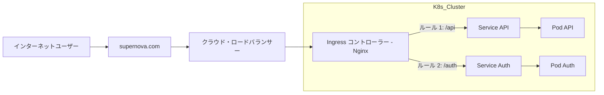

# Kubernetes Ingress：数百のアプリケーションを束ねる賢い門番 🚉

Day 37へようこそ！ 

昨日は **LoadBalancer** タイプの Service について学びました。しかし、もしあなたのマイクロサービス・プロジェクトに 50 個の異なるサービス（`auth.supernova.com`, `shop.supernova.com`, `api.supernova.com/v1` など）があったらどうなるでしょうか？ すべてのサービスに対して LoadBalancer タイプの Service を作成していたら、IP アドレスのレンタル料や物理的なロードバランサーのリソース費用だけで、毎月の請求額に上司が「気絶」してしまうでしょう。

今日は、これらすべてのトラフィックを一つの「執事」で調整する方法を学びます。それが **Kubernetes Ingress** (#(Kubernetes Ingress)) です。

---

## 🪝 THE HOOK：「巨額」の請求書とリソースの無駄遣い

あなたの会社がモノリスからマイクロサービスへ移行したばかりだとします。意気揚々と 10 個の小さなサービスを作成しました。これまでの習慣通り、あなたは 10 個の `type: LoadBalancer` を作成しました。
- AWS のロードバランサー（ELB）は、1 つあたり月額約 20 ドルかかります。10 個なら 200 ドル。
- アプリケーションが 50 サービスに拡大すると、トラフィックを受け取るだけで月額 1000 ドルかかります。
- さらに重要なのは、50 個の異なるロードバランサーの IP/DNS を指す 50 個の CNAME/A レコードを管理しなければならないことです。

これは極めてアマチュアなやり方です。DevOps マスターは **Ingress** を使い、これらすべてをたった一つのロードバランサー（そしてたった一つの IP）にまとめます。コストを 90% 削減し、管理の手間を 100% 解消します。

---

## 🎭 ANALOGY：高級マンションとコンシェルジュ

あなたのクラスターを **高級マンション群** と考えてみましょう。
- 各部屋（Service）にはいくつかの居室（Pod）があります。
- **古いモデル (LoadBalancer)**：各部屋がそれぞれ専用の警備員を雇い、マンションの入り口で客を待たせている状態です。非常にコストがかかり、場所も取ります。
- **Ingress モデル**：建物全体で一人の **コンシェルジュ** (#(Ingress Controller)) だけをメインロビーに雇います。
    - 客が来て「101 号室（auth.supernova.com）に行きたい」と言えば、コンシェルジュが 1 階へ案内します。
    - 「202 号室（shop.supernova.com）に行きたい」と言えば、2 階へ案内します。
    - 「202 号室の会計部門（shop.supernova.com/billing）に用がある」と言われても、コンシェルジュはどこへ行くべきかを知っています。

コンシェルジュこそが、トラフィックを調整する「頭脳」です。費用は一人分で済みますが、建物全体のサービス効率を向上させます。

---

## ⚙️ UNDER THE HOOD：Ingress リソース vs. Ingress コントローラー

Ingress を動作させるには、2 つのコンポーネントが必要です：

### 1. Ingress リソース（設計図）
これは、「ドメイン A に来たら Service X へ、ドメイン B に来たら Service Y へ」というルールを記述した YAML ファイルです。

### 2. Ingress コントローラー（実行者）
これは、クラスター内で動作するアプリケーションです（例：**Nginx Ingress Controller** (🔊), **Traefik**, **Kong**）。これは常に「設計図」を読み取り、内部のロードバランス・エンジン（Nginx, HAProxy など）を自動的に再設定して、要求を実行します。

### Ingress フロー図



---

## 💻 DEVOPS IN PRACTICE：プロフェッショナルな Ingress 設定

一つの Ingress ファイルだけで 2 つの異なるアプリケーションをルーティングする方法を見てみましょう：

```yaml
apiVersion: networking.k8s.io/v1
kind: Ingress
metadata:
  name: main-ingress
  annotations:
    kubernetes.io/ingress.class: "nginx"
    cert-manager.io/cluster-issuer: "letsencrypt-prod" # SSL/TLS の自動発行！
spec:
  rules:
  - host: shop.supernova.com
    http:
      paths:
      - path: /
        pathType: Prefix
        backend:
          service:
            name: shop-service
            port:
              number: 80
  - host: api.supernova.com
    http:
      paths:
      - path: /v1
        pathType: Prefix
        backend:
          service:
            name: api-v1-service
            port:
              number: 80
```

### なぜ Ingress を使うのか？
1. **SSL 終端 (SSL Termination)** (#(SSL Termination))：HTTPS の復号処理はすべて Ingress で行われます。内部の Service は軽量で高速な HTTP で動作させることができます。
2. **パスベースのルーティング**：`domain.com/blog` はあるアプリへ、`domain.com/forum` は別のアプリへ振り分けます。
3. **ホストベースのルーティング**：`dev.com` は開発環境へ、`prod.com` は本番環境へ振り分けます。

---

## 🛡️ MASTER THINKING：「エッジ・ゲートウェイとセキュリティ」

Ingress コントローラー（Nginx など）を使用すると、以下のような高度な機能を簡単に追加できます：
- **レート制限（Rate Limiting）**：DDOS 攻撃を防ぐため、ユーザー一人につき毎秒 10 リクエストまでに制限します。
- **IP ホワイトリスト**：社内ネットワーク（オフィスの IP）からのみ管理画面へのアクセスを許可します。
- **Basic 認証**：アプリケーションのコードを修正することなく、入り口で簡単なパスワード認証を追加できます。

---

## 💻 INTERVIEW QUESTION：K8s リードレベル

**質問：Ingress コントローラーは実際、Service の IP に接続していますか？ それとも Pod の IP に接続していますか？ その理由は何ですか？**

**回答（マスターレベル）:**
最新の Ingress コントローラーの多く（Nginx など）は、Service の IP をバイパスして、Pod の **エンドポイント IP（Endpoint IP）** (#(Endpoints)) に直接接続します。
**理由**：Service IP を経由すると、ノードの `iptables` による振り分け処理が一段階増え、遅延とリソース消費が発生するためです。Pod に直接接続することで、Ingress コントローラーはより複雑なロードバランス・アルゴリズム（例：スティッキーセッション、最小接続数）を実装でき、システムのレイテンシ（遅延）を削減できます。

---

## 📝 QUICK QUIZ：トラフィック調整エンジニアへの挑戦

1. **Ingress のルールに基づいて、実際にトラフィックを誘導する役割を担うコンポーネントはどれですか？**
    - A. Ingress リソース
    - B. Ingress コントローラー
    - C. kube-proxy

2. **複数の LoadBalancer Service を作る代わりに Ingress を使う最大のメリットは何ですか？**
    - A. YAML コードが綺麗になる。
    - B. コストを削減でき（クラウド LB が 1 つで済む）、ホストやパスによるルーティングが可能になる。
    - C. データベースでも使用できる。

3. **Ingress における「SSL 終端」という用語はどういう意味ですか？**
    - A. ウェブサイトのセキュリティを無効にすること。
    - B. Ingress ゲートウェイで SSL 証明書を処理し、HTTPS 通信を復号してから内部サービスへ送信すること。
    - C. 10 年ごとに SSL を自動更新すること。

---

## 📊 文字数: ~4500文字

**まとめ**: あなたはクラスターの「有能なコンシェルジュ」になる方法を学びました。明日（**Day 38**）は、さらに「重厚な」テーマである **Kubernetes Storage** (#(Kubernetes Storage)) に戻ります。Pod がいつでも消えうる環境で、どうやってデータを永続的に保存するのでしょうか？ PV, PVC、そして CSI の世界を探索していきましょう！
