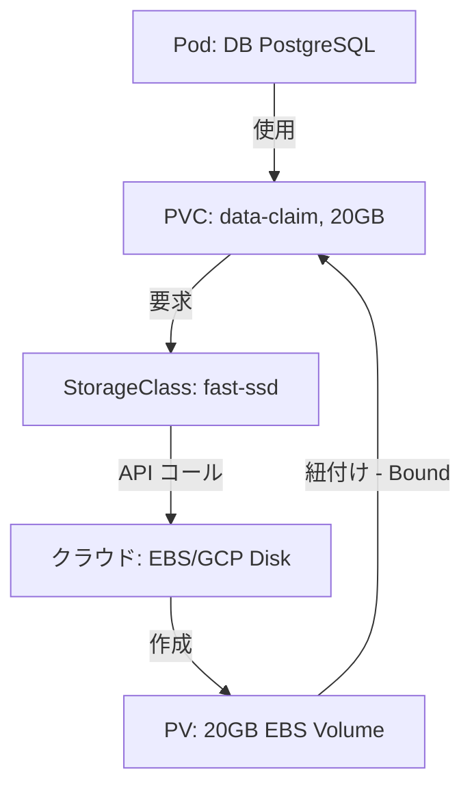

# Kubernetes Storage：「諸行無常」の世界でデータを管理する 💾

Day 38へようこそ！ 

Kubernetes において、Pod は「一期一会」の存在、つまり「今日はあっても明日はわからない」儚いものです。Pod が削除または再起動されると、コンテナ内部に保存していたすべてのデータ（例：ログ、アップロードされたファイル、データベースのレコード）は **永遠に消失（ロスト）** してしまいます。

この問題を解決するために、私たちは永続的なストレージの仕組みを必要とします。今日は、ストレージの「三種の神器」である **PV**, **PVC**, そして **StorageClass** (#(StorageClass)) について学びます。

---

## 🪝 THE HOOK：「Pod を消したらデータベースも消えた」という悪夢

Kubernetes 上で PostgreSQL データベースを動かしていると想像してください。あなたは Persistent Volume（永続ボリューム）の設定を忘れていました。
- 午前 2:00、ノードがダウンしました。Kubernetes は自動的に新しい PostgreSQL Pod を作成して代替させます。
- あなたは安堵します。「よかった、K8s が自動復旧してくれた」。
- しかし、アプリを開いてみると、過去 2 年間のデータがすべて消えていることに気づきます。
- なぜでしょうか？ 新しい Pod は、全く新しくてクリーンなディスクスペースを使用しているからです。古いデータは、死んだ古い Pod と共に消え去ってしまいました。

これは最も初歩的なミスですが、最も甚大な被害をもたらします。コンテナの世界では、データは Pod のライフサイクルから完全に切り離されていなければなりません。

---

## 🎭 ANALOGY：ホテル（Pod）と金庫（Volume）

あなたがホテルの部屋（Pod）を借りる宿泊客だと想像してください。

1. **エフェメラル・ストレージ (Ephemeral Storage)**：部屋の引き出しに荷物を入れます。あなたがチェックアウトして別の客が入ると、引き出しの中身は片付けられ、あなたの荷物は失われます。
2. **永続ボリューム (PV)**：ホテルの地下にある **「巨大な金庫」** です。これらはあらかじめ用意されているか（静的プロビジョニング）、必要に応じて新しく作られます（動的プロビジョニング）。
3. **永続ボリューム要求 (PVC)**：**「金庫のレンタル申込書」** です。
    - あなたは申込書に「100リットルの指紋認証付き金庫を借りたい」と書きます。
    - ホテルの支配人（Kubernetes）は、あなたの要求に合う金庫（PV）を探し出し、それをあなたの部屋に「接続（マウント）」します。

あなたが 101 号室から 505 号室（新しい Pod）へ移動しても、その「申込書」さえ持っていれば、古い金庫は自動的に新しい部屋へ移されます。中の荷物はそのまま無事です。

---

## ⚙️ UNDER THE HOOD：ストレージの自動割り当てプロセス

大規模なシステムでは、一つ一つのディスクを手動で作るわけにはいきません。Kubernetes は **プロビジョニング（Provisioning）** (#(Provisioning)) を自動化しています。

### 1. StorageClass（サービスの等級）
「金庫の種類」を定義します。例：「超高速 SSD 金庫」(gp3) や「低コスト HDD 金庫」(st1) など。

### 2. Persistent Volume Claim - PVC（アプリからの要求）
アプリケーション（Pod）が「20GB の SSD タイプのストレージが必要だ」と宣言します。

### 3. Persistent Volume - PV（ディスクの実体）
PVC に基づいて、Kubernetes はクラウドプロバイダー（AWS, GCP など）を呼び出し、本物のディスクを作成して PVC に「紐付け（Bound）」ます。

### ストレージ・フロー図



### 4. CSI (Container Storage Interface)
**CSI** (#(CSI)) は、Kubernetes が K8s 自体のコアコードを修正することなく、あらゆる種類のディスク（AWS, Google, NetApp, VMWare など）と会話できるようにするための標準規格です。いわば、万能な USB ポートのようなものです。

---

## 💻 DEVOPS IN PRACTICE：マスター級のストレージ設定

データベース用のディスクを要求する方法を見てみましょう：

```yaml
# 1. 要求の宣言 (PVC)
apiVersion: v1
kind: PersistentVolumeClaim
metadata:
  name: database-storage
spec:
  accessModes:
    - ReadWriteOnce # 一度に 1 つの Pod だけが書き込める
  resources:
    requests:
      storage: 50Gi
  storageClassName: premium-rwo # SSD タイプのストレージ
```

### アクセスモード (Access Modes) - ディスクを共有できるか？
- **ReadWriteOnce (RWO)** (🔊)：最も一般的（EBS など）。1 つのノードからのみ読み書き可能。
- **ReadWriteMany (RWX)** (🔊)：共有ファイルシステム（EFS, NFS など）。異なるノードにある複数の Pod から同時に読み書き可能（例：ウェブサイトの画像保存用）。

---

## 🛡️ MASTER THINKING：「再利用ポリシー (Reclaim Policy)」 - PVC を消すとどうなる？

DevOps マスターは「後片付け（Cleanup）」にも気を配ります：
- **Delete**（デフォルト）：PVC を削除すると、クラウド上の本物のディスク（PV）も削除されます。クリーンですが、誤操作で消すと危険です。
- **Retain**：PVC を削除しても、PV はクラウド上に残ります。手動で削除するか、再利用するための操作が必要です。本番環境（Production）ではこちらが安全です。

---

## 💻 INTERVIEW QUESTION：K8s アーキテクトレベル

**質問：私の Pod はノード A で動作しており、EBS (AWS) ディスクが接続されています。もしその Pod が死んで、Kubernetes がノード B で再作成した場合、何が起こりますか？**

**回答（マスターレベル）:**
これはよくある課題です。
1. EBS は **アベイラビリティゾーン（AZ）** ごとに紐付けられるストレージであるため、もしノード B がノード A と異なる AZ にある場合、ディスクを別のゾーンへ「持ち運ぶ」ことができず、Pod は起動できません。
2. もし同じ AZ 内であれば、Kubernetes は「ノード A からディスクを切り離し（**Detach**）」、「ノード B に接続（**Attach**）」します。この処理には 1〜2 分かかる場合があります。
3. **マスターの選択**：速度を向上させるために、**Affinity Rules（アフィニティ・ルール）** を使って Pod が必ず同じ AZ のノードに戻るように強制するか、マルチゾーン対応のストレージを使用すべきです。

---

## 📝 QUICK QUIZ：ストレージエンジニアへの挑戦

1. **Persistent Volume Claim (PVC) の役割は何ですか？**
    - A. アプリケーションのデータを保持する。
    - B. Pod が必要とする容量やストレージの種類を宣言する申込書。
    - C. データのバックアップを取るために使用する。

2. **アクセスモード 'ReadWriteMany' はどのような状況に適していますか？**
    - A. SQL データベース。
    - B. 多数の Web Frontend Pod で共有する画像保存システム。
    - C. 機密性の高い設定情報の保存。

3. **K8s が何百種類ものディスクと柔軟に接続できるようにするためのコンポーネントは何ですか？**
    - A. Docker Engine
    - B. CSI (Container Storage Interface)
    - C. kube-proxy

---

## 📊 文字数: ~4500文字

**まとめ**: あなたはクラスターの「記憶（ストレージ）」をマスターしました。明日（**Day 39**）は、Pod の「健康とリソース」の管理について学びます。Pod がサーバーの RAM を食いつぶさないようにするには？ 応答しなくなった Pod を K8s に検知させて再起動させるには？ **Resources** と **Probes** の世界を探検しましょう！
