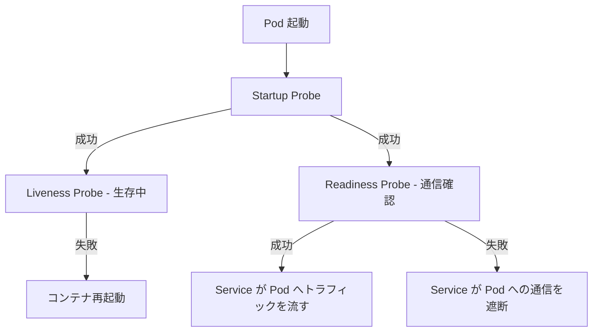

# Resources & Probes：Kubernetes における生存管理の芸術 🏥

Day 39へようこそ！ 

何百ものアプリケーションが同じクラスター内で共存する環境において、ルールがなければ、一つのアプリケーションの不具合（例：メモリリーク）がサーバー全体の RAM を食いつぶし、他の「罪のない」アプリケーションまで巻き添えにして死なせてしまう可能性があります。

今日は、**Resources** (#(Resources)) を通じて「生存ルール」を設定する方法と、**Probes** (#(Probes)) を通じて Kubernetes にアプリの健康診断を行わせる方法を学びます。

---

## 🪝 THE HOOK：「ドミノ倒し」現象とクラスターの沈黙

3 つのノードがあり、各ノードに 8GB の RAM があると想像してください。あなたはメモリリーク（Memory Leak）のバグがある Java アプリケーションをデプロイしました。
- 午前 8:00：Java Pod が 2GB の RAM を消費。
- 午前 9:00：7GB の RAM を消費。ノード 1 がラグ（遅延）し始めます。
- 午前 9:30：ノード 1 の RAM が枯渇。OS はノードを救うために他の Pod を強制終了し始めます。
- Kubernetes は Pod の死を検知し、それらをノード 2 へ移動させます。ノード 2 もすぐに Java Pod によって RAM を食い尽くされます。
- わずか 2 時間で、クラスター全体が崩壊します（連鎖的障害：Cascading Failure）。

これは、Pod に「食事制限」を設けていないときによく起こる惨劇です。DevOps マスターは、決してこのような事態を許しません。

---

## 🎭 ANALOGY：ビュッフェ・レストランと常駐の医師

### 1. Resource：客の食事量
Pod を、ビュッフェ・レストラン（ノード）に入る客と考えてみましょう。
- **Requests（要求）**：その客が空腹にならないために最低限必要な「食事量」です（例：ご飯 2 杯は確実に必要）。レストランはこれを見て、新しい客を受け入れるかどうかを判断します。
- **Limits（制限）**：その客が取ることのできる「最大食事量」です（例：どんなに空腹でも 10 杯まで）。この制限を超えて食べようとすると、その客は... 店の外につまみ出されます（OOM Killed）。

### 2. Probes：常駐の医師
医師は常に客の健康状態をチェックします：
- **Liveness Probe（生存確認）**：「生きていますか？」。もし客が失神（アプリがフリーズ）していたら、医師は客を叩き起こします（Pod を再起動）。
- **Readiness Probe（準備確認）**：「友達を迎える準備はできていますか？」。もし客がまだ食事中（アプリが起動中）なら、医師は友達（Service）に外で待つように伝え、中には入れません。

---

## ⚙️ UNDER THE HOOD：リソース制御の仕組み

YAML ファイルでは、Resources を以下のように定義します：

```yaml
resources:
  requests:
    memory: "256Mi"
    cpu: "500m" # 0.5 コア
  limits:
    memory: "512Mi"
    cpu: "1" # 1 コア
```

### 制限を超えるとどうなるか？
- **CPU Limit を超えた場合**：Pod は「絞り込み（Throttling）」を受けます。動作が遅くなるだけで、死ぬことはありません。
- **Memory Limit を超えた場合**：Pod は即座に殺されます！ ステータスに **OOMKilled** (#(OOMKilled)) と表示されます。

---

## 🌐 HEALTH CHECKS - 「三位一体」の診断

Kubernetes は Pod を監視するために 3 種類の Probe を使用します：

### 1. Liveness Probe (🔊) - 生存確認
アプリケーションがフリーズ（デッドロック）していないかを検知します。失敗すると、K8s はコンテナを再起動します。

### 2. Readiness Probe (🔊) - 準備確認
アプリケーションが起動を完了し、トラフィックを受け入れられる状態になったかを確認します。失敗すると、K8s は一時的にその Pod への Service からの接続を遮断します。

### 3. Startup Probe (🔊) - 起動確認
キャッシュの読み込みに 5 分かかるような、起動が極めて遅い「古参」アプリケーションに使用します。起動が完了するまで、上記の 2 つのチェックを一時停止します。

### ヘルスチェックのフロー図



---

## 💻 DEVOPS IN PRACTICE：効果的な Probe の設定

単にポートが開いているかを確認するだけでは不十分です。データベース接続なども含めてチェックできる、専用の `/health` エンドポイントをアプリ内に作成しましょう。

```yaml
livenessProbe:
  httpGet:
    path: /healthz
    port: 8080
  initialDelaySeconds: 15 # チェック開始まで 15 秒待機
  periodSeconds: 20 # 20 秒ごとにチェック
readinessProbe:
  httpGet:
    path: /ready
    port: 8080
```

---

## 🛡️ MASTER THINKING：「QoS - サービスの品質」

Requests と Limits の設定方法によって、Kubernetes は Pod に優先順位（QoS）を付けます：
- **Guaranteed**: Requests = Limits。最優先の「VIP 客」です。K8s はリソース不足の際、最後までこの Pod を守ります。
- **Burstable**: Requests < Limits。「ビジネス客」です。 
- **BestEffort**: 何も設定しない。「飛び込みの客」です。サーバーのメモリが足りなくなると、真っ先に追い出されます。

**Master Tip**: 本番環境のすべての Pod には、必ず Resource Requests/Limits を設定してください。決して `BestEffort` で動かしてはいけません！

---

## 💻 INTERVIEW QUESTION：K8s リードレベル

**質問：Liveness Probe や Readiness Probe が、逆に惨劇を引き起こすことはありますか？（例：クラスター全体のダウン）**

**回答（マスターレベル）:**
はい、あります。これを **「死のスパイラル（Death Spiral）」** (🔊) と呼びます。
例えば、データベースが重くなったとします。すべてのバックエンド Pod が `Readiness Probe` に失敗し、K8s は Service から全 Pod を切り離します。ユーザーは 100% 503 エラーを受け取ります。
さらに悪いのは、`/health` チェックで DB クエリを実行しており、DB の遅延でチェックが失敗する場合です。K8s はアプリが死んだと判断し、全 Pod を一斉に再起動させます。再起動した全 Pod が一斉に DB に負荷をかけることで、DB は完全に崩壊します。
**解決策**: ヘルスチェックは極めてシンプルかつ軽量であるべきで、サードパーティ・サービスに深く依存させてはいけません。

---

## 📝 QUICK QUIZ：健康管理エンジニアへの挑戦

1. **Pod が 'limits' で規定された以上の RAM を使用すると、どのような現象が起こりますか？**
    - A. アプリの動作が遅くなる。
    - B. Pod が再起動され、OOMKilled エラーが記録される。
    - C. ノードがダウンする。

2. **アプリが初期データのロード中にトラフィックが送られないようにするための Probe はどれですか？**
    - A. Liveness Probe
    - B. Startup Probe
    - C. Readiness Probe

3. **クラスターのリソースが不足した際、Kubernetes が最も優先的に保護する QoS タイプはどれですか？**
    - A. BestEffort
    - B. Guaranteed (Requests = Limits)
    - C. Burstable

---

## 📊 文字数: ~4500文字

**まとめ**: あなたは Pod を「健康」で「適切」な状態に保つ方法を学びました。明日（**Day 40**）は、このシリーズの最終回です。何百もの複雑な YAML ファイルを一瞬でインストール可能な「アプリケーション」としてパッケージ化できるツール、**Helm** (#(Helm)) について学びます。お楽しみに！
