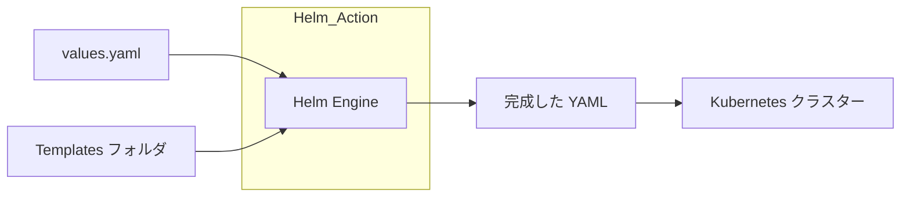

# Helm：K8s アプリケーションのパッケージ化と神速デプロイのエンジン 📦

Day 40へようこそ！ Kubernetes を征服する道のりにおいて、ここまで到達したことを心から祝福します。

これまでの学習で、一つの完成されたアプリケーションを K8s にデプロイするには、多くの YAML ファイル（Deployment, Service, Ingress, PVC, ConfigMap, Secret...）が必要であることを理解しました。
- もし 50 個のマイクロサービスがあったら？ 数百の YAML ファイルを抱えることになります。
- もif Dev, Staging, Prod の 3 つの環境に異なるパラメータでデプロイしたかったら？ 何千行ものコードをコピー＆ペーストして手動で修正しなければなりません。それはもはや「自殺行為」です。

今日は、Kubernetes における最強の「パッケージマネージャー（🔊）」である **Helm** (#(Helm)) について学びます。

---

## 🪝 THE HOOK：「YAML スパゲッティ」エラーと巨大プロジェクトの崩壊

20 個のマイクロサービスで構成されるプロジェクトを管理していると想像してください。上司から「プロジェクト全体の Docker イメージのバージョンを変更してくれ」と頼まれました。
- あなたは一つ一つの `deployment.yaml` ファイルを開いて修正を始めます。
- 15 個目のサービスで、誤って YAML のスペース（インデント）を一つ消してしまいました。
- `kubectl apply` を実行します。システムの一部がダウンし、各サービスの構成がバラバラになってしまいました。あなたは、そのたった一つのスペースを探し出すためだけに、週末を丸一日潰すことになります。

これこそが、YAML を手動で管理することの危険性です。DevOps マスターは Helm を使い、YAML を再利用可能な **Charts（チャート）** (#(Charts)) に変換し、プロフェッショナルなバージョン管理を行います。

---

## 🎭 ANALOGY：袋麺（YAML）とコンボメニュー（Helm）

### 1. YAML：単品料理を一つずつ作る
`kubectl apply -f folder/` を使うのは、スーパーで麺、スープの素、具材を一つずつ買ってきてラーメンを作るようなものです。同じラーメンを 10 杯作りたければ、その工程を 10 回繰り返さなければなりません。間違いやすく、労力もかかります。

### 2. Helm：パッケージ化されたコンボメニュー
**Helm** は、レストランの **「コンボメニュー（セットメニュー）」** (🔊) のようなものです。
- 一品ずつ選ぶ必要はありません。「ファミリーコンボを一つ」と注文するだけです。
- そのコンボの中には、すでにチキン、ポテト、コーラが入っています（Deployment, Service, Ingress などに対応）。
- もし「辛口にしてほしい」とか「氷抜きにしてほしい」といった要望があれば、メモ（**Values.yaml**）に書くだけです。厨房（Helm エンジン）が自動的にあなたの好みに合わせてコンボをカスタマイズしてくれます。

たった一つのコマンドで、インフラの「フルコース」を整えることができます。

---

## ⚙️ UNDER THE HOOD：Helm Chart の構造

Helm Chart はテンプレートを含むディレクトリです。最も重要な構成要素は以下の通りです：

### 1. Chart.yaml
チャートに関する情報（名前、バージョン、説明）が含まれています。いわばソフトウェアパッケージの「身分証明書」です。

### 2. values.yaml
すべての変数を保持する場所です。レプリカ数を変えたい？ ここを修正します。イメージを変えたい？ ここを修正します。

### 3. templates/
YAML のテンプレートファイルが置かれるディレクトリです。値を直接書き込む（ハードコードする）代わりに、**Go Templates** 言語を使用します。
例：`image: {{ .Values.image.repository }}:{{ .Values.image.tag }}`。Helm は `values.yaml` からデータを取得して、ここを埋めます。

### Helm のフロー図



---

## 💻 DEVOPS IN PRACTICE：コマンド一つでアプリを「アップグレード」

シナリオ：クラスターに Redis クラスターをインストールしたいとします。
自分で YAML を書く代わりに、Helm の「アプリストア」である **Artifact Hub** (🔊) へ行き、Bitnami/Redis のチャートを探します。

### 1. インストール：
```bash
helm install my-redis bitnami/redis -f my-values.yaml
```

### 2. アップグレード：
`values.yaml` でメモリ設定などを修正し、以下を実行するだけです：
```bash
helm upgrade my-redis bitnami/redis -f my-values.yaml
```

### 3. ロールバック（差し戻し）：
アップデートにエラーがあったとしても、慌てる必要はありません！
```bash
helm rollback my-redis 1
```
システムは即座に以前の安定した状態（バージョン 1）に戻ります。これはすべての DevOps マスターにとって「命綱」となる機能です。

---

## 🛡️ MASTER THINKING：「チャートの再利用性」

DevOps マスターはアプリごとにチャートを作りません。彼らは **Generic Chart** (🔊) （共通テンプレート）を作成します。
NestJS であろうと、Go であろうと、Python であろうと、アプリの YAML 構造はほぼ同じです。唯一の違いは `values.yaml` の変数だけです。
これにより、100 個のマイクロサービスのインフラ管理を、1 個のサービスを管理するのと同じくらい簡単に行うことができます。「コードではなく、設定で管理する（Manage by Configuration, not by Code）」のです。

---

## 💻 INTERVIEW QUESTION：K8s リードレベル

**質問：Helm と Kustomize、どちらを使って Kubernetes の設定を管理すべきだと思いますか？ その理由も教えてください。**

**回答（マスターレベル）:**
- **Kustomize**: 設定を「上書き（Overlay）」するのに適しています。複雑なテンプレートロジックを持たず、純粋な YAML を維持します。小規模なチームやシンプルなプロジェクトに向いています。
- **Helm**: 本格的なパッケージマネージャーです。ロジック（if/else, ループ）、バージョン管理（Release）、そして強力なロールバック機能を備えています。複雑なアプリケーションや、複数の顧客にソフトウェアを配布する場合の業界標準です。
**マスターの選択**: 私は **パッケージ化（Packaging）** には Helm を選び、デプロイの自動化には **ArgoCD** (GitOps) を組み合わせます。これが大規模企業における究極のスタックです。

---

## 📝 QUICK QUIZ：パッケージング・マスターへの挑戦

1. **Helm Chart の中で、環境に応じて変わる変数を保持するファイルはどれですか？**
    - A. Chart.yaml
    - B. values.yaml
    - C. deployment.yaml

2. **エラーが発見された際、アプリを即座に以前のバージョンに戻すためのコマンドはどれですか？**
    - A. helm install
    - B. helm delete
    - C. helm rollback

3. **Helm が使用しているテンプレート言語は何ですか？**
    - A. Python Jinja2
    - B. Go Templates
    - C. JavaScript

---

## 📊 文字数: ~4500文字

**まとめ**: あなたは Helm という「魔法の杖」を手にしました。Kubernetes に関するフェーズ 3 の一連のレッスン、完走おめでとうございます！ これであなたは世界最大規模のシステムを運用する準備が整いました。ここまでの道のりを誇りに思ってください！ 🥂
---
**Day 40 終了。**
