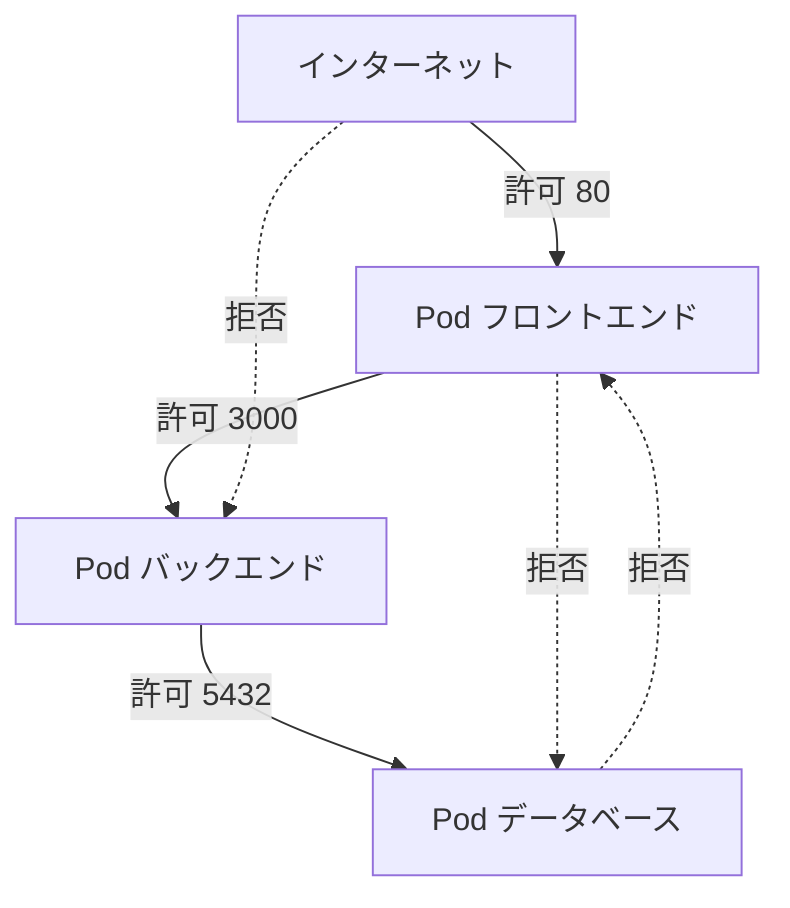

# K8s セキュリティ：ロッカーからネットワークまで、鉄壁の要塞を築く 🛡️

Day 41へようこそ！ 私たちは今、本番環境で Kubernetes を運用する上で最も高度かつ重要な側面の一つ、**「セキュリティ（Security）」**に踏み込もうとしています。

分散システムにおいて、セキュリティとは単にサーバーに「鍵をかける」ことだけではありません。それは、人間のアクセス権限から、チップ間の通信に至るまで、多層的な保護システムを構築することです。今日は、2 つの究極の「武器」である **RBAC** (🔊) と **Network Policies** (#(Network Policies)) をマスターします。

---

## 🪝 THE HOOK：「内部からの脆弱性」という惨劇

クラスターの管理を学ぶために、チームに入ったばかりの新人（Newbie）に Admin 権限が与えられたと想像してください。
- 彼は誤って `namespace dev` ではなく `kubectl delete ns production` を実行してしまいました。 
- わずか 2 秒で、会社の全製品データが消滅します。 
- さらに悪いことに、フロントエンドの Pod がハッカーに占拠されました。内部ネットワークに障壁がないため、ハッカーはその Pod から直接データベースの Pod にアクセスし、ファイアウォールを経由せずに全データを盗み出しました。

「誰でも何でもできる」状態や、「どの Pod も互いに通信できる」状態を放置することは、ハッカーを自宅にお茶に招くのと同じです。

---

## 🎭 ANALOGY：5 つ星ホテルと IC カードキー

あなたの K8s クラスターを **「5 つ星ホテル」** と考えてみましょう：

### 1. RBAC：IC カードキー（誰が何をしていいか？）
- **宿泊客**：自分の部屋とエレベーターだけを開けられるカードを持っています。倉庫や管理室には入れません。
- **清掃スタッフ**：多くの部屋を開けられるカードを持っていますが、勤務時間内のみであり、会計帳簿を見ることは許されません。
- **総支配人**：すべてのドアを開けられるマスターカードを持っています。

**RBAC** は、「A さん（Subject）は、1 階（Namespace）の Pod（Resource）を閲覧（Verb）することだけが許される」といった定義を可能にします。

### 2. Network Policies：防火壁（誰が誰と話していいか？）
101 号室で火災が発生したとします。仕切りがなければ、火はホテル全体に広がります。 
**Network Policy** は、自動シャッターのようなものです。 
- フロントエンド Pod は、ポート 8080 でバックエンド Pod を呼び出すことだけが許可されます。 
- バックエンド Pod は、フロントエンドを「逆呼び出し」することは許可されません。 
- データベース Pod は、バックエンドからの命令のみを受け取り、インターネットや他の Pod からのトラフィックは一切禁止されます。

---

## ⚙️ UNDER THE HOOD：「権限」と「障壁」の仕組み

### 1. RBAC (Role-Based Access Control)
K8s は権限管理のために 4 つの主要なオブジェクトを使用します：
- **Role**：1 つの Namespace 内での権限リスト（例：Pod の取得、一覧表示、監視）。
- **ClusterRole**：Role と同じですが、クラスター全体に適用されます（例：ノードの管理）。
- **RoleBinding**：Role を特定の User や ServiceAccount に「紐付け」ます。
- **ClusterRoleBinding**：ClusterRole をシステム全体に「紐付け」ます。

### 2. Network Policies (🔊)
デフォルトでは、K8s は「全接続（All-connected）」を許可しており、すべての Pod が互いに通信できます。Network Policy は、**Label Selectors** を使用してその状態を変更します。



---

## 💻 DEVOPS IN PRACTICE：「すべて拒否（Default Deny）」ポリシーの設定

DevOps マスターは常に、**「まずすべてを拒否」** し、必要なものだけを徐々に開いていくことから始めます。これが **「ゼロトラスト（Zero Trust）」** (#(Zero Trust)) の考え方です。

### ステップ 1：すべてのイングレストラフィックを拒否するポリシーを宣言
```yaml
apiVersion: networking.k8s.io/v1
kind: NetworkPolicy
metadata:
  name: default-deny-all
spec:
  podSelector: {} # Namespace 内のすべての Pod に適用
  policyTypes:
  - Ingress
```

### ステップ 2：フロントエンドからのトラフィックのみをバックエンドに許可
```yaml
spec:
  ingress:
  - from:
    - podSelector:
        matchLabels:
          app: frontend
    ports:
    - protocol: TCP
      port: 8080
```

---

## 🛡️ MASTER THINKING：「最小権限の原則（The Principle of Least Privilege）」

黄金律：**必要な最小限の権限のみを付与する** (#(Least Privilege))。 
- アプリケーションが設定ファイルの読み取りのみを必要とするなら、書き込み権限を与えてはいけません。 
- エンジニアがログの閲覧のみを必要とするなら、Pod の削除権限を与えてはいけません。 
- `default` を使い回すのではなく、アプリケーションごとに個別の **ServiceAccounts** (🔊) を使用してください。

---

## 💻 INTERVIEW QUESTION：シニアセキュリティレベル

**質問：Network Policy を作成したのに効果がなく、Pod 同士が自由に通信できてしまいます。なぜでしょうか？**

**回答（マスターレベル）:**
最も一般的な原因は 2 つあります：
1. **ネットワークプラグイン（CNI）**: Network Policy は、ポリシーの強制（Enforcement）をサポートするネットワークプラグイン（例：**Calico**, **Cilium**, **Weave**）を必要とします。サポートしていないクラウドのデフォルトプラグインを使用している場合、ポリシーは無視されます。
2. **セレクターの不一致**: Pod のラベルと、Network Policy の YAML ファイル内のラベルが完全に一致していません。 
**チェックリスト**: 常に `kubectl get networkpolicy` を実行し、影響を受けている Pod の数が正しく表示されているか確認してください。

---

## 📝 QUICK QUIZ：セキュリティ軍師への挑戦

1. **RBAC において、Role の権限を特定の User に割り当てるために使用するオブジェクトはどれですか？**
    - A. ClusterRole
    - B. RoleBinding
    - C. ServiceAccount

2. **Network Policy における「ゼロトラスト」の考え方とは何を意味しますか？**
    - A. 開発者を絶対的に信頼すること。
    - B. デフォルトですべての接続を拒否し、本当に必要なトラフィックフローだけを開放すること。
    - C. データベースにパスワードを設定しないこと。

3. **Network Policy に基づいてトラフィックの遮断・許可を実行するコンポーネントはどれですか？**
    - A. API Server
    - B. Kube-scheduler
    - C. Calico や Cilium などのネットワークプラグイン（CNI）。

---

## 📊 文字数: ~4500文字

**まとめ**: あなたはクラスターに「高い壁と深い堀」を築き上げました。明日（Day 42）は、**Prometheus** (#(Prometheus)) と **Grafana** (#(Grafana)) を通じて、システムの鼓動を正確に把握するための「監視カメラシステム」の設置方法を学びます。お見逃しなく！
