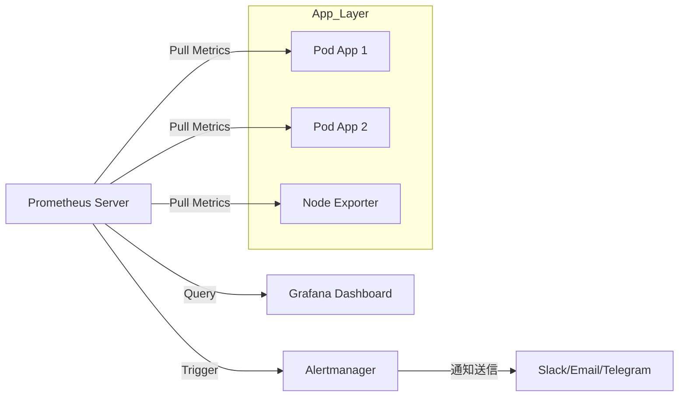

# Monitoring Master：K8s クラスターのための Prometheus & Grafana 活用術 📈

Day 42へようこそ！ 

システムの規模が 10 個から 1,000 個の Pod へと拡大したとき、一つ一つの Pod が健全かどうかを座って「眺めて」確認することは不可能です。もし午前 2 時に、誰にも気づかれずにデータベース의 ディスクがいっぱいになったらどうなるでしょうか？ 

今日は、**Prometheus** と **Grafana** を使った **Monitoring（監視）** (#(Monitoring)) を通じて、クラスターに「神経系」を張り巡らせる方法を学びます。

---

## 🪝 THE HOOK：「沈黙의 死」というエラー

大規模なマーケティングキャンペーンを実施していると想像してください。ウェブサイトにトラフィックが殺到しています。
- 午前 10:00：サイトはまだ動いていますが、Pod の RAM 消費が限界に達し始めます。
- 午前 10:30：Pod が K8s によって次々と強制終了（OOMKilled）され始めます。サイトのレスポンスが 10 秒遅れになります。
- 午前 11:00：システムが完全に崩壊。技術チームは... 何の通知も届いていなかったため、のんびり昼食に出かけています。古いログにはサイトが正常であることしか記録されておらず、診断のための RAM/CPU の数値も手元にありません。

リアルタイムの監視ダッシュボードがなかったために、莫大な売上を失ってしまいました。DevOps マスターは、問題が実際に発生する「前」に、その兆候を察知します。

---

## 🎭 ANALOGY：Apple Watch とオンライン医師

あなたのクラスターを人間の体と考えてみましょう：

### 1. Prometheus：Apple Watch（データ収集）
クラスターの手首に装着され、常に以下の数値を測定します：
- 心拍数（Request per second：秒間リクエスト数）。
- 体温（CPU 使用率）。
- 血糖値（RAM 使用率）。
これらの数値をすべてノート（**Time Series Database：時系列データベース**）に記録します。

### 2. Grafana：スマートフォンの画面（データ表示）
Grafana 自体は何も測定しません。Apple Watch (Prometheus) からデータを受け取り、カラフルなグラフを描画する美しい画面です。一目見て「あ、心拍数が高すぎるな、休ませよう」と判断できるようにしてくれます。

### 3. Alertmanager：アラームの鐘
もし心拍数が 150 を超えたら（CPU > 90%）、Prometheus は Alertmanager に「今すぐ鐘を鳴らせ！」と伝えます。Alertmanager は Telegram や Slack にメッセージを送り、手遅れになる前にあなたに知らせます。

---

## ⚙️ UNDER THE HOOD：Pull vs Push メカニズム

Prometheus は、従来の監視ツールとは大きく異なる仕組みで動作します：

### 1. Pull モデル (#(Pull Model))
アプリケーションに「レポートを本部に提出」させるのではなく、Prometheus 自体が 15 秒または 30 秒ごとに各アプリケーション（`/metrics` エンドポイント）を訪れ、データを「引き出し（Pull）」に行きます。 
**メリット**：アプリがダウンして応答がない場合、Prometheus は即座にそれを検知できます。また、数千のアプリが一斉にデータを送りつけて本部のシステムがパンクすることもありません。

### 2. Time Series Database (TSDB) (🔊)
監視データは、通常の SQL テーブルのような形式では保存されません。`(メトリクス名, 時間, 値)` という形式で時系列に沿って保存されます。例：`[Cpu_Usage, 10:01:00, 45%]`。この保存方法は、数十億ものレコードを処理する際に極めて高速で、ディスク容量も節約できます。

### メトリクスの流れ図



---

## 💻 DEVOPS IN PRACTICE：魔法の言語「PromQL」

Prometheus からデータを取得するには、**PromQL** (#(PromQL)) を学ぶ必要があります。これは、新人（ルーキー）とマスターを分けるスキルです。

例：過去 5 分間のクラスター全体の CPU 使用率を計算する場合：
```promql
100 - (avg by (instance) (irate(node_cpu_seconds_total{mode="idle"}[5m])) * 100)
```

### 万能ダッシュボード：Grafana
ダッシュボードを一から自作する必要はありません！ Grafana には、テンプレート（例：Kubernetes クラスター用の ID 315）を共有するコミュニティがあります。ID を入力するだけで、NASA のようなプロフェッショナルな監視画面が「ドーン」と手に入ります。

---

## 🛡️ MASTER THINKING：「4 Golden Signals」（4 つの黄金のシグナル）

アプリケーションを監視する際、マスターは常に 4 つの死活的な指標に集中します：
1. **Latency（遅延）** (🔊)：応答時間はどのくらいか？（サイトが重くないか？）
2. **Traffic（トラフィック）** (🔊)：どれくらいのユーザーが利用しているか？（帯域幅はどれくらいか？）
3. **Errors（エラー）** (🔊)：5xx エラーの発生率はどれくらいか？
4. **Saturation（飽和度）** (🔊)：システムがどれくらい「満杯」か？（RAM の空きはどれくらいか？）

これら 4 つの指標を追うだけで、システムの健康状態の 90% を把握できます。

---

## 💻 INTERVIEW QUESTION：監視リードレベル

**質問：監視対象の Pod が多すぎて（例：50,000 Pod）、Prometheus が過負荷になった場合、どう対処しますか？**

**回答（マスターレベル）:**
**Hierarchical Federation（階層型フェデレーション）** (#(Federation)) 戦略、または **Thanos** (🔊) や **Cortex** といった高可用性ストレージ・ソリューションを使用します：
1. **Federation**: クラスター単位やチーム単位で Prometheus を小分けにします。「親」の Prometheus は、「子」の Prometheus から集約されたデータ（aggregated data）のみを取得します。
2. **Thanos/Cortex**: Prometheus からオブジェクトストレージ（S3/GCS など）に直接データをプッシュします。これにより Prometheus をステートレス（Stateless）に運用でき、ディスク容量の心配をせずに、数年分のデータを極めて低コストで保持できます。

---

## 📝 QUICK QUIZ：オブザーバビリティ運用エンジニアへの挑戦

1. **Prometheus がデータを収集する際の主な動作メカニズムは何ですか？**
    - A. Push (アプリケーションがデータを送る)。
    - B. Pull (Prometheus が能動的にデータを取得しに行く)。
    - C. Email (レポートファイルをメールで送る)。

2. **Prometheus のデータからグラフを表示する「顔（フロントエンド）」の役割を果たすツールはどれですか？**
    - A. Alertmanager
    - B. Grafana
    - C. Node Exporter

3. **4 Golden Signals における 'Saturation' は何を指しますか？**
    - A. オンラインユーザー数。
    - B. アプリケーションの遅延。
    - C. リソース（RAM/CPU/ディスク）がどれだけ限界まで使われているかの度合い。

---

## 📊 文字数: ~4500文字

**まとめ**: あなたはシステムを監視するための「神の目」を手に入れました。明日（Day 43）は、**Logging（ログ管理）** を通じてオブザーバビリティ（可観測性）のパズルを完成させます。1,000 個ものコンテナのログを一度に素早く見るにはどうすればいいか？ **Loki** と **EFK** について深掘りしましょう！
