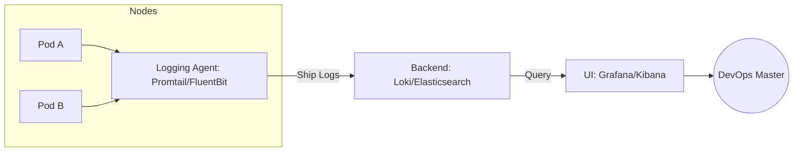

# Centralized Logging：数百万行のログを一瞬で管理する術 🔍

Day 43へようこそ！ 

昨日は Prometheus を使って数値（メトリクス）を監視する方法を学びました。しかし、数値は「システムにエラーが出ている」ことしか教えてくれません。**なぜ**エラーが出ているのかを知るには、**Logs（ログ）**を見る必要があります。

K8s では、Pod が死ぬとその中のログもすべて消えてしまいます。500 個もの Pod が動いている場合、どのログにエラーがあるかを探すのは至難の業です。今日は、**Centralized Logging（中央集約型ログ管理）** (#(Centralized Logging)) によってこの問題を解決します。

---

## 🪝 THE HOOK：「大海の一針」を探すエラー

顧客から「10 分前に注文の支払いができなかった」というクレームが入ったと想像してください。
- あなたは 20 個のマイクロサービスを抱えています。その注文は 5 つの異なるサービスを経由しました。
- 各 Pod に対して `kubectl logs` コマンドを実行しますが、その時の Pod はすでに削除されたか再起動されており、古いログはすべて消えています。 
- あなたは慌てて各ノードに SSH で入り、`/var/log/pods` の中を探し回ります。「Database timeout」という一行のログを見つけるためだけに 2 時間を無駄にしてしまいました。

時間は金なりです。DevOps マスターなら、単一의 検索窓を使ってわずか **3 秒**でそのログを見つけ出します。

---

## 🎭 ANALOGY：探偵と都市の防犯カメラシステム

ログ管理をこのように考えてみましょう：

### 1. 従来の方法：聞き込み捜査
探偵は一軒一軒の家（サーバー）を回り、ドアを叩いて「10 分前に誰か通りませんでしたか？」と聞いて回らなければなりません。もしその人がすでに引っ越して（Pod が削除されて）いたら、探偵は手がかりを失います。

### 2. Centralized Logging：中央監視システム
あらゆる交差点、あらゆる店舗の映像（すべての Pod からのログ）が、直接 **「司令センター」** (#(Logging Backend)) へ転送されます。
- 事件が発生した際、探偵はセンターに座り、時刻と車のナンバー（取引 ID）を検索システムに入力するだけです。
- 即座に、対象の全行程が画面に表示されます。 
- たとえその店舗が火事になったり取り壊されたり（Pod が死んだり）しても、映像はセンターに安全に保存されています。

---

## ⚙️ UNDER THE HOOD：Loki vs EFK - どちらの「武器」を選ぶか？

現在、最も普及しているログ管理スタックは 2 つあります：

### 1. Grafana Loki (🔊) - 「ログのための Prometheus」
Loki は非常に軽量で低コストなため、現在極めて注目されているツールです。
- **仕組み**：ログ内のすべての単語をインデックス化する代わりに、Prometheus と同じように「ラベル（Labels）」（例：app=nginx, env=prod）だけをインデックス化します。
- **メリット**：ディスク容量と RAM の消費が極めて少ないです。Grafana と完璧に統合されています。

### 2. EFK Stack (Elasticsearch - Fluentd - Kibana)
伝統的な「巨人」です。
- **Elasticsearch**：ログ内のすべての単語をインデックス化する、非常に強力な検索エンジン。
- **Fluentd/Fluent Bit**：ノードからログを収集するコレクター。
- **Kibana**：表示用インターフェース。
- **メリット**：全文検索（Full-text search）が極めて高速で詳細です。ビッグデータ分析が必要な巨大システムに適しています。

### ログの流れ図



---

## 💻 DEVOPS IN PRACTICE：LogQL を使ってプロのようにログを「フィルタリング」

Loki を使用する場合、**LogQL** (#(LogQL)) を使用します。これにより、システム全体に対して `grep` コマンドを使うのと同じ感覚でログを絞り込むことができます。

例：本番環境（prod）の「payment」アプリで "error" という文字を含むすべてのログを探す：
```logql
{app="payment", env="prod"} |= "error"
```

さらに、ログをメトリクスに変換することも可能です。例：1 分あたりのエラー発生数をカウントする：
```logql
count_over_time({app="payment"} |= "error" [1m])
```

---

## 🛡️ MASTER THINKING：「Structured Logging（構造化ログ）」

ログは単なるランダムな文字列であるべきではありません。マスターは常に、開発者に **JSON Logging** (🔊) を使うよう要求します。
- **なぜか？** コンピュータは JSON を非常に速く読み取れるからです。ログが JSON 形式であれば、複雑な正規表現（Regex）を使わずに、`user_id` や `status_code`、`response_time` といったフィールドで簡単にフィルタリングできます。
- **Master Tip**: ログには常に `TraceID` (🔊) を付与してください。10 個のマイクロサービスを経由する 1 つのリクエストが共通の `TraceID` を持っていれば、その全行程を数珠つなぎで追跡できます。

---

## 💻 INTERVIEW QUESTION：シニア・オブザーバビリティレベル

**質問：AWS 上でのインフラコストを節約したい場合、ELK (Elasticsearch) と Loki のどちらを推奨しますか？**

**回答（マスターレベル）:**
私は **Loki** を推奨します。 
1. **ストレージ**: Elasticsearch はインデックスを保存するために大量の RAM と高価な SSD を必要とします。Loki はデータを直接 **S3** (オブジェクトストレージ) に保存できるため、極めて安価で耐久性に優れています。
2. **運用コスト**: Elasticsearch クラスターの運用には高度な専門知識が必要で、管理リソースも消費します。Loki は Prometheus と同じインフラとセットで運用できるため、はるかにシンプルです。 
3. **パフォーマンス**: ログが膨大な場合、Loki の検索は ELK よりわずかに遅くなりますが、日々の DevOps 業務の 90% において、Loki の速度は十分すぎます。

---

## 📝 QUICK QUIZ：ログ運用エンジニアへの挑戦

1. **EFK スタックにおいて、ノード上のファイルからログを直接収集（Collect）する役割を持つのはどれですか？**
    - A. Elasticsearch
    - B. Fluentd/Fluent Bit
    - C. Kibana

2. **ログに JSON を使用することが推奨される理由は何ですか？**
    - A. 見た目が現代的だから。
    - B. 中央集約型ログ管理ツールが、各データフィールドごとに解析、インデックス化、検索を容易に行えるようにするため。
    - C. ログの容量を小さくするため。

3. **Loki を介してログを S3/GCS に保存する最大のメリットは何ですか？**
    - A. ストレージコストを節約でき、サーバーのディスクフルを心配しなくて済む。
    - B. ログのセキュリティが向上する。
    - C. ウェブサイトの動作が速くなる。

---

## 📊 文字数: ~4500文字

**まとめ**: あなたはオブザーバビリティ（可観測性）の 2 つの柱（Metrics と Logs）をマスターしました。明日（Day 44）は、マイクロサービス・インフラの頂点である **Service Mesh** (#(Service Mesh)) に触れます。ロジックコードを一行も書かずに、数千ものサービス間通信をどう管理するか？ **Istio** について探求しましょう！
