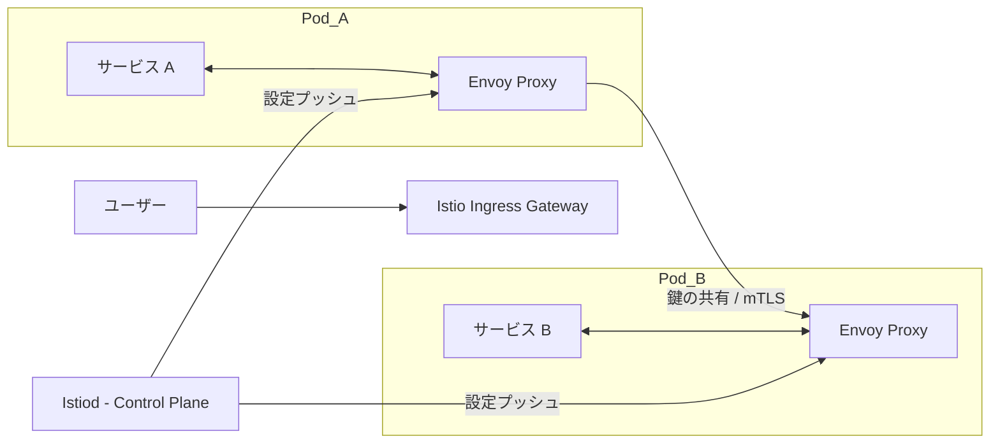

# Service Mesh：Istio でマイクロサービス・インフラを掌握する 🕸️

Day 44へようこそ！ 

私たちはすでに、健全でセキュリティが保たれ、綿密に監視されたクラスターを手にしています。しかし、マイクロサービスの数が数十、数百に達すると、新たな問題が発生します。それが **「サービス間通信（East-West Traffic）」** です。
- サービス A からサービス B への呼び出しを、どうやって安全（mTLS）に行うか？
- 新しいバージョンにトラフィックの 10% だけを流す（Canary）にはどうすればいいか？
- サービス間のリクエスト数制限（Rate Limit）をどう設定するか？

これらの処理をすべて開発者にコードで書かせていたら、彼らは発狂してしまうでしょう。今日は、マイクロサービス時代における究極の解決策、**Service Mesh** (#(Service Mesh)) について学びます。

---

## 🪝 THE HOOK：「接続の混乱」というエラー

50 個のマイクロサービスを管理していると想像してください。 
- 経営陣から「サービス間のすべての通信を暗号化（HTTPS）せよ」という命令が下りました。あなたは 50 の開発チームを回り、コードを更新して SSL 証明書をインストールするよう依頼しなければなりません。 
- 1 週間後、証明書の期限切れで 5 つのサービスがダウン。 
- 一つのサービスがハングアップしたことで、それを呼び出している他のサービスも連鎖的にハングアップ（連鎖的障害：Cascading Failure）してしまいました。トラフィックが複雑に絡み合っているため、どこからエラーが始まったのかさえ分かりません。

大規模な環境において、インフラのロジック（セキュリティ、リトライ、ルーティング）をアプリケーションコードの中に含めるのは致命的なミスです。DevOps マスターは、これらを切り離して管理します。

---

## 🎭 ANALOGY：警護官（Sidecar）とプロの諜報ネットワーク

あなたのクラスターを **「大使館街」** と考えてみましょう：

### 1. アプリケーション：大使（Services）
彼らは外交任務（ビジネスロジック）のみを遂行します。車の運転も、護身術も知りません。

### 2. Service Mesh (Istio)：警護チーム（Sidecars）
各大使が外出する際には、必ず **「警護官（Sidecar Proxy）」** (#(Sidecar Proxy)) が同行します。
- 大使 A が大使 B に手紙を送りたい？ 彼は自分の警護官に手紙を渡すだけです。
- 警護官 A は、警護官 B が本当に大使 B の部下かどうかを確認します（認証）。
- 警護官 A は自動的に手紙を暗号化します（mTLS）。
- もし警護官 B が忙しそうなら？ 警護官 A は大使の手を煩わせることなく、自動的に待機して再試行（リトライ）します。

すべての制御、セキュリティ、測定は、**「司令センター（Control Plane）」** を通じて連携する警護チームによって行われます。大使たちは外交任務だけに専念すればいいのです。

---

## ⚙️ UNDER THE HOOD：Istio のアーキテクチャ

Istio (🔊) は現在最も普及している Service Mesh であり、主に 2 つの部分で構成されています：

### 1. Data Plane（データプレーン）
各 Pod に Sidecar として付随して動作する、極めて軽量な **Envoy Proxy** (🔊) のネットワークです。Pod に出入りするすべてのトラフィックはこの「漏斗（じょうご）」を通過しなければなりません。

### 2. Control Plane（コントロールプレーン - Istiod）
「中央の脳」の役割を果たします。設定（ルール）を Envoy Proxy 軍団全体にプッシュし、実行させます。

### Istio の「キラー」機能：
- **mTLS (Mutual TLS)** (#(mTLS))：開発者が HTTPS について知らなくても、Pod 間のすべての通信を自動的に暗号化します。
- **Traffic Shifting**：トラフィックの 10% を v2 へ、90% を v1 へといったルーティングを可能にします。
- **Circuit Breaking** (🔊)：サービス B のエラーが多い場合、他のサービスを巻き添えにしないよう、プロキシが即座に接続を遮断します。
- **Distributed Tracing**：システム全体のトラフィックマップを自動的に描画します。

### Service Mesh の流れ図



---

## 💻 DEVOPS IN PRACTICE：Pod へ「魔法」を注入する

特定の Namespace で Istio を有効にするには、マスターはその Namespace にラベルを貼るだけです：
```bash
kubectl label namespace dev istio-injection=enabled
```
その瞬間から、新しく起動するすべての Pod に Kubernetes が自動的に Envoy コンテナを「詰め込み」ます。まさに魔法です！

---

## 🛡️ MASTER THINKING：「抽象化の代償（The Cost of Abstraction）」

Service Mesh は極めて強力ですが、DevOps マスターは以下の点を考慮しなければなりません：
- **遅延（Latency）**：トラフィックがプロキシを経由するため、数ミリ秒の遅延が発生します。
- **リソース**：500 個の Sidecar を動かせば、それなりの RAM/CPU を消費します。
**Master Tip**: 小規模なプロジェクトに Service Mesh を乱用してはいけません。システムが真に複雑になり、コードの修正が不可能なレベルで高度なセキュリティやオブザーバビリティが必要になったときに初めて導入してください。

---

## 💻 INTERVIEW QUESTION：シニア・アーキテクトレベル

**質問：Sidecar 方式と Sidecarless 方式（Cilium/eBPF など）の違いは何ですか？ 未来はどちらにあると思いますか？**

**回答（マスターレベル）:**
- **Sidecar (Istio)**：各 Pod にプロキシを置きます。理解しやすくデバッグも直感的ですが、リソースを消費しネットワーク遅延も増えます。
- **Sidecarless (Cilium)**：**eBPF** (🔊) 技術を使い、OS のカーネル（Kernel）でトラフィックを直接処理します。数千ものプロキシが不要なため、より速く、より軽量です。
**未来**: トレンドは Sidecarless や「Ambient Mesh」（Istio Ambient）へと強くシフトしています。マスターは常に、このようなリソースを最適化する技術をアップデートし続けなければなりません。

---

## 📝 QUICK QUIZ：Service Mesh ネットワークエンジニアへの挑戦

1. **Istio における Envoy Proxy は、通常どのようなパターンでデプロイされますか？**
    - A. Deployment
    - B. Sidecar (アプリケーションと同じ Pod 内で動作)。
    - C. Database

2. **Service Mesh における mTLS 機能は何を解決しますか？**
    - A. ウェブサイトの読み込みを速くする。
    - B. クラスター内のサービス間で、自動的に通信を暗号化し身元を確認する。
    - C. データの自動バックアップを行う。

3. **プロキシネットワークに命令を下す「脳」の役割を果たす Istio のコンポーネントはどれですか？**
    - A. Istiod
    - B. Envoy
    - C. Kubelet

---

## 📊 文字数: ~4500文字

**まとめ**: あなたは最高峰のトラフィック制御ツール、Istio をマスターしました。明日（Day 45）はフェーズ 3 の最終回、**Progressive Delivery（段階的デリバリー）** (#(Progressive Delivery)) について学びます。Google や Facebook のような大手企業のように、「カナリア（Canary）」形式で安全に新機能をリリースするにはどうすればいいか？ **Argo Rollouts** を探求しましょう！
