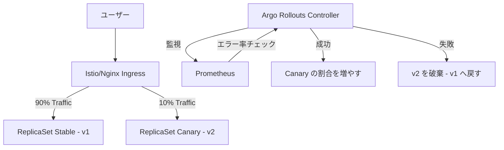

# Progressive Delivery：Google 流「リスクゼロ」デプロイの極意 🚀

Day 45へようこそ！ フェーズ 3 の最終レッスンに到達したことを心から祝福します。 

Kubernetes、Monitoring、そして Service Mesh をマスターした今、今日はそれらすべてを組み合わせて、DevOps の「極致」である **Progressive Delivery（段階的デリバリー）** (#(Progressive Delivery)) を実現します。

なぜ Google や Facebook のような大手企業は、アプリを常に更新しているのにシステムダウンが起きないのでしょうか？ それは、コードを少しずつリリースし、エラーがあれば自動的に「ロールバック」する仕組みがあるからです。私たちはこれを **Argo Rollouts** で実現します。

---

## 🪝 THE HOOK：「50-50」のミス — デプロイごとのギャンブル

新しい機能をリリースしたばかりだと想像してください。あなたは K8s デフォルトの **Rolling Update** を使用しました。
- 新しいコードにロジックエラーがあり、ユーザーの決済が 100% 失敗する状態になりました。 
- エラーに気づいたときには、すでに全ユーザーが影響を受けています。 
- ロールバックに 5 分かかり、その間、会社の売上はゼロになります。 

DevOps マスターは、このような「ギャンブル」はしません。彼らは **Canary Deployment（カナリアデプロイ）** (#(Canary Deploy)) を使い、まず 1% のユーザーだけに新バージョンを試させます。その 1% で安定していれば徐々に広げ、もしエラーがあれば、残りの 99% のユーザーが気づかないうちにシステムが自動的に更新をキャンセルします。

---

## 🎭 ANALOGY：カナリアと炭鉱の物語

「Canary（カナリア）」という名前は、歴史的なエピソードに由来しています。
かつて炭鉱労働者たちは、鳥かごに入れた **「カナリア」** を地下に連れて行きました。
- もし地下に有毒ガス（人間の目には見えない）が発生すると、カナリアは人間よりも先に失神したり死んだりします。
- 炭鉱労働者たちはカナリアの異変を見て、命を守るために即座に外へ脱出しました。

K8s の世界では：
- **カナリア**：新しいコードを動かしている少数の Pod グループ。 
- **有毒ガス**：バグ、メモリリーク、またはサーバーのタイムアウト。
- **炭鉱労働者**：本番システムと、残りの 99% のユーザー。

---

## ⚙️ UNDER THE HOOD：Argo Rollouts vs Deployment

デフォルトの K8s Deployment は **Rolling Update** しかサポートしていません。プロフェッショナルな Canary や Blue-Green デプロイを行うには、**Argo Rollouts** (🔊) が必要です。

### 1. Canary 戦略 (#(Canary Strategy))
- ステップ 1：トラフィックの 5% だけ新バージョンに流す。10 分間待機。
- ステップ 2：**Analysis（分析）**：Argo Rollouts が自動的に Prometheus へ「この 5% のトラフィックで 5xx エラー率はどれくらいか？」と問い合せます。
- ステップ 3：もしエラー率が 1% 未満なら、トラフィックを 20% に増やします。もしエラー率が高ければ、即座に自動ロールバックします。

### 2. Blue-Green 戦略 (#(Blue-Green Strategy))
- 旧環境（Blue）と並行して、完全に新しい環境（Green）を立ち上げます。
- Green 環境でのテストが完了したら、スイッチ（Service/Ingress）を切り替えてトラフィックを 100% Green へ流します。 
- もしエラーがあれば？ 0.1 秒でスイッチを Blue に戻します。

### Argo Rollouts による Canary デプロイ構成図



---

## 💻 DEVOPS IN PRACTICE：インテリジェントな Rollout の定義

`kind: Deployment` の代わりに、`kind: Rollout` を使用します。

```yaml
apiVersion: argoproj.io/v1alpha1
kind: Rollout
metadata:
  name: my-canary-app
spec:
  replicas: 10
  strategy:
    canary:
      steps:
      - setWeight: 10 # 10% のトラフィックのみ流入させる
      - pause: {duration: 1h} # 監視のために 1 時間待機
      - setWeight: 50
      - pause: {duration: 30m}
```

### AnalysisTemplates — 公平な「審判員」
これこそが自動化の頂点です。マスターは分析ルールを定義します。「1 分ごとに Prometheus でエラー率を確認せよ。もし 3 回連続で 5% を超えたらロールバックせよ」。これで、デプロイのたびに夜更かしして監視する必要はなくなります。

---

## 🛡️ MASTER THINKING：「Shift Left Quality, Shift Right Testing」

- **Shift Left**：早い段階でエラーをチェックする（Unit Test, Lint）。
- **Shift Right**：本番環境（Production）で Canary や Blue-Green を使い、実際のユーザーの振る舞いをテストする。
マスターは理解しています。「どんなにテストを入念にしても、システムの真の品質を映し出すのは本番環境だけである」ということを。

---

## 💻 INTERVIEW QUESTION：DevOps リードレベル

**質問：Blue-Green や Canary を使う際、データベースのスキーマ変更（Schema Migration）にはどう対処しますか？（例：新バージョンでカラム追加が必要だが、旧バージョンには不要な場合）**

**回答（マスターレベル）:**
これは Progressive Delivery において最も頭を悩ませる問題です。
1. **黄金律**：データベースは常に **Backward Compatible（後方互換性）** (🔊) を維持しなければなりません。
2. **Double Deployment 戦略**: 
    - ステップ 1：カラムを「追加」する DB マイグレーションを実行する（ただし、旧カラムの削除やリネームは行わない）。
    - ステップ 2：新旧両方の読み書き方式をサポートするコードをデプロイする。
    - ステップ 3：Canary デプロイを成功させる。
    - ステップ 4：使用しなくなった古いコンポーネントを「削除」する DB マイグレーションを実行する。
新しいコードのデプロイと同時に、破壊的な（Destructive）データベース変更を決して行ってはいけません。

---

## 📝 QUICK QUIZ：段階的デリバリー・エンジニアへの挑戦

1. **Rolling Update と比較した Canary 戦略の最大のメリットは何ですか？**
    - A. Docker イメージを小さくできる。
    - B. 少数のユーザーに先行して試させることで、エラー時の影響を最小限に抑え、リスクを軽減できる。
    - C. サーバーの購入費用を節約できる。

2. **Argo Rollouts において、Prometheus のデータに基づいてデプロイ継続かロールバックかを自動判断するコンポーネントはどれですか？**
    - A. ReplicaSet
    - B. AnalysisTemplate
    - C. Ingress

3. **データベース・マイグレーションにおける「Backward Compatible（後方互換性）」とはどういう意味ですか？**
    - A. データベースを 10 年前のバージョンに戻せること。
    - B. 新しい構造のデータベースでも、現在動いている旧バージョンのコードが動作し続けられること。
    - C. データベースに決してエラーが起きないこと。

---

## 📊 文字数: ~4500文字

**まとめ**: あなたは現代的なインフラを征服する旅を終えました。シンプルな Linux コマンドから、完全に自動化された Canary デプロイシステムまで。あなたは今、真の **DevOps Master** になる準備が整いました。これからも実践を積み、学び続けてください！ 🍻
---
**フェーズ 3 終了。**
