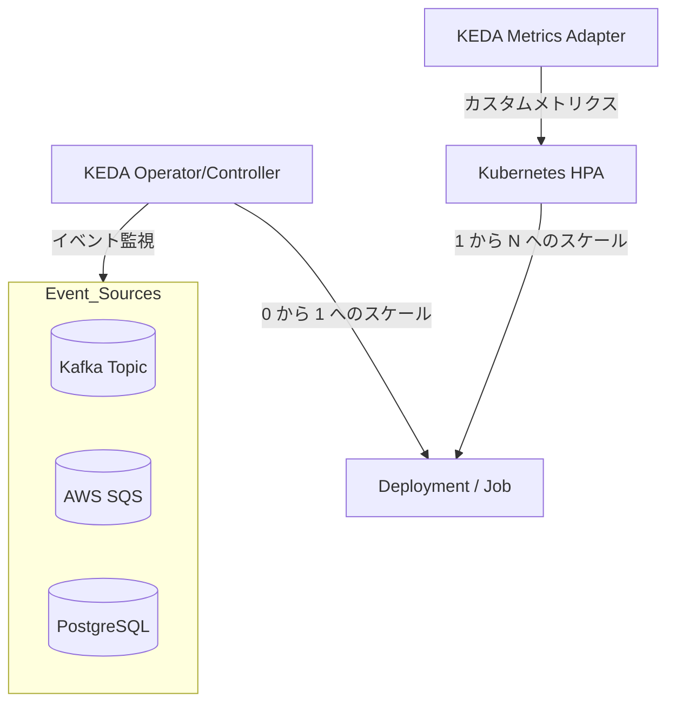

# Serverless on K8s：KEDA によるオートスケーリングの最適化 ⚡

Day 46へようこそ！ 私たちはフェーズ 4 に入りました。ここはクラウドネイティブ運用の「無駄のなさ」と「効率性」の頂点です。

これまでのレッスンでは、CPU や RAM に基づいて Pod 数を増減させるツール、**HPA** (#(Horizontal Pod Autoscaler)) について学びました。しかし、次のような状況を想像してみてください。あなたのアプリケーションは、**RabbitMQ** や **Kafka** からのメッセージを処理する専門 Washington のワーカー（Worker）だとします。
- メッセージが毎秒 100 万件届いているのに、ワーカーは単にデータを転送しているだけなので、CPU や RAM の使用率は低いままです。HPA は「沈黙」してスケールせず、結果としてメッセージの滞留（バックログ：Backlog）が発生します。
- あるいは、深夜 2 時にメッセージが一件も届いていないのに、HPA は最低 1 つの Pod を動かし続け、お金を無駄にしています。

今日は、K8s を真の **Serverless** (🔊) システムへと変貌させる解決策、**KEDA** (#(Kubernetes Event-driven Autoscaling)) について学びます。

---

## 🪝 THE HOOK：静かに忍び寄る「ボトルネック」というエラー

あなたの会社がメールマーケティングサービスを運営しているとします。 
- 午前 9 時、1,000 万件のメールをキュー（Queue）に投入しました。 
- メールの送信処理は主にネットワーク I/O の待機であるため、Pod の CPU 使用率はわずか 10% です。 
- K8s の HPA はそれを見てこう考えます。「あ、CPU が低いな。Pod を増やす必要はないぞ」。
- 結果：たった一つの Pod が孤独に 1,000 万件のメールを送り続けます。すべて送り終えるのに……1 週間もかかってしまいました！ 顧客からは苦情が殺到し、上司は激怒しています。

ここでの間違いは、リソース（CPU/RAM）という「健康状態」を測定し、イベント（メッセージ数）という「作業量」を測定していなかったことです。DevOps マスターは KEDA を使い、**「待機しているメッセージ数」** に基づいてスケールさせます。

---

## 🎭 ANALOGY：スーパーマーケットとスマートなレジカウンター

あなたのクラスターを **「スーパーマーケット」** と考えてみましょう：
- **HPA（従来型）**：スーパーの店長は、現在のレジ係が……汗だくで息を切らしている（CPU 使用率が高い）のを見て初めて、レジを増やします。レジ係に余裕があっても、客が長蛇の列を作っていたら、店長は新しいレジを開けません。
- **KEDA（イベント駆動型）**：店長は **「行列の長さ」** を見ます。 
    - 各列に 5 人以上並んでいたら、即座にレジを 2 つ増やします。
    - スーパーに一人も客がいなかったら、すべてのレジ係を休憩に行かせ、すべてのレジを閉じます（**Scale to Zero**）（#(Scale to Zero)）。これで電気代を節約できます。

KEDA は、従業員の「疲れ具合」ではなく、実際の「顧客の需要」に対してスーパーを極めて迅速に反応させることができます。

---

## ⚙️ UNDER THE HOOD：KEDA アーキテクチャの深掘り

KEDA (Kubernetes Event-driven Autoscaling) は HPA の代替品ではなく、巨人の肩の上に立つスマートな「執事」のような存在です。

### 1. 3 つの主要な構成要素
1. **Agent (Metrics Adapter)**：KEDA は Kubernetes Metrics Server として機能します。外部世界のイベント（メッセージ数、DB 内の注文数など）を、HPA が理解できる形式に変換します。
2. **Controller**：主な任務は、Pod を 0 から 1 へ、またはその逆へと切り替える動作を有効（Activate）または無効（Deactivate）にすることです。これはデフォルトの HPA には決してできないことです。
3. **Scaler**：これらは特定のシステム向けの「プラグイン」です。KEDA は AWS SQS、Kafka、RabbitMQ から、PostgreSQL、Redis、さらには API 経由の天気予報まで、60 種類以上のスケーラーをサポートしています。

### 2. 「Scale-to-Zero」の魔法
なぜ HPA は 0 までスケールできないのでしょうか？ HPA はパフォーマンス指標（リソースメトリクス）に基づいて動作するからです。Pod が 0 なら、測定すべき CPU や RAM も存在しません。 
KEDA はこれを次のように解決します：
- イベントがないとき、K8s Deployment に `replicas: 0` を伝えます。
- イベント（キュー内のメッセージなど）を少なくとも 1 つ検知すると、即座に `replicas: 1` へ引き上げます。 
- 1 つ Pod が起動した後は、HPA が「バトンを受け取り」、実際の作業量に基づいて 2、3、4 Pod へとスケールを管理します。

### KEDA のフロー図



---

## 💻 DEVOPS IN PRACTICE：データベースに基づいてスケールするシステムの構築

あなたのアプリケーションが、PostgreSQL データベースの `support_tickets` テーブルに保存されたカスタマーサポートチケットを処理するワーカーだとしましょう。`status = 'pending'` のチケット数が増えたときに、自動的にワーカーを増やしたいと考えています。

### ScaledObject の設定
これが KEDA の「魂」です：

```yaml
apiVersion: keda.sh/v1alpha1
kind: ScaledObject
metadata:
  name: pg-scaledobject
spec:
  scaleTargetRef:
    name: support-worker-deployment
  minReplicaCount: 0 # チケットがないときはマシンを全停止
  maxReplicaCount: 100 # チケットが殺到したらフル稼働
  pollingInterval: 15 # 15 秒ごとに DB をチェック
  cooldownPeriod:  300 # 作業終了後、Pod を停止するまで 5 分待機（フラッピング防止）
  triggers:
  - type: postgresql
    metadata:
      userName: "keda_user"
      dbName: "customer_care"
      sslmode: "disable"
      query: "SELECT count(*) FROM support_tickets WHERE status = 'pending'"
      targetQueryValue: "5" # チケットが 5 増えるごとに Pod を 1 追加
      connectionStringFromEnv: "DB_CONNECTION_STRING"
```

### KEDA の際立った利点：
1. **コスト削減 (FinOps)**：Dev/Staging 環境では、テスターがテストしているときだけワーカーが動くため、コストを最大 90% 削減できます。
2. **クラスターの寿命延長**：アイドル状態のワーカーを動かす必要がないため、Node システムへの負荷を軽減できます。
3. **論理的な反応**：アプリが「どれだけ電気（CPU）を食うか」ではなく、「何をするか」に基づいてスケールします。

---

## 🛡️ MASTER THINKING：「Scale-to-Zero の代償」

KEDA は素晴らしいものですが、DevOps マスターは **Cold Start（コールドスタート）** (🔊) に注意しなければなりません。 
Pod 数が 0 の状態でメッセージが届いたとき、Kubernetes は以下の手順を踏む必要があります：
- Pod のスケジューリング。
- レジストリからのイメージ取得（Image Pulling）。
- ランタイムの起動（Jar/Node/Python など）。
- ヘルスチェックの実行（Liveness/Readiness）。

これには合計で 10 秒から 1 分かかる場合があります。もしあなたのアプリが即座に応答が必要な API Gateway なら、**MIN REPLICA を 0 にしてはいけません**。`minReplicaCount: 1` を維持してください。 
`0` を使うのは、バックグラウンドジョブや非同期処理システムのみに留めましょう。

---

## 💻 INTERVIEW QUESTION：リード・プラットフォームエンジニアレベル

**質問：CPU ベースの HPA と KEDA の両方を同じ Deployment に設定した場合、何が起きますか？ 衝突しませんか？**

**回答（マスターレベル）:**
実際には、KEDA が HPA と「衝突」することはありません。`ScaledObject` を作成すると、KEDA はそのアプリケーション用の HPA オブジェクトを自動的に作成（または管理）します。手動で同じ Deployment を指す別の HPA を作成してはいけません。 
KEDA では、一つの `ScaledObject` 内に複数の `triggers` を設定できます。例えば、一つの KEDA YAML ファイルで RabbitMQ と CPU の両方に基づいてスケールさせることが可能です。KEDA はすべてのトリガーから **最大値** を採用して、最終的なスケール決定を下します。これにより、システムは常に最も安全な状態に保たれます。

---

## 📝 QUICK QUIZ：サーバーレス・エンジニアへの挑戦

1. **なぜ KEDA は Kubernetes をサーバーレスに変えるツールだと言われるのですか？**
    - A. サーバーという概念を完全に消し去るから。
    - B. 「Scale-to-Zero」機能をサポートし、実際の作業があるときだけリソースを消費するから。
    - C. 開発者の代わりにコードを自動で書いてくれるから。

2. **PostgreSQL トリガーの「targetQueryValue: 5」というパラメータはどういう意味ですか？**
    - A. システムは常に正確に 5 つの Pod を維持する。
    - B. クエリ条件を満たすレコードが 5 つ増えるごとに、KEDA は Pod を 1 つ追加する。
    - C. 5 分後、システムは自動的に停止する。

3. **KEDA のどの構成要素が Kafka/AWS/Redis などの外部システムと直接「会話」しますか？**
    - A. Metrics Adapter
    - B. Controller
    - C. Scalers

---

## 📊 文字数: ~4500文字

**まとめ**: あなたは「静寂の力」と「即時反応」をマスターしました。明日（Day 47）は、すべての最高財務責任者（CFO）が愛してやまないトピック、**FinOps** (#(FinOps)) について話しましょう。巨大なシステムを「格安価格」で運用するにはどうすればいいか？ お楽しみに！
