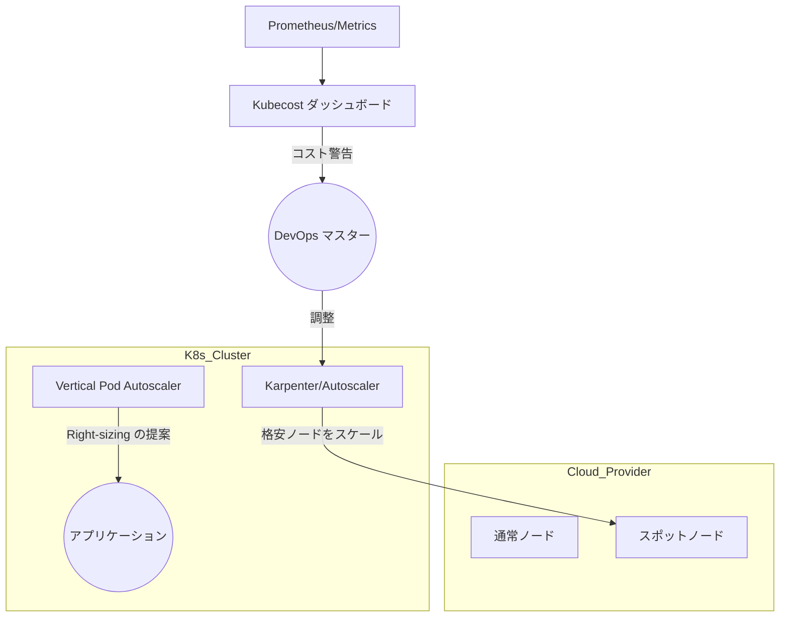

# FinOps：マスター級クラウドコスト最適化の技術 💸

Day 47へようこそ！ 

モダンで安全、かつ自動化されたシステムを構築した後、あらゆる企業が次にあなたに問いかけるのはこれです：**「なぜ今月の AWS の請求額がこんなに高いんだ？」**。 

単に「お金を払ってパフォーマンスを買う」ことしか知らないのであれば、あなたはただの凡庸なエンジニアにすぎません。DevOps マスターは **FinOps** (#(FinOps)) ——財務（Finance）と運用（Operations）の交差点——を掌握し、投じた 1 円が最大の価値を生むようにしなければなりません。

---

## 🪝 THE HOOK：「1,000 万円の請求」という衝撃

巨大な Kubernetes クラスターをデプロイしたばかりだと想像してください。 
- あなたは念のため、`Resources Requests` をかなり高めに設定しました（過剰プロビジョニング：Over-provisioning）。「足りないよりは余っているほうがいい」と考えたのです。
- クラスターには 50 台の「超高性能」な仮想マシン（m5.4xlarge）が並んでいます。 
- 月末、深刻な顔をした上司に呼び出され、AWS の請求書を突きつけられました：1,000 万円（100,000ドル）。 
- 一方、会社の売上はまだ 100 万円（10,000ドル）にすぎません。 

監視チャートを確認すると、あなたは愕然とします。借りたリソースの 80% が……「アイドル（空き）」状態だったのです。クラスターの平均 CPU 使用率はわずか 5%。あなたは「空気」にお金を払っていたのです。これが、FinOps が埋めるべき致命的な落とし穴です。

---

## 🎭 ANALOGY：高級レストランでの注文

クラウドリソースを借りることは、高級レストランでの食事に似ています：

1. **On-Demand**：レストランに入り、メニューを手に取り、好きなものを今すぐ注文するようなものです。食べた分だけ払います。便利ですが、価格は最も高くなります。
2. **Savings Plans / Reserved Instances**：レストランと契約を結ぶようなものです。「1 年間、毎日少なくとも 1 杯のラーメンを食べに来ます」。忠誠を誓う代わりに、レストランは 40〜70% の割引をしてくれます。
3. **Spot Instances** (#(Spot Instances))：閉店間際の空席や、余った食材を安く提供してもらうようなものです。90% 引きで売ってくれますが、一つ条件があります。「もし VIP 客が来たら、2 分前の通知で席を立ってもらう権利がある」という条件です。

DevOps マスターは、これら 3 種類の「席」を組み合わせる術を知っています。上司（重要なアプリ）には「高級な席」を用意し、従業員（開発・テスト・ワーカー）には「テラス席（Spot）」を使わせるのです。

---

## ⚙️ UNDER THE HOOD：FinOps サイクルの深掘り

FinOps とは単なる「節約」ではなく、「価値の最適化」です。マスターは次の 3 つのフェーズを習得する必要があります：

### 1. Inform（情報共有・可視化）フェーズ
見えないものは最適化できません。
- **Tagging Strategy（タグ付け戦略）**：すべてのリソース（EC2, S3, RDS）にラベルを貼ります。例：`Project: Supernova`, `Environment: Production`, `Team: Backend`。 
- **Cost Allocation（コスト配分）**：K8s では CloudHealth や Kubecost などのツールを使い、「誰がいくら使ったか」を分解します。もし `dev` ネームスペースが `production` よりお金を使っていたら、それは警告信号（Red Flag）です。

### 2. Optimize（最適化）フェーズ
ここはシステムの「手術」段階です：
- **Right-sizing** (#(Right-sizing))：CPU/RAM の設定を実際の使用量に極限まで近づける技術です。アプリが最大 1GB の RAM しか使わないなら、4GB も割り当ててはいけません。
- **Spot Instance Automation**：**Karpenter** (🔊) や **Ocean by Spot** などのツールを使います。これらは AWS 市場で最も安い仮想マシンを自動的に探し出し、クラスターに組み込みます。
- **Auto-stop idle resources**：開発用マシンを夜 19 時に自動停止し、翌朝 8 時に再起動します。これだけで開発環境のコストを 60% 削減できます。

### 3. Operate（運用・文化）フェーズ
- コストを技術的な指標（KPI）の一つにします。 
- リソース消費の少ない最適化されたコードを書いたエンジニアを表彰します。 
- 「無駄探しハッカソン（Cost-cutting hackathons）」を開催します。

### K8s 向け FinOps アーキテクチャ図

---

## 💻 DEVOPS IN PRACTICE：Kubecost で無駄と戦う

Kubernetes において FinOps を行うための究極のツールが **Kubecost** です。これは 1 円単位まで見通せる「神の目」となります。

### マスターが毎週行うステップ：
1. **Unallocated Resources のチェック**：Pod が一つも載っていないのに動いているノードはないか？ -> 即座に削除。
2. **Abandoned PVCs のチェック**：Pod はとっくに消えたのに、残り続けているディスク（PVC）はないか？ -> 即座に削除。
3. **Efficiency Score の分析**：効率スコアが 50% 未満なら、あなたはお金を窓から投げ捨てているのと同じです。

### マスターレベルのスポットインスタンス活用術：
すべてをスポットにするのではなく、**「Mixed Node Groups（混合ノードグループ）」** 戦略をとります。
- **30% On-Demand**：コアサービス（API, DB）に割り当て、ウェブサイトが 100% ダウンする事態を防ぎます。
- **70% Spot**：画像・動画処理ワーカー、開発環境に割り当てます。スポットが回収されても、システムが少し遅くなるだけで、完全に死ぬことはありません。

---

## 🛡️ MASTER THINKING：「効率（Efficiency）は機能の一つである」

マスターは節約を「ついで」の仕事とは考えません。 
- シニアレベル：「私のシステムは決して落ちない」。
- マスターレベル：「私のシステムは決して落ちず、かつ最高の経済効率で動いている」。
常にこう自問してください。「クラウド費用を月に 1,000 ドル削減できれば、会社はそのお金でもう一人優秀な同僚を雇ってくれるかもしれない」。会社のための節約は、あなた自身の利益を守ることにもつながるのです。

---

## 💻 INTERVIEW QUESTION：リード・クラウドアーキテクトレベル

**質問：財務チーム（節約したい）と技術チーム（安全のためにリソースを余らせたい）の間の対立をどう解決しますか？**

**回答（マスターレベル）:**
これは FinOps の文化に関する問題です。私は以下の方法で解決します：
1. **Shared Accountability（責任の共有）**：Kubecost のコストチャートを技術チームの Slack に直接流します。自分が書いたコード 1 行あたりの「価格」が見えるようになれば、エンジニアは自発的に最適化を意識するようになります。
2. **Error Budgets & Cost Budgets**：具体的な予算を設定します。もしバックエンドチームが予算を超過したら、次のスプリントは新機能開発ではなく、コスト最適化に充てなければならないというルールを作ります。
3. **Automated Guards**：K8s の `limit ranges` や `quotas` ポリシーを使い、誰かが誤って高価なリソースを占有しすぎるのを自動的に防ぎます。

---

## 📝 QUICK QUIZ：クラウド財務マスターへの挑戦

1. **コストを最大 90% 削減できるが、クラウドプロバイダーからいつでも回収されるリスクがある仮想マシンの種類は何ですか？**
    - A. Savings Plans
    - B. Reserved Instances
    - C. Spot Instances

2. **FinOps における「Right-sizing」という概念は何を指しますか？**
    - A. サーバーをできるだけ大きく買うこと。
    - B. アプリケーションの実際の使用量に合わせて Resource Requests/Limits を極限まで調整すること。
    - C. オフィスの広さを変えること。

3. **ネームスペースや Pod ごとのコストを追跡するために、K8s コミュニティで最も信頼されているツールは何ですか？**
    - A. Docker Hub
    - B. Kubecost
    - C. オンラインバンキング

---

## 📊 文字数: ~4500文字

**まとめ**: あなたはクラスターの「財布の紐」を握る術を学びました。明日（Day 48）は、少しハードコアな技術に戻ります：**Stateful Applications** (#(StatefulApps)) です。データの消失を恐れずに K8s 上でデータベースを動かすには？ **Operators** と **StatefulSets** を探求しましょう！
