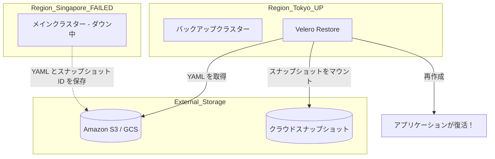

# Disaster Recovery：15 分でクラスターを「復活」させる極意 ⛈️

Day 49へようこそ！ 

私たちは、システムを「自己修復（Self-healing）」させる方法を学んしてきました。しかし、現実を直視しましょう。どんな自己修復メカニズムも太刀打ちできない「大災害」は存在します。 
- ハッカーが管理者権限を奪取し、クラスター全体を消去した。
- AWS や GCP の **リージョン（Region）** (🔊) 全体がダウンした（例：バージニアやシンガポールがクラウドの地図から消えた）。
- スクリプトのロジックエラーにより、データベース内の全データを誤って削除してしまった。

この時点で、問いかけるべきは「どうやってダウンさせないか」ではなく、**「どれだけ速く復活できるか？」** です。今日は、DevOps マスターにとって究極の「救命ボート」である **Velero** (#(Velero)) をマスターします。

---

## 🪝 THE HOOK：一夜にして「一文無し」になるエラー

100 個のマイクロサービスと 20 個のデータベース（StatefulSets）を含むクラスターを管理していると想像してください。
- ある日、クラウドプロバイダーのデータセンターで深刻な火災が発生しました。クラウドコンソールには「サービス利用不可」の文字が並びます。
- 上司からは 5 分おきに状況確認の電話がかかってきます。サービス停止が長引いているため、提携先からは契約解除をちらつかされています。
- あなたは心の中で考えます。「コードは Git にある（GitOps）。アプリは再起動できるはずだ」。しかし、あなたは愕然とします。**全顧客データ（Persistent Volumes）** は、今まさに燃えているあのデータセンターの中にあったのです。
- コードは残っていますが、データ（状態：State）は完全に失われました。会社の唯一の資産が消滅したのです。

メインシステムの外（外部ストレージ）にバックアップを保存していなければ、あなたは火遊びをしているのと同じです。

---

## 🎭 ANALOGY：生命保険と「ブラックボックス」

災害復旧（Disaster Recovery：DR）戦略について考えてみましょう：

1. **Self-healing（自己修復）**：風邪を引いたときに自然に体力が回復するようなものです。大きな介入は必要ありません。
2. **HA（高可用性）**：心臓を……2 つ持っているようなものです。一方が止まっても、もう一方が動き続けます。非常に安全ですが、サーバー費用が 2 倍かかるため非常に高価です。
3. **Disaster Recovery（バックアップ）**：別の国の安全な地下室に保管された **「ブラックボックス」** のようなものです。 
    - そこには、あなたの家の設計図（K8s YAML）がすべて入っています。
    - そこには、日記や最も大切な資産（ディスクデータ - Persistent Volumes）がすべて入っています。
    - もし現在の街が自然災害で沈んでも、あなたはこのブラックボックスを別の街へ持っていき、建設チーム（Velero）に数時間で全く同じ家を建て直すよう依頼するだけでいいのです。

---

## ⚙️ UNDER THE HOOD：Velero の世界を深掘りする

プロフェッショナルな DR 戦略を構築するために、マスターは核となる概念を正確に理解する必要があります：

### 1. RTO と RPO（企業の生死を分ける指標）
- **RTO (Recovery Time Objective)**： 「復活までにどれくらいかかるか？」。もし RTO = 15 分なら、ユーザーが SNS で文句を言い始める前にクラスターを復旧させなければなりません。
- **RPO (Recovery Point Objective)** (#(RPO))： 「どれだけのデータ損失を許容できるか？」。もし毎日午前 1 時にバックアップを取っていて、システムが午後 11 時にダウンした場合、あなたは 22 時間分のデータを失ったことになります。マスターは通常、低い RPO（例：30 分ごとのスナップショット）を要求します。

### 2. Velero の仕組み（詳細）
Velero は 2 つのコンポーネントで構成されています：
- **Velero Server**： クラスター内部で動作します。
- **Object Storage**： クラスターの外部（例：Amazon S3）にあります。

「Backup」ボタンを押すと：
- Velero は K8s API をスキャンして、Deployments, Services, ConfigMaps, Secrets などのすべての YAML 定義を取得し、圧縮して S3 に送信します。
- 最も重要な点： Velero はクラウドプロバイダー（AWS/GCP/Azure）に信号を送り、すべてのディスク（EBS/AzureDisk）の **スナップショット（Snapshot）** を作成します。これらのスナップショット ID も S3 に保存されます。

### 3. Backup Hooks (🔊)
データベースは、データを書き込んでいる最中に「突然」バックアップされるのを嫌います。Velero マスターは **Backup Hooks** を使って次のようにします：
- スナップショットの前にデータベースの書き込みを一時停止（Freeze）させる。
- RAM からディスクへデータを書き出す（Flush）。
- スナップショット完了後に書き込みを再開させる。
これにより、バックアップの **整合性（Integrity）** (#(Integrity)) が常に保たれ、リストア時にファイルエラーが発生するのを防ぎます。

---

## 💻 DEVOPS IN PRACTICE：クラスターをまたいだ復活プロセス

**シンガポール**リージョンのクラスターが完全にダウンしたとしましょう。マスターは **東京**リージョンへ移動して復活させます。

### ステップ 1：自動スケジュールの設定
ダウンしてからバックアップを考えるのでは遅すぎます。
```bash
velero schedule create production-hourly --schedule="0 * * * *" --ttl 48h0m0s
```
このコマンドは Velero に命じます。「1 時間ごとに 1 つ保存し、S3 の費用を節約するために 2 日間だけ保持せよ」。

### ステップ 2：「新しい土地」での復活
東京のクラスターで、Velero をその S3 バケットに向け、次を実行します：
```bash
velero restore create --from-backup production-hourly-20261024
```
**Velero** は自動的に次のことを行います：
- すべてのネームスペース、Pod を再作成する。
- クラウドプロバイダーに対し、保存されたスナップショット ID から新しいディスクを作成するよう要求する。
- 新しいディスクを対応する各 Pod に正しくマウントする。

### Disaster Recovery のフロー図



---

## 🛡️ MASTER THINKING：「チェックされていないバックアップはゴミである」

マスターはコンソールに表示される内容を鵜呑みにしません。
面接での定番の質問：「バックアップが本当に使えると、どうやって確信を持っていますか？」
**回答**: 定期的に **Disaster Recovery Drills（災害復旧訓練）** (#(DRDrill)) を実施します。
- 月に一度、一時的なクラスターへデータを復旧させてみること。
- アプリがスムーズに立ち上がり、DB にデータエラーがなければ、ようやく枕を高くして眠れます。そうでなければ、あなたのバックアップはただの無意味な数字の羅列にすぎません。

---

## 💻 INTERVIEW QUESTION：シニア・サイトリライアビリティエンジニアレベル

**質問：システムがオンプレミス（クラウドスナップショットが使えない）で動いている場合、Velero を使ってどのようにステートフルなアプリのデータをバックアップしますか？**

**回答（マスターレベル）:**
オンプレミス環境では、AWS の API を呼び出してスナップショットを取ることはできません。この場合、Velero に統合されている **Restic** (🔊) を有効にします。 
Restic はファイルシステム層で動作します。データベース Pod のマウントポイントに「潜り込む」ための Sidecar Pod を実行し、データブロックをスキャンして S3 へ直接送信します。この仕組みはクラウドスナップショットより少し時間がかかりますが、**「インフラに依存しない（Infrastructure Agnostic）」** バックアップ能力を保証し、オンプレミスからクラウドへ、あるいはその逆へのデータ移行を容易にします。

---

## 📝 QUICK QUIZ：データ守護者への挑戦

1. **RPO (Recovery Point Objective) という指標は何を測定しますか？**
    - A. システムの復旧にかかる時間。
    - B. 許容できる最大データ損失量（最後のバックアップからの経過時間で計算）。
    - C. Amazon S3 に支払う金額。

2. **Velero における Backup Hooks の目的は何ですか？**
    - A. ウェブサイトの読み込みを速くするため。
    - B. データベースの書き込みを一時停止させ、スナップショット内のデータの整合性（Consistency）を確保するため。
    - C. エラー時にコードを自動修正するため。

3. **Velero のアーキテクチャに含まれない構成要素はどれですか？**
    - A. クラスター内で動作する Velero Server。
    - B. クラスター外部の Object Storage (S3/GCS)。
    - C. データを転送するために地球を周回する衛星。

---

## 📊 文字数: ~4500文字

**まとめ**: あなたは企業の「復活のチケット」を手に入れました。明日（Day 50）は私たちの最終レッスンです。世界中へと視野を広げましょう：**Multi-Cluster Architecture** (#(MultiCluster)) です。10 カ国にある 10 個のクラスターを、カートを押すように軽やかに管理するには？ また明日お会いしましょう！
